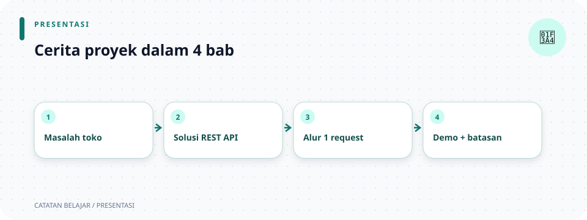

# Panduan Presentasi Proyek

> **Navigasi:** [Indeks catatan](README.md) · [README proyek](../README.md) · [Endpoint API](../endpoin.md)




Dokumen ini adalah urutan singkat untuk menjelaskan proyek tanpa harus membuka
semua file sekaligus. Detail tiap fungsi tetap tersedia pada catatan file yang
ditautkan di bawah.

## Ringkasan satu kalimat

Toko Laptop App adalah REST API Rust untuk mengelola inventaris laptop, dengan
registrasi akun, login cookie session/JWT HS256, PostgreSQL sebagai database,
dan validasi input sebelum query dijalankan.

## Naskah pembuka (sekitar 30 detik)

> “Toko Laptop App adalah REST API untuk mengelola inventaris laptop. Saya membangunnya dengan Rust dan Axum, memakai PostgreSQL untuk menyimpan data, serta SQLx untuk menjalankan query. Request masuk melalui route, diperiksa oleh handler dan validator, lalu repository mengakses database. Presenter menyusun response JSON. Route laptop dilindungi login menggunakan session cookie atau JWT. Proyek ini saya gunakan untuk belajar pemisahan tanggung jawab dalam backend; password masih berupa teks biasa sehingga aplikasi ini hanya untuk latihan lokal.”

## Urutan presentasi yang disarankan

1. Mulai dari [README](../README.md) untuk tujuan aplikasi, cara menjalankan,
   dan daftar endpoint.
2. Tunjukkan [struktur proyek](01-gambaran-proyek.md): `routes` menentukan
   URL, `handlers` menangani HTTP, `validation` memeriksa input, `repositories`
   menjalankan SQL, dan `presenters` membentuk response.
3. Jelaskan startup melalui [`main.rs`](rust/main.md): aplikasi membaca `.env`,
   membuat pool PostgreSQL, menjalankan migration, menyiapkan akun admin,
   membuat router, lalu membuka server HTTP.
4. Buka [`routes.rs`](rust/routes.md) untuk menunjukkan pemisahan endpoint
   publik (`/health`, `/api/auth/register`, `/api/auth/login`) dan endpoint
   yang wajib login.
5. Pilih `POST /api/laptops` sebagai contoh alur lengkap: request masuk ke
   [handler create](rust/handlers/laptops/create.md), divalidasi, disimpan oleh
   [repository](rust/repositories/laptop-repository.md), lalu diformat oleh
   [presenter](rust/presenters/laptop-response.md).
6. Jelaskan login memakai [handler auth](rust/handlers/auth.md) dan
   [middleware autentikasi](rust/auth/session.md). Session disimpan di memori,
   sementara JWT HS256 berlaku satu jam; logout menghapus session tetapi tidak
   membatalkan JWT yang sudah diterbitkan.
7. Akhiri dengan [endpoint](../endpoin.md), collection Postman, dan test yang
   dijalankan dengan `cargo test --all-targets`.

## Peta cepat file aktif

```text
main.rs -> config.rs -> PostgreSQL + migration
        -> routes.rs -> middleware session/JWT -> handler
                                           -> validation -> repository -> presenter -> JSON
```

## Hal penting untuk disebutkan

- Input laptop diperiksa di aplikasi dan juga dibatasi oleh constraint database.
- Password disimpan sebagai teks biasa hanya untuk pembelajaran session lokal;
  ini bukan rancangan untuk produksi.
- Harga disimpan sebagai angka Rupiah utuh di database, kemudian diubah menjadi
  teks seperti `Rp 12.500.000` ketika dikirim sebagai response.
- Endpoint laptop, pemeriksaan identitas, dan logout menerima session cookie
  atau JWT bearer; `/health` dan login sendiri bersifat publik.

## Pertanyaan yang mungkin muncul

| Pertanyaan | Jawaban singkat |
| --- | --- |
| Mengapa ada session dan JWT sekaligus? | Keduanya adalah dua cara autentikasi yang didukung middleware; client dapat memakai cookie atau bearer token. |
| Apa yang diperiksa `/health`? | Hanya server HTTP merespons. Endpoint ini tidak menjalankan query database. |
| Apa yang dilakukan logout? | Menghapus session. JWT yang sudah terbit masih aktif sampai expiry satu jam. |
| Apakah aplikasi ini siap produksi? | Belum. Password masih disimpan sebagai teks biasa dan session memakai memory store. |
| Di mana alur satu request dapat dilihat? | Gunakan `POST /api/laptops`: handler → validation → repository → presenter. |

Untuk demo, siapkan server dan database lebih dulu, lalu ikuti urutan request pada [panduan Postman](postman.md) atau [contoh curl](curl.md). Hindari memasukkan password asli ke slide atau rekaman layar.
