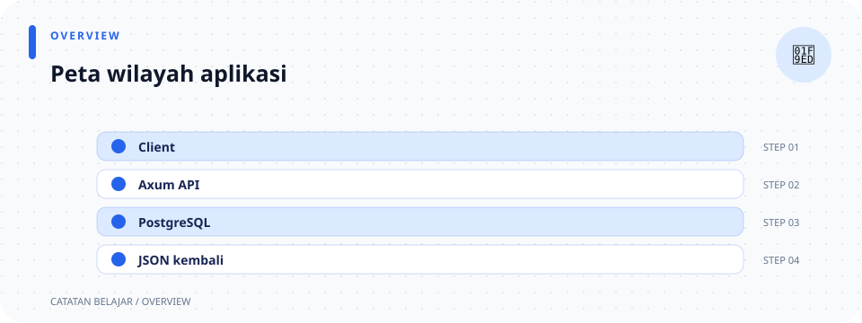

# Gambaran Projek

> **Navigasi:** [Indeks catatan](README.md) · [README proyek](../README.md) · [Endpoint API](../endpoin.md)




Toko Laptop App adalah REST API inventaris laptop. Kode aktif menyediakan operasi CRUD: melihat daftar laptop, melihat satu laptop, menambah, mengubah sebagian field, dan menghapus data. Aplikasi juga memiliki registrasi akun, role `admin`/`buyer`/`restocker`, dan login berbasis cookie session serta JWT bearer. Repository ini tidak memiliki frontend, trigger PostgreSQL, atau function PostgreSQL aktif.

## Teknologi yang benar-benar dipakai

| Teknologi | Dipakai untuk | Contoh di kode |
| --- | --- | --- |
| Rust 2024 | Bahasa aplikasi. | `Cargo.toml`. |
| Axum | Router, handler, extractor, dan response HTTP. | `routes.rs`, `handlers/`, `error.rs`. |
| Tokio | Runtime async dan listener TCP. | `#[tokio::main]`, `TcpListener`. |
| SQLx | Pool dan query PostgreSQL. | `config.rs`, `repositories/`. |
| PostgreSQL | Penyimpanan tabel `laptops` dan `users`, termasuk `token_version` untuk pencabutan JWT. | Migration berurutan yang mempertahankan riwayat database. |
| Serde | Membaca JSON body ke payload Rust. | `#[derive(Deserialize)]`. |
| serde_json | Membuat JSON response. | `json!`, `Value`. |
| dotenvy | Mencoba memuat environment dari `.env`. | `main.rs`. |
| Postman | Mengirim request CRUD dan mengecek response. | folder `postman/`. |

## Struktur proyek

| Lokasi | Tanggung jawab |
| --- | --- |
| `src/main.rs` | Startup program: env, config, database, router, port, server. |
| `src/lib.rs` | Mendaftarkan semua modul aplikasi. |
| `src/config.rs` | Membaca environment dan membuat pool PostgreSQL. |
| `src/routes.rs` | Menghubungkan method/URL ke handler. |
| `src/handlers/` | Handler dipisahkan menurut resource dan operasi HTTP. |
| `src/models/` | Entity database dan payload POST/PATCH dipisah per tipe. |
| `src/validation/` | Validasi ID, teks, create, dan update. |
| `src/repositories/` | Query SQL dikelompokkan menurut resource. |
| `src/presenters/` | Pemetaan response dan format Rupiah dipisah. |
| `src/error.rs` | Memetakan error menjadi response HTTP JSON. |
| `database/migrations/` | Riwayat perubahan tabel laptop/user, hash password, role, dan versi pencabutan JWT. |
| `.env` | Pengaturan lokal server dan PostgreSQL; tidak dibagikan sebagai dokumentasi. |
| `postman/` | Collection serta environment untuk uji manual. |
| `catatan/` | Penjelasan detail kode; tidak dijalankan oleh aplikasi. |

## Pembagian tanggung jawab

Contoh `POST /api/laptops` melewati beberapa lapisan yang berbeda.

```text
JSON request
    ↓
handler menerima Json<CreateLaptopPayload>
    ↓
validation membersihkan dan memeriksa nilai
    ↓
repository menjalankan INSERT
    ↓
PostgreSQL mengembalikan baris baru
    ↓
presenter membuat JSON object dan format Rupiah
    ↓
handler mengirim 201 Created
```

Pemisahan folder dan file mengikuti tanggung jawab, bukan menambah lapisan bisnis baru. `Json<T>` dari Axum meminta body JSON dibaca menjadi tipe Rust `T` yang mendukung Serde `Deserialize`; `Json<Value>` mengubah nilai JSON yang disiapkan presenter menjadi body response. Jika JSON body tidak dapat diparse menjadi tipe yang diminta, extractor dapat mengirim error sebelum handler berjalan.

Setiap file tetap memiliki fokus kecil:

- Ingin tahu URL? Buka [routes](rust/routes.md).
- Ingin tahu alur request? Buka [handlers](rust/handlers.md) lalu catatan tiap [operasi laptop](rust/handlers/laptops/mod.md).
- Ingin tahu aturan input? Buka [validation](rust/validation.md).
- Ingin tahu SQL? Buka [repositories](rust/repositories.md).
- Ingin tahu bentuk response? Buka [presenters](rust/presenters.md).

## Istilah Rust yang muncul berulang

| Istilah | Arti dalam project ini |
| --- | --- |
| `mod` | Mendaftarkan bagian kode sebagai modul. |
| `use` | Membawa nama dari library/modul agar dapat ditulis pendek. |
| `pub` | Membuka struct/fungsi/modul agar dapat dipakai bagian lain. |
| `async` dan `.await` | Menandai dan menunggu operasi I/O seperti database dan jaringan. |
| `Result` | Nilai bisa sukses (`Ok`) atau gagal (`Err`). |
| `Option` | Nilai bisa ada (`Some`) atau tidak ada (`None`), dipakai untuk hasil query dan field PATCH. |
| `?` | Meneruskan error dan menghentikan fungsi saat langkah sebelumnya gagal. |
| `&T` | Meminjam nilai `T` tanpa memindahkan kepemilikannya. |
| `Result<T, E>` | Mengandung `Ok(T)` saat berhasil atau `Err(E)` saat gagal; `Result` berbeda dari `Option`, yang menyatakan ada/tidaknya nilai. |

Migration yang sudah diterapkan adalah riwayat: jangan mengedit atau menghapusnya karena SQLx memeriksa checksum. Tambahkan file migration baru untuk perubahan skema berikutnya. Detailnya ada di [catatan skema database](rust/database/initial-schema.md). Kolom `token_version` menaik saat pencabutan JWT; lihat penjelasan terpisah [dari login sampai logout](token_ver.md).

Lanjutkan ke [alur kerja aplikasi](02-alur-kerja-aplikasi.md) untuk melihat istilah tersebut saat request benar-benar berjalan.
