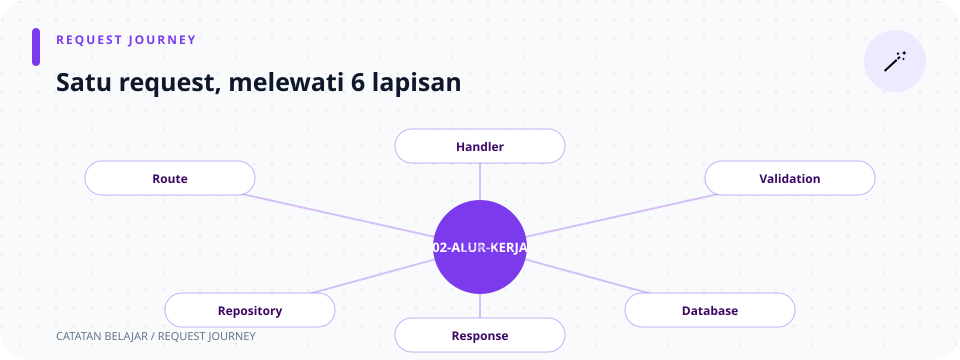

# Alur Kerja Aplikasi

> **Navigasi:** [Indeks catatan](README.md) · [README proyek](../README.md) · [Endpoint API](../endpoin.md)




Halaman ini menghubungkan file-file backend. Penjelasan isi setiap fungsi ada di catatan file masing-masing; halaman ini fokus pada urutan perpindahan data.

## Di halaman ini

[Startup](#saat-server-dinyalakan) · [Request umum](#perjalanan-umum-request) · [Login](#alur-login-session) · [Error](#jalur-error) · [Endpoint laptop](#alur-setiap-endpoint) · [Lanjut belajar](#lanjut-belajar)

## Saat server dinyalakan

1. [main.rs](rust/main.md) mencoba memuat `.env` dengan `dotenvy::dotenv().ok()`.
2. `AppConfig::from_env()` di [config.rs](rust/config.md) membaca host, port, kredensial PostgreSQL/admin, dan secret JWT.
3. `connect_database().await` membuat `PgPool`. Bila langkah ini gagal, server belum mulai menerima request.
4. SQLx menjalankan migration yang belum diterapkan dan mencatatnya di `_sqlx_migrations`. Migration lama menjadi riwayat ber-checksum; jangan mengedit atau menghapusnya, tetapi buat migration baru untuk perubahan selanjutnya. Lihat [catatan skema database](rust/database/initial-schema.md).
5. `migrate_legacy_passwords()` meng-hash password lama dengan Argon2id dan menghapus nilai lama; `initialize_admin_user()` menyimpan hash password akun dari environment.
6. `routes::create_router(...)` di [routes.rs](rust/routes.md) memasang endpoint, middleware session/JWT, dan pool sebagai state router.
7. Tokio membuat `TcpListener` pada `APP_HOST:APP_PORT`.
8. `axum::serve(listener, app).await` menunggu koneksi HTTP.

```text
.env / environment -> AppConfig -> PgPool -> SQLx migrations -> users table + seed akun latihan -> Router + session store + JWT secret -> TcpListener -> Axum
```

## Perjalanan umum request

```text
Postman / client
        ↓ method + URL + headers + body HTTP
routes.rs memilih handler
        ↓
middleware menerima session cookie atau JWT bearer untuk endpoint laptop dan endpoint session/logout
        ↓
handlers/{auth,system,laptops} mengambil Session / State / Path / Json
        ├─ validation/{id,create,update,text} (bila ada input)
        ├─ repositories/{laptop,user}_repository -> PostgreSQL -> model/hasil query
        └─ presenters/{laptop_response,rupiah} (bila response membawa laptop)
        ↓
Json response atau ApiError
        ↓
client menerima status HTTP + JSON
```

`State(pool)` mengambil pool yang dipasang router; `Path(id)` membaca `{id}` dari URL; `Json(payload)` meminta Serde mengubah body JSON menjadi struct dengan field dan tipe yang sesuai. Extractor `Json`/`Path` menolak body atau parameter yang bentuknya tidak cocok sebelum handler dipanggil. Header, cookie, dan body adalah bagian request yang berbeda; login memberi client JWT serta session cookie.

## Alur login session

```text
POST /api/auth/register + username/password
  -> validasi username dan password
  -> auth service membuat akun baru di users
  -> username duplikat: 409; berhasil: 201 Created
  -> pengguna login terpisah untuk membuat session
```

```text
POST /api/auth/login + username/password
  -> handler login memeriksa input
  -> auth service mencari password username di users
  -> password cocok: buat session baru dan JWT HS256 (berlaku satu jam)
  -> SessionManagerLayer mengirim cookie session ke client
  -> client mengirim cookie session atau Authorization: Bearer <JWT>
  -> middleware require_auth memverifikasi JWT/session dan role pengguna di database
  -> logout menaikkan token_version pengguna dan menghapus session aktif
  -> semua JWT lama pengguna ditolak; session yang dipakai untuk logout dihapus
```

Password di database berupa hash Argon2id dengan salt unik. Server-side session berarti browser atau `curl` membawa cookie sebagai penunjuk session; username disimpan di session store, bukan dipercayakan dari body request pada setiap endpoint.

JWT membawa `token_version` yang dibandingkan dengan nilai terkini di database. Logout menaikkan nilai database, sehingga JWT lama pengguna tidak lagi cocok; ini mencabut semua JWT pengguna, bukan hanya token request logout. Logout menghapus session yang dipakai pada request tersebut, bukan session lain. Baca [penjelasan token_version](token_ver.md) untuk contoh nilai sebelum dan sesudah logout.

## Jalur error

| Keadaan | Asal | Bentuk hasil |
| --- | --- | --- |
| Input laptop tidak valid (ID nol/negatif, teks kosong, angka negatif, PATCH kosong) | `validation/` | `ApiError::BadRequest` -> 400 JSON error. Validasi username/password auth juga menghasilkan 400, melalui response auth. |
| ID valid tetapi laptop tidak ada | Repository memberi `None` atau `false`. | `ApiError::NotFound` -> 404 JSON error. |
| Koneksi/query database gagal | SQLx | `ApiError::Database` -> 500 JSON error; detail dicetak di server. |
| Kredensial login salah atau tidak ada session/JWT valid | `auth` handler/middleware | 401 JSON error. |
| Username registrasi sudah dipakai | Auth handler menerima `false` dari insert. | 409 `Conflict`. |
| Role tidak diizinkan untuk endpoint | Middleware role | 403 `Forbidden`. |
| Penyimpanan atau pembacaan session gagal | `auth` handler/middleware | 500 JSON error; detail dicatat di server. |
| JSON request/path tidak sesuai tipe | Extractor Axum | Axum menghentikan request sebelum handler. |

Status HTTP terpisah dari body JSON: `2xx` menunjukkan sukses, `4xx` masalah request/akses/resource, dan `5xx` kegagalan server. Misalnya `201 Created` dipakai saat insert berhasil, sementara body response membawa data yang dibuat.

## Alur setiap endpoint

### `GET /health`

```text
route -> handlers::system::health -> Json({ status: "ok", service: ... })
```

Endpoint ini tidak memakai pool dan tidak menjalankan query. Cocok untuk mengecek apakah server HTTP hidup.

### `GET /api/laptops`

```text
route
  -> handlers::laptops::list_laptops
  -> repositories::laptop_repository::list_laptops
  -> SELECT ... ORDER BY id
  -> Vec<Laptop>
  -> presenter laptop_to_array untuk tiap laptop
  -> { status: "success", data: [ [...], ... ] }
```

Daftar kosong tetap response sukses; `data` menjadi array kosong.

### `GET /api/laptops/{id}`

```text
Path<i64>
  -> validate_laptop_id
  -> repositories::laptop_repository::get_laptop
  -> Some(Laptop) / None
  -> ok_or_else(not_found_laptop)
  -> laptop_to_array
  -> response sukses / 404
```

Data detail berbentuk array `[id, nama, merek, harga_rupiah, stok]`, bukan object. ID yang nol/negatif berhenti di validasi (400); ID positif tetapi tidak ada menjadi 404.

### `POST /api/laptops`

```text
Json<CreateLaptopPayload>
  -> validate_create_laptop
  -> INSERT ... RETURNING
  -> Laptop baru
  -> laptop_to_object
  -> 201 Created + message
```

Validasi merapikan nama/merek serta memeriksa harga/stok. `RETURNING` memberi ID yang dibuat database agar dapat dikirim dalam response. POST adalah endpoint yang memakai JSON object bernama untuk `data`.

### `PATCH /api/laptops/{id}`

```text
Path<i64> + Json<UpdateLaptopPayload>
  -> validasi ID dan field yang ada
  -> UPDATE memakai COALESCE
  -> Some(Laptop) / None
  -> ok_or_else(not_found_laptop)
  -> laptop_to_array + message
```

`Option` di payload membedakan field yang dikirim dan tidak. `COALESCE` di SQL memakai nilai lama bila parameter dari `Option` adalah `None`. Body kosong ditolak agar PATCH tidak hanya mengubah `updated_at`.

### `DELETE /api/laptops/{id}`

```text
Path<i64>
  -> validate_laptop_id
  -> DELETE ... WHERE id = $1
  -> rows_affected > 0
  -> response sukses / 404
```

Endpoint ini tidak memakai presenter karena response hanya membawa status, pesan, dan ID yang dihapus.

## Lanjut belajar

Untuk melihat pasangan method/URL yang tepat, buka [routes](rust/routes.md). Untuk melihat handler per operasi, buka [handlers](rust/handlers.md) lalu [handler laptop](rust/handlers/laptops/mod.md). Contoh request ada di [endpoin.md](../endpoin.md) dan [Postman collection](../postman/toko-laptop-app.postman_collection.json).
