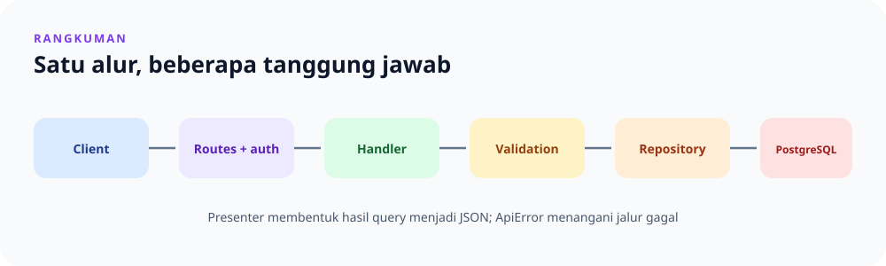

# Catatan Akhir Toko Laptop App

> **Navigasi:** [Indeks catatan](README.md) · [README proyek](../README.md) · [Dokumentasi endpoint](../endpoin.md)



Halaman ini merangkum cara memahami dan menjalankan Toko Laptop App setelah mengikuti catatan per lapisan. Aplikasi ini adalah REST API inventaris laptop berbasis Rust, Axum, SQLx, dan PostgreSQL; tidak ada frontend dalam proyek ini.

## Peta tanggung jawab

```text
main -> config/database -> routes + middleware
                              |
request -> handler -> validation -> repository -> PostgreSQL
                   <- presenter <- model <-
                              |
                       JSON response
```

| Lapisan | Tanggung jawab |
| --- | --- |
| [`main.rs`](rust/main.md) dan [`config.rs`](rust/config.md) | Memuat konfigurasi, menyambungkan database, menjalankan migration, dan memulai server. |
| [`routes.rs`](rust/routes.md) | Menetapkan endpoint publik/terlindungi dan menghubungkan URL ke handler. |
| [`handlers/`](rust/handlers.md) | Mengatur alur request dan memilih status HTTP. |
| [`validation/`](rust/validation.md) | Membersihkan serta memvalidasi ID dan payload laptop. |
| [`repositories/`](rust/repositories.md) | Menjalankan query PostgreSQL. |
| [`models/`](rust/models.md) dan [`presenters/`](rust/presenters.md) | Mewakili data aplikasi dan menyusun bentuk JSON response. |
| [`auth/`](rust/auth/mod.md) | Mengelola akun, middleware, session, JWT, role, dan response autentikasi. |

## Alur utama

1. Saat startup, aplikasi membaca environment, membuat koneksi PostgreSQL, menerapkan migration, meng-upgrade password legacy bila perlu, dan menyinkronkan akun admin dari konfigurasi.
2. Router mendaftarkan endpoint publik dan protected. `auth::require_auth` memeriksa identitas serta izin sebelum request protected mencapai handler.
3. Handler mengambil input, menjalankan validasi bila diperlukan, memanggil layanan/repository, lalu mengirim response dengan status HTTP yang sesuai.
4. Repository mengakses PostgreSQL. Presenter mengubah hasil laptop ke bentuk response yang ditetapkan API, termasuk format Rupiah.

## Endpoint dan akses

| Endpoint | Akses |
| --- | --- |
| `GET /health`, `POST /api/auth/register`, `POST /api/auth/login` | Publik |
| `GET /api/auth/session`, `POST /api/auth/logout` | Pengguna yang sudah login |
| `GET /api/laptops` dan `GET /api/laptops/{id}` | Admin, buyer, restocker |
| `POST /api/laptops`, `DELETE /api/laptops/{id}` | Admin |
| `PATCH /api/laptops/{id}` | Admin, restocker |
| `POST /api/admin/users`, `PATCH /api/admin/users/{username}/role` | Admin |

Buyer hanya dapat membaca laptop. Restocker dapat membaca dan memperbarui laptop. Admin dapat mengakses semua route protected. Detail kontrak request/response ada di [dokumentasi endpoint](../endpoin.md).

## Login, session, dan JWT

- Password disimpan sebagai hash Argon2id dengan salt acak, bukan sebagai teks asli.
- Login menerbitkan JWT HS256 yang berlaku satu jam dan membuat session cookie.
- Middleware mencoba JWT terlebih dahulu. Jika JWT tidak menghasilkan identitas yang valid, middleware mencoba session; role dan identitas akun diperiksa terhadap database.
- Logout menaikkan `token_version`, sehingga semua JWT lama pengguna ditolak, lalu menghapus session yang digunakan untuk logout. Session lain tidak ikut dihapus oleh mekanisme ini.
- Session memakai `MemoryStore`: session tidak bertahan setelah server dimulai ulang dan tidak dibagikan antar-instance.

Lihat penjelasan terperinci tentang [middleware](rust/auth/middleware.md), [session](rust/auth/session.md), [JWT](rust/auth/jwt.md), dan [`token_version`](token_ver.md).

## Menjalankan dan memeriksa

Siapkan PostgreSQL dan environment sesuai [README proyek](../README.md), lalu jalankan perintah berikut dari folder `11-toko-laptop-app`:

```bash
cargo run
```

Untuk pemeriksaan lokal:

```bash
cargo fmt --all
cargo check
cargo test
```

Gunakan [panduan `curl`](curl.md) atau [Postman](postman.md) untuk mencoba API. Jangan membagikan file `.env`, JWT, password, atau cookie session.

Migration aktif sekarang satu baseline yang kompatibel dengan database lama. Setelah baseline diterapkan, jangan mengubah file migration; buat file baru untuk perubahan skema selanjutnya. Jangan gunakan kredensial nyata atau deploy aplikasi latihan ini sebagai aplikasi produksi tanpa tinjauan keamanan dan konfigurasi tambahan.

## Hasil pemeriksaan catatan

Seluruh halaman Markdown di `catatan/` kini memiliki ilustrasi SVG yang merangkum topiknya. Catatan auth mengikuti pembagian modul saat ini: middleware, session, JWT, dan response dijelaskan pada halaman masing-masing.

Untuk menelusuri materi dari awal, mulai dari [gambaran proyek](01-gambaran-proyek.md), lanjutkan ke [alur kerja aplikasi](02-alur-kerja-aplikasi.md), lalu pilih catatan source dari [indeks](README.md).
