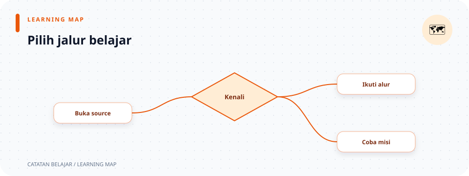

# Pusat Catatan Belajar

> **Navigasi:** [README proyek](../README.md) · [Dokumentasi API](../endpoin.md) · [Panduan `curl`](curl.md) · [Panduan Postman](postman.md)




Folder ini menjelaskan cara kerja REST API toko laptop, dari startup server sampai response kembali ke client. Catatan ditulis dalam urutan sederhana: pahami gambaran proyek, ikuti satu request, lalu buka rincian file yang ingin dipelajari.

> **Baru membuka proyek?** Mulai dari [gambaran proyek](01-gambaran-proyek.md), lanjutkan ke [alur aplikasi](02-alur-kerja-aplikasi.md), lalu gunakan tabel referensi pada halaman ini untuk masuk ke detail source.

## Peta aplikasi

```text
main.rs → config + database → routes + auth middleware
                                  ↓
Client → handler → validation → repository → PostgreSQL
                     ↓                         ↓
                 ApiError ← presenter ← Laptop
                     ↓
                JSON response
```

| Bagian | Pertanyaan yang dijawab | Mulai dari |
| --- | --- | --- |
| Startup | Apa yang terjadi sebelum server menerima request? | [Startup server](rust/main.md) |
| Routes dan auth | URL mana yang publik, dan mana yang perlu login? | [Routes](rust/routes.md) · [Session dan JWT](rust/auth/session.md) |
| Handler | Bagaimana request masuk dan response dibentuk? | [Ringkasan handlers](rust/handlers.md) |
| Validation | Input seperti apa yang diterima? | [Ringkasan validation](rust/validation.md) |
| Database | Di mana query PostgreSQL dijalankan? | [Ringkasan repository](rust/repositories.md) |
| Response | Bagaimana data model menjadi JSON dan Rupiah? | [Ringkasan presenter](rust/presenters.md) |

## Jalur belajar yang disarankan

1. **Kenali proyek:** baca [gambaran proyek](01-gambaran-proyek.md) dan [panduan presentasi](00-panduan-presentasi.md).
2. **Ikuti urutannya:** baca [alur kerja aplikasi](02-alur-kerja-aplikasi.md), lalu pelajari [main](rust/main.md), [config](rust/config.md), [lib](rust/lib.md), dan [routes](rust/routes.md).
3. **Telusuri satu endpoint:** gunakan `POST /api/laptops` sebagai contoh pada [handler create](rust/handlers/laptops/create.md), [validator create](rust/validation/create.md), [repository laptop](rust/repositories/laptop-repository.md), dan [presenter response](rust/presenters/laptop-response.md).
4. **Pelajari login:** mulai dari [handler auth](rust/handlers/auth.md), lanjut ke [modul auth](rust/auth/mod.md), [session](rust/auth/session.md), [JWT](rust/auth/jwt.md), dan [repository user](rust/repositories/user-repository.md).
5. **Buka konsep per lapisan:** gunakan indeks [models](rust/models.md), [validation](rust/validation.md), [repositories](rust/repositories.md), atau [presenters](rust/presenters.md) untuk memilih file terkait.
6. **Lihat kontrak client:** buka [dokumentasi endpoint](../endpoin.md), [contoh `curl`](curl.md), atau [skenario Postman](postman.md).

## Misi belajar 15 menit

Gunakan checklist ini setelah membaca. Setiap misi menghubungkan konsep dengan hasil yang bisa dilihat langsung.

| Misi | Tantangan | Petunjuk / hasil yang diharapkan |
| --- | --- | --- |
| 🧭 Telusuri request | Ikuti `POST /api/laptops` dari route sampai JSON response. | Temukan handler, validator, query `INSERT`, dan presenter. |
| 🔮 Tebak status | Prediksi hasil body PATCH kosong dan ID positif yang tidak ada. | PATCH kosong → `400`; ID valid format tetapi baris tidak ada → `404`. |
| 🛡️ Uji gerbang | Bandingkan `GET /health` dan `GET /api/laptops` tanpa login. | Health check → `200`; daftar laptop → `401`. |
| 💸 Ikuti harganya | Cari angka harga dari model hingga JSON client. | Database menyimpan integer; presenter mengirim string Rupiah. |
| 🎤 Jelaskan singkat | Terangkan proyek dalam tiga kalimat tanpa membaca source. | Sebut tujuan API, alur lapisan, lalu satu batasan keamanan. |

Centang setiap misi yang sudah bisa dijelaskan:

- [ ] Saya tahu file yang menentukan URL.
- [ ] Saya bisa membedakan `400`, `401`, dan `404` pada contoh API.
- [ ] Saya bisa menjelaskan perbedaan session cookie dan JWT setelah logout.
- [ ] Saya tahu mengapa password teks biasa hanya untuk latihan lokal.

## Referensi catatan source

| Area | Ringkasan dan rincian |
| --- | --- |
| Startup dan struktur crate | [main](rust/main.md) · [config](rust/config.md) · [lib](rust/lib.md) · [Cargo.toml](rust/cargo-toml.md) |
| Routing dan handler | [routes](rust/routes.md) · [ringkasan handlers](rust/handlers.md) · [modul handlers](rust/handlers/mod.md) · [auth](rust/handlers/auth.md) · [health check](rust/handlers/system.md) |
| Operasi laptop | [modul laptop](rust/handlers/laptops/mod.md) · [create](rust/handlers/laptops/create.md) · [read](rust/handlers/laptops/read.md) · [update](rust/handlers/laptops/update.md) · [delete](rust/handlers/laptops/delete.md) |
| Autentikasi | [modul auth](rust/auth/mod.md) · [response HTTP](rust/auth/http.md) · [JWT](rust/auth/jwt.md) · [session dan middleware](rust/auth/session.md) · [repository user](rust/repositories/user-repository.md) |
| Model request dan entity | [ringkasan models](rust/models.md) · [modul models](rust/models/mod.md) · [modul laptop](rust/models/laptop/mod.md) · [entity](rust/models/laptop/entity.md) · [payload POST](rust/models/laptop/create-payload.md) · [payload PATCH](rust/models/laptop/update-payload.md) |
| Validasi input | [ringkasan validation](rust/validation.md) · [modul](rust/validation/mod.md) · [ID](rust/validation/id.md) · [teks](rust/validation/text.md) · [create](rust/validation/create.md) · [update](rust/validation/update.md) |
| Database | [ringkasan repository](rust/repositories.md) · [modul repository](rust/repositories/mod.md) · [query laptop](rust/repositories/laptop-repository.md) · [migration laptop](rust/database/0001-create-laptops.md) · [migration awal user](rust/database/0002-create-users.md) · [migration password latihan](rust/database/0003-plaintext-password.md) |
| Response | [ringkasan presenters](rust/presenters.md) · [modul presenter](rust/presenters/mod.md) · [pemetaan laptop](rust/presenters/laptop-response.md) · [format Rupiah](rust/presenters/rupiah.md) · [error API](rust/error.md) |

## Cara membaca setiap halaman

- Tautan **Buka source** menuju file implementasi yang sedang dijelaskan.
- Tabel merangkum fungsi, field, atau hasil sebelum uraian langkah demi langkah.
- Potongan kode menunjukkan bagian penting source; JSON dan command merupakan contoh yang bisa disalin setelah server disiapkan.
- Istilah Rust seperti `Result`, `Option`, `?`, dan `.await` dijelaskan sesuai konteks pemakaiannya.
- Gunakan tautan di bagian **Hubungan dengan file lain** atau tabel indeks di atas untuk mengikuti data ke lapisan berikutnya.

## Batasan yang perlu diingat

Proyek ini tidak memiliki frontend. Catatan membahas pengalaman client API dan source backend. Password disimpan sebagai teks biasa untuk latihan lokal, session berada di memory store, dan logout tidak membatalkan JWT yang sudah diterbitkan. Jangan gunakan kredensial nyata atau deploy sebagai aplikasi produksi.
