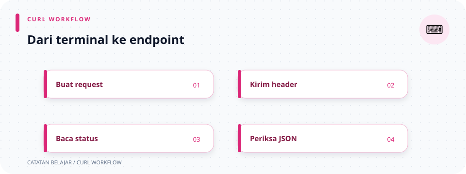

# Panduan `curl` API

> **Navigasi:** [Indeks catatan](README.md) · [README proyek](../README.md) · [Endpoint API](../endpoin.md)




Panduan ini berisi contoh untuk semua endpoint API toko laptop. Contoh memakai Bash/Linux/macOS dan URL lokal `http://127.0.0.1:3001` secara langsung. Jika host atau port server berubah, ganti URL tersebut pada command yang digunakan. Untuk Windows PowerShell, gunakan `curl.exe` bila perintah `curl` mengarah ke alias PowerShell.

## Di halaman ini

[Urutan login](#urutan-pemakaian) · [Semua contoh endpoint](#semua-endpoint) · [Opsi curl](#penjelasan-opsi-curl) · [Error umum](#error-umum)

## Urutan pemakaian

Endpoint laptop dan endpoint session aktif/logout memerlukan login terlebih dahulu. Buat akun lewat registrasi atau gunakan akun admin dari environment, lalu login untuk mendapat cookie session dan JWT HMAC. Route terlindungi menerima cookie seperti sebelumnya atau JWT pada header `Authorization`.

Contoh login di bawah memakai placeholder. Ganti nilainya dengan `ADMIN_USERNAME` dan `ADMIN_PASSWORD` yang ada di `.env` lokal. Jangan menaruh password asli dalam dokumentasi, source code, atau file yang akan dibagikan. File cookie adalah kredensial aktif; jangan dibagikan atau di-commit.

```bash
curl -i \
  -c cookies.txt \
  -H 'Content-Type: application/json' \
  -d '{"username":"admin","password":"GANTI_DENGAN_ADMIN_PASSWORD"}' \
  "http://127.0.0.1:3001/api/auth/login"
```

Response sukses login berstatus `200 OK`, mengatur cookie session, dan mengembalikan JWT pada `data.access_token` yang berlaku satu jam. Setelah request lain, cek identitas dengan `GET /api/auth/session`. Logout menghapus session, tetapi token JWT tetap berlaku sampai kedaluwarsa.

## Semua endpoint

### 1. Health check — `GET /health`

Endpoint publik; tidak memerlukan login, body, atau `-X` karena curl secara default mengirim `GET` saat tidak diberi metode/body lain.

```bash
curl -i "http://127.0.0.1:3001/health"
```

Contoh response `200 OK`:

```json
{"status":"ok","service":"toko-laptop-app"}
```

### 2. Registrasi — `POST /api/auth/register`

Endpoint publik. Username harus unik dan maksimal 100 karakter; password tidak boleh kosong. Registrasi membuat akun tetapi tidak otomatis membuat session.

```bash
curl -i \
  -H 'Content-Type: application/json' \
  -d '{"username":"pengguna-baru","password":"password-lokal"}' \
  "http://127.0.0.1:3001/api/auth/register"
```

Response sukses berstatus `201 Created`. Username yang telah digunakan menghasilkan `409 Conflict`. Password disimpan sebagai teks biasa untuk latihan lokal saja; jangan gunakan untuk akun nyata atau produksi.

### 3. Login — `POST /api/auth/login`

Endpoint publik. Isi username/password sesuai environment server. `-c cookies.txt` menyimpan cookie dari response untuk dipakai pada request selanjutnya.

```bash
curl -i \
  -c cookies.txt \
  -H 'Content-Type: application/json' \
  -d '{"username":"ADMIN_USERNAME_DI_ENV","password":"PASSWORD_ANDA"}' \
  "http://127.0.0.1:3001/api/auth/login"
```

Contoh response sukses `200 OK`:

```json
{
  "status": "success",
  "message": "Login berhasil",
  "data": {
    "username": "admin",
    "access_token": "<JWT>",
    "token_type": "Bearer",
    "expires_in": 3600
  }
}
```

Login gagal mengembalikan `401 Unauthorized`. Simpan/copy `access_token` dari response untuk request bearer. Login tidak memakai `-X POST`: opsi `-d` (`--data`) membuat curl otomatis memakai metode `POST`.

### 4. Daftar laptop — `GET /api/laptops`

Wajib login. `-b cookies.txt` mengirim cookie yang sebelumnya disimpan saat login. Jika memilih JWT, ganti cookie dengan header `Authorization: Bearer $TOKEN`. Tidak perlu `-X GET`: tanpa opsi metode atau body, curl memakai `GET` secara default.

```bash
curl -i -b cookies.txt "http://127.0.0.1:3001/api/laptops"
```

Contoh response `200 OK`:

```json
{
  "status": "success",
  "data": [
    [1, "ThinkPad E14", "Lenovo", "Rp 12.500.000", 5]
  ]
}
```

Jika belum ada laptop, `data` adalah array kosong. Setiap item berbentuk `[id, nama, merek, harga, stok]`.

### 5. Tambah laptop — `POST /api/laptops`

Wajib login. `-H` menyatakan bahwa body yang dikirim adalah JSON. `-d` mengirim body dan otomatis memilih metode POST, jadi `-X POST` tidak diperlukan.

```bash
curl -i \
  -b cookies.txt \
  -H 'Content-Type: application/json' \
  -d '{"nama":"ThinkPad E14","merek":"Lenovo","harga":12500000,"stok":5}' \
  "http://127.0.0.1:3001/api/laptops"
```

Contoh response `201 Created`:

```json
{
  "status": "success",
  "message": "Laptop berhasil ditambahkan",
  "data": {
    "id": 1,
    "nama": "ThinkPad E14",
    "merek": "Lenovo",
    "harga": "Rp 12.500.000",
    "stok": 5
  }
}
```

Simpan nilai `data.id` dari response untuk detail, update, atau delete. Nama wajib maksimal 150 karakter; merek maksimal 100 karakter. Harga dan stok harus bilangan bulat nol atau lebih.

### 6. Detail laptop — `GET /api/laptops/{id}`

Ganti `1` dengan ID laptop yang didapat dari response tambah laptop. Wajib login. GET tidak memerlukan `-X`.

```bash
curl -i -b cookies.txt "http://127.0.0.1:3001/api/laptops/1"
```

Contoh response `200 OK`:

```json
{
  "status": "success",
  "data": [1, "ThinkPad E14", "Lenovo", "Rp 12.500.000", 5]
}
```

ID tidak valid menghasilkan `400 Bad Request`; ID positif yang tidak ditemukan menghasilkan `404 Not Found`.

### 7. Update sebagian field — `PATCH /api/laptops/{id}`

Wajib login. PATCH mengirim satu atau beberapa field yang ingin diubah; field lain tidak berubah. Di sini `-X PATCH` diperlukan karena `-d` sendiri secara default memilih POST, bukan PATCH.

```bash
curl -i \
  -b cookies.txt \
  -X PATCH \
  -H 'Content-Type: application/json' \
  -d '{"nama":"ThinkPad E14 Gen 5","harga":13500000}' \
  "http://127.0.0.1:3001/api/laptops/1"
```

Contoh response `200 OK`:

```json
{
  "status": "success",
  "message": "Laptop berhasil diperbarui",
  "data": [1, "ThinkPad E14 Gen 5", "Lenovo", "Rp 13.500.000", 5]
}
```

Body tanpa field yang dapat diubah ditolak dengan `400 Bad Request`.

### 8. Hapus laptop — `DELETE /api/laptops/{id}`

Wajib login. Karena tidak ada body, `-X DELETE` dipakai untuk memilih metode HTTP DELETE.

```bash
curl -i \
  -b cookies.txt \
  -X DELETE \
  "http://127.0.0.1:3001/api/laptops/1"
```

Contoh response `200 OK`:

```json
{
  "status": "success",
  "message": "Laptop berhasil dihapus",
  "id": 1
}
```

Jika ID tidak ditemukan, response `404 Not Found`.

### 9. Lihat session aktif — `GET /api/auth/session`

Wajib login. GET tidak memerlukan `-X`.

```bash
curl -i -b cookies.txt "http://127.0.0.1:3001/api/auth/session"
```

Contoh response `200 OK`:

```json
{
  "status": "success",
  "data": {"username": "admin"}
}
```

Tanpa cookie session atau bearer JWT yang valid, server mengembalikan `401 Unauthorized`.

### 10. Logout — `POST /api/auth/logout`

Wajib memakai cookie session atau JWT bearer yang valid. Tidak ada body, maka metode ditentukan eksplisit memakai `-X POST`. Logout menghapus session server-side; JWT bearer tetap berlaku sampai kedaluwarsa.

```bash
curl -i \
  -b cookies.txt \
  -c cookies.txt \
  -X POST \
  "http://127.0.0.1:3001/api/auth/logout"
```

Contoh response `200 OK`:

```json
{
  "status": "success",
  "message": "Logout berhasil"
}
```

Sesudah logout, endpoint yang dilindungi kembali menghasilkan `401` sampai login lagi.

## Penjelasan opsi curl

| Opsi | Arti | Alasan digunakan |
| --- | --- | --- |
| `-i` | Tampilkan header response bersama body. | Memudahkan melihat status HTTP serta `Set-Cookie` saat login. |
| `-H 'Content-Type: application/json'` | Menambahkan header request. | Memberi tahu Axum bahwa request body adalah JSON. |
| `-d '...'` | Mengirim data/body request. | Dipakai pada login dan create; curl otomatis mengubah metode menjadi POST. |
| `-X PATCH` | Memaksa metode HTTP tertentu. | Diperlukan untuk PATCH karena curl tidak dapat menyimpulkan PATCH hanya dari `-d`. |
| `-X DELETE` | Memaksa metode HTTP DELETE. | Dipakai untuk delete yang tidak mempunyai body. |
| `-X POST` | Memaksa metode HTTP POST. | Dipakai untuk logout karena tidak mengirim body; kalau memakai `-d`, `-X POST` bisa dihilangkan. |
| `-b cookies.txt` | Membaca cookie dari file dan mengirimkannya. | Mempertahankan session pada request protected. |
| `-c cookies.txt` | Menulis cookie dari response ke file. | Menyimpan cookie yang server berikan saat login; juga memperbarui cookie setelah logout. |
| `-X GET` | Memaksa metode GET. | Tidak dipakai karena curl sudah menggunakan GET secara default saat tidak ada `-d` atau metode lain. |
| URL lengkap | Menentukan alamat server dan path endpoint secara langsung. | Contoh memakai `http://127.0.0.1:3001`; ubah URL pada command jika host atau port server berbeda. |

Catatan tentang `-X`: opsi ini hanya memilih/menimpa nama metode HTTP; ia tidak otomatis menambahkan body atau header JSON. Gunakan bersama `-H` dan/atau `-d` sesuai kebutuhan. Hindari menambahkan `-X GET` pada contoh GET karena tidak menambah fungsi.

## Error umum

| Status | Penyebab umum | Yang perlu diperiksa |
| --- | --- | --- |
| `400` | Body JSON atau data laptop tidak valid; ID bukan bilangan positif. | Nama/merek, angka harga/stok, dan format JSON. |
| `401` | Login belum dilakukan, kredensial salah, atau session/JWT tidak valid. | Login ulang; kirim `-b cookies.txt` untuk cookie atau header `Authorization: Bearer $TOKEN` untuk JWT. |
| `404` | Laptop dengan ID tersebut tidak ada. | Periksa ID dari response create. |
| `500` | Query database atau session store gagal. | Log server; detail internal tidak dikirim pada response API. |

Jika Axum menolak JSON yang malformed atau tipe konten yang salah sebelum handler berjalan, bentuk response error dapat berbeda dari JSON error aplikasi.

## Ilustrasi alur request

```text
register (sekali) → login → simpan cookie/JWT
                           ↓
                    CRUD laptop
                           ↓
                       logout
```
