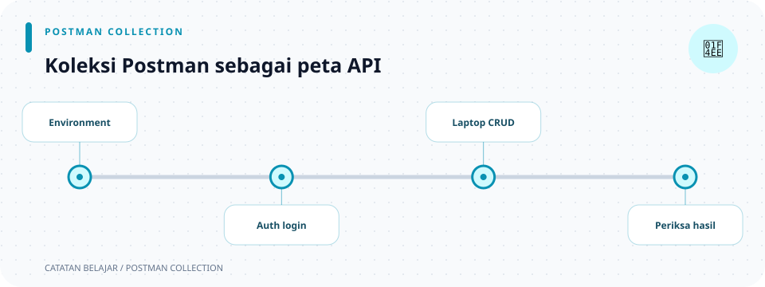

# Folder `postman/`

> **Navigasi:** [Indeks catatan](README.md) · [README proyek](../README.md) · [Endpoint API](../endpoin.md)




Folder ini tidak dijalankan oleh Rust. Isinya adalah konfigurasi Postman untuk mencoba registrasi/login dan menjalankan satu rangkaian uji CRUD terhadap API yang sedang hidup.

## Di halaman ini

[Collection dan request](#postman-collection) · [Environment lokal](#environment-postman-lokal)

- [Buka collection JSON](../postman/toko-laptop-app.postman_collection.json)
- [Buka environment JSON](../postman/toko-laptop-app.local.postman_environment.json)

## Persiapan dan urutan menjalankan

1. Jalankan server dan database terlebih dahulu, lalu import collection serta environment JSON di atas ke Postman.
2. Pilih environment **Toko Laptop App - Local**. Sesuaikan `baseUrl` dengan host dan port server.
3. Isi `adminUsername` dan `adminPassword` dengan kredensial lokal admin. Collection/environment bukan tempat untuk menyimpan kredensial yang akan dibagikan atau di-commit.
4. Jalankan request `01 - Login admin` sebelum request laptop. Login mengembalikan JWT yang disimpan oleh script dan cookie session yang dikelola cookie jar Postman.
5. Jalankan `02 - Daftar laptop`, lalu `03 - Tambah laptop`, `04 - Detail laptop`, `05 - Ubah laptop`, dan `06 - Hapus laptop` secara berurutan. Create menghasilkan ID yang dibutuhkan tiga request berikutnya.
6. `00 - Register akun` adalah alur terpisah untuk membuat buyer. Registrasi publik tidak memberi role admin dan tidak membuat session.

## Postman collection

File: [`toko-laptop-app.postman_collection.json`](../postman/toko-laptop-app.postman_collection.json)

### Bagian `info`

| Field | Nilai/fungsi |
| --- | --- |
| `name` | Nama collection: `Toko Laptop App - CRUD Laptop`. |
| `description` | Menjelaskan bahwa login harus dilakukan sebelum rangkaian CRUD; registrasi tersedia sebagai request publik. |
| `schema` | URL schema Collection v2.1.0 yang memberi tahu Postman bentuk JSON collection ini. |

### Bagian `variable`

| Variable | Nilai awal | Dipakai untuk |
| --- | --- | --- |
| `baseUrl` | `http://127.0.0.1:3001` | Awalan seluruh URL request. |
| `laptopId` | String kosong | Menyimpan ID hasil POST untuk detail, PATCH, dan DELETE. |
| `jwtToken` | String kosong | Diisi otomatis setelah login dan dipakai sebagai bearer token. |
| `testRunId` | String kosong | Membuat nama laptop uji berbeda pada setiap run. |
| `adminUsername` | String kosong | Username yang sama dengan `ADMIN_USERNAME` server. |
| `adminPassword` | String kosong | Password yang sama dengan `ADMIN_PASSWORD` server; isi pada environment lokal dan jangan dibagikan. |
| `registerUsername` | `pengguna-baru` | Username contoh untuk request registrasi. Ubah agar belum pernah digunakan. |
| `registerPassword` | `password-lokal` | Password contoh untuk request registrasi lokal. |

`{{baseUrl}}`, `{{laptopId}}`, dan `{{testRunId}}` adalah sintaks substitusi variable Postman. Collection menyimpan semua nilai sebagai string, sehingga ID dari response angka diubah dengan `String(...)` sebelum disimpan.

Postman mengganti `{{namaVariable}}` pada URL, header, dan body sebelum mengirim request. Environment dipilih secara manual; jika collection dan environment memiliki nama variable yang sama, nilai environment yang aktif mengesampingkan nilai collection. Gunakan collection variables untuk nilai yang dipakai oleh script collection (`pm.collectionVariables.get/set`), dan environment variables untuk konfigurasi lokal seperti `baseUrl` atau kredensial. Nilai environment yang diekspor dapat berisi secret, jadi jangan membagikan nilai sensitif.

### Request 00 — Register akun

Request publik memakai `POST {{baseUrl}}/api/auth/register` dengan body JSON berisi `registerUsername` dan `registerPassword`. Username harus unik dan maksimal 100 karakter setelah spasi pinggir dibuang; password tidak boleh kosong. Response `201 Created` berarti akun berhasil dibuat, sementara `409 Conflict` berarti username sudah terdaftar. Request dapat dijalankan berulang; test menerima kedua hasil tersebut. Registrasi tidak membuat session sehingga request ini tidak menggantikan login. Password di-hash dengan Argon2id sebelum disimpan.

### Request 01 — Login admin

Request memakai `POST {{baseUrl}}/api/auth/login` dengan body JSON berisi `adminUsername` dan `adminPassword`. Jalankan request ini terlebih dahulu. Postman menyimpan cookie dari response dan script test menyimpan `data.access_token` ke `jwtToken`; request protected mengirim kedua kredensial, dan middleware menerima JWT maupun session cookie. Login yang salah mengembalikan 401.

Response `200 OK` berarti autentikasi berhasil; token berlaku satu jam. `401 Unauthorized` berarti kredensial tidak cocok atau token/session tidak diterima. Script memeriksa token pada response sebelum menyimpan variable agar request berikutnya dapat menggunakan nilai yang dihasilkan login.

### Request 02 — Daftar laptop

Request memakai `GET {{baseUrl}}/api/laptops` tanpa body dan memakai bearer JWT hasil login.

Script `test` berisi tiga langkah:

1. `pm.test(... status(200))` memastikan request berhasil dengan HTTP 200.
2. `pm.response.json().data` membaca field `data` pada JSON response ke variabel `rows`.
3. `items.every(row => Array.isArray(row) && row.length === 5)` memastikan setiap laptop adalah array lima elemen. Ini sesuai `laptop_to_array` di [presenters](rust/presenters.md).

### Request 03 — Tambah laptop

Request memakai `POST {{baseUrl}}/api/laptops`, header `Content-Type: application/json`, dan body raw JSON:

```json
{
  "nama": "Postman Test {{testRunId}}",
  "merek": "Test",
  "harga": 1000000,
  "stok": 2
}
```

Bagian `options.raw.language = "json"` memberi tahu editor Postman bahwa body harus diperlakukan sebagai JSON.

Sebelum request, script `prerequest` menjalankan `Date.now()`, mengubahnya ke string, lalu menyimpannya sebagai collection variable `testRunId`. Karena itu nama laptop baru selalu berbeda pada run yang berbeda.

Sesudah request, script test:

1. Memastikan status 201.
2. Membaca seluruh JSON response ke `data`.
3. Memeriksa `data.data.id` hanya bila status memang 201 dan object/ID ada.
4. Menyimpan ID baru itu sebagai `laptopId`.
5. Memastikan ID yang dikembalikan bertipe number.

Response POST memakai object `data`, sesuai `laptop_to_object`.

### Request 04 — Detail laptop

URL `{{baseUrl}}/api/laptops/{{laptopId}}` menggunakan ID yang disimpan request POST. Test memeriksa:

1. Status 200.
2. `data` adalah array dengan panjang lima.
3. Elemen indeks `0` (ID) sama dengan `laptopId`. `String(laptop[0])` dipakai karena response memakai angka sedangkan collection variable berupa string.

### Request 05 — Ubah laptop

Request menggunakan `PATCH` pada URL yang sama, header JSON, dan body:

```json
{
  "nama": "Postman Test Updated {{testRunId}}",
  "harga": 1200000
}
```

Hanya `nama` dan `harga` yang dikirim. Test memastikan status 200, array berisi lima elemen, nama mengandung `Updated`, dan harga indeks `3` menjadi `Rp 1.200.000`. Blok test terakhir memastikan merek (indeks 2) masih `Test` dan stok (indeks 4) masih `2`. Ini menguji perilaku PATCH parsial/`COALESCE` di [repository](rust/repositories.md).

### Request 06 — Hapus laptop

Request memakai `DELETE {{baseUrl}}/api/laptops/{{laptopId}}`. Script hanya memeriksa status 200. Ia memakai ID yang sama agar lima request membentuk satu skenario lengkap: buat data uji, pakai, ubah, lalu bersihkan kembali.

### Arti API Postman di script

| Kode | Kegunaan |
| --- | --- |
| `pm.test(nama, fungsi)` | Membuat satu assertion bernama di hasil Postman. |
| `pm.response` | Object response HTTP yang baru diterima. |
| `pm.response.json()` | Mengubah body response JSON menjadi object JavaScript. |
| `pm.response.code` | Status HTTP sebagai angka. |
| `pm.expect(...)` | Assertion berbasis Chai yang membuat test gagal jika kondisi salah. |
| `pm.collectionVariables.set/get` | Menyimpan atau membaca variable pada collection saat run. |

`pm.test` mengelompokkan pemeriksaan bernama di tab **Tests**; kegagalan assertion akan menandai test gagal meski request tetap sudah dikirim. `pm.response.code` adalah status HTTP numerik (misalnya `201`), berbeda dari object JSON dalam body. `pm.response.json()` hanya dapat dipakai bila server mengembalikan JSON yang valid.

## Environment Postman lokal

File: [`toko-laptop-app.local.postman_environment.json`](../postman/toko-laptop-app.local.postman_environment.json)

File environment mendefinisikan nilai `baseUrl` dengan nilai awal `http://127.0.0.1:3001`.

| Field | Arti |
| --- | --- |
| `id` | ID unik environment Postman. |
| `name` | Nama tampilan environment: `Toko Laptop App - Local`. |
| `values` | Daftar variable environment. Tambahkan `adminUsername` dan `adminPassword` di sini untuk login. |
| `key: baseUrl` | Nama variable yang dapat mengesampingkan nilai collection. |
| `value` | URL server lokal saat ini. |
| `type: default` | Jenis nilai variable menurut format ekspor Postman. |
| `enabled: true` | Variable aktif dipakai. |
| `_postman_variable_scope` | Menandai scope sebagai environment. |
| `_postman_exported_at` / `_using` | Metadata waktu dan aplikasi saat file diekspor. |

Pilih environment ini di Postman, ubah `baseUrl` agar cocok dengan `APP_HOST` dan `APP_PORT`, lalu tambahkan `adminUsername` dan `adminPassword` sesuai environment server. Postman tidak membaca file `.env` backend otomatis. Username/password registrasi dapat diatur pada collection variables. Cookie session dikelola melalui cookie jar Postman; jangan menaruh cookie session atau JWT di file yang dibagikan. Request protected dalam collection menggunakan bearer JWT yang dibuat oleh request login.

## Ilustrasi urutan collection

```text
00 Register ─┐
             ├─> 01 Login ─> 02 List ─> 03 Create ─> 04 Detail
             │                                      └> 05 Update ─> 06 Delete
             └─ registrasi dapat dilewati jika akun sudah tersedia
```
