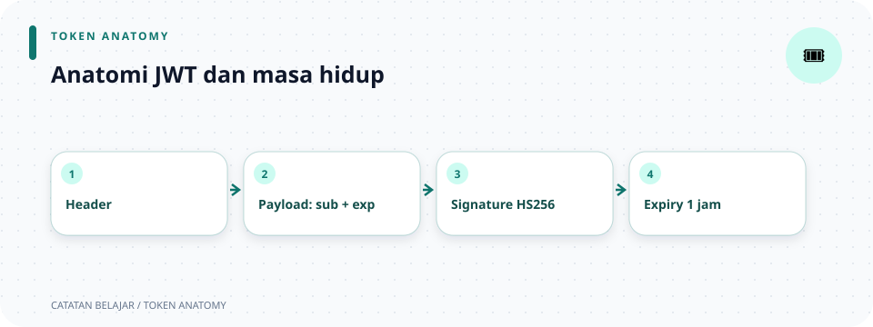

# `src/auth/jwt.rs`

> **Navigasi:** [Indeks catatan](../../README.md) · [README proyek](../../../README.md) · [Endpoint API](../../../endpoin.md)



[Bandingkan session dan JWT](sesi_jwt.md)


[Buka kode sumber `jwt.rs`](../../../src/auth/jwt.rs)

## Tujuan

Modul ini menerbitkan dan memverifikasi access token JWT menggunakan HMAC-SHA256 (HS256). Token memberi client cara mengautentikasi request tanpa mengirim password lagi. Secret dibaca dari `JWT_SECRET`, yang harus berisi sedikitnya 32 byte.

> **Ringkas:** login membuat JWT satu jam dengan ID pengguna (`sub`), `role`, dan `token_version`; route terlindungi memeriksa signature, expiry, serta nilai pengguna terbaru di database.

## Isi token

`Claims` adalah struct Rust yang menjadi payload JWT. Saat login berhasil, aplikasi mengisi empat klaim berikut:

| Klaim | Tipe di Rust | Arti dan cara digunakan |
| --- | --- | --- |
| `sub` | `i64` | *Subject* atau ID pengguna pemilik token. Middleware memakai nilai ini untuk mencari pengguna di database. |
| `exp` | `u64` | Waktu kedaluwarsa dalam detik sejak Unix epoch (1 Januari 1970 UTC). `issue_token` menetapkannya satu jam setelah token dibuat; `verify_token` menolak token yang sudah melewati waktu ini. |
| `role` | `UserRole` | Salinan role pengguna saat token diterbitkan, misalnya `admin`. Middleware membandingkannya dengan role terbaru di database sebelum memakai identitas JWT. Role ini bukan pengganti pemeriksaan izin route. |
| `token_version` | `i64` | Salinan versi token pada baris pengguna saat token diterbitkan. Middleware membandingkannya dengan versi terbaru di database. Jika versi dinaikkan saat logout, token-token lama pengguna tidak lagi cocok dan ditolak. |

Contoh payload setelah di-decode:

```json
{
  "sub": 7,
  "exp": 1793864943,
  "role": "admin",
  "token_version": 0
}
```

Pada contoh tersebut, `sub: 7` menunjuk pengguna dengan ID 7, `role: "admin"` adalah role yang tercatat saat token dibuat, dan `token_version: 0` harus tetap sama dengan versi pengguna di database agar JWT diterima. Nilai `exp` adalah timestamp, bukan durasi; aplikasi menghitungnya dengan menambahkan 3.600 detik ke waktu sekarang.

Signature JWT memastikan payload tidak diubah tanpa terdeteksi, tetapi payload **tidak dienkripsi**. Client yang memiliki token dapat membaca claims. Karena itu, jangan masukkan password, secret, atau data sensitif ke dalamnya.

### Perbedaan `role` dan `token_version`

Kedua klaim ini menyimpan nilai pengguna saat token diterbitkan, tetapi dipakai untuk tujuan berbeda:

- `role` menyimpan peran untuk pemeriksaan akses. Middleware memastikan role di token masih sama dengan role terbaru di database; perubahan role membuat token lama tidak cocok.
- `token_version` adalah penanda untuk mencabut token secara kolektif. Saat logout, aplikasi menaikkan versi di database. Semua JWT lama milik pengguna itu kemudian memiliki versi yang tidak cocok, termasuk JWT yang masih belum kedaluwarsa atau dipakai di perangkat lain.

Pemeriksaan terhadap database ini dilakukan pada setiap request yang menggunakan JWT. Jadi, masa berlaku satu jam membatasi umur token, sedangkan pencocokan `role` dan `token_version` memungkinkan perubahan status pengguna berlaku sebelum token kedaluwarsa.

## Cara kerja di aplikasi

1. Saat startup, `main.rs` memberikan `JWT_SECRET` ke `create_router`, lalu router membuat `JwtService`.
2. Setelah kredensial login cocok, handler mengambil ID, role, dan `token_version` pengguna dari database. `issue_token(user_id, role, token_version)` menyimpan ketiganya bersama klaim expiry satu jam.
3. `jsonwebtoken::encode` menandatangani claims dengan algoritma HS256 dan secret aplikasi.
4. Client mengirim token melalui header `Authorization: Bearer <access_token>`.
5. `bearer_token` membaca header dan mengambil token setelah skema `Bearer`. Header dengan format lain dianggap tidak memiliki bearer token.
6. `verify_token` memeriksa algoritma, signature, dan expiry. Middleware mencari pengguna berdasarkan `sub`, lalu mencocokkan `role` dan `token_version` token dengan nilai terbaru di database.

`JwtService` menyimpan secret sebagai `Arc<str>`. `Arc` memungkinkan service di-clone dengan biaya rendah saat dipakai bersama oleh handler dan middleware. Secret tidak dimasukkan ke claims atau response. `Claims` adalah bentuk data yang diserialisasi ke payload JWT. Role diserialisasi sebagai teks huruf kecil, misalnya `"admin"`.

Di bagian atas source, `//!` adalah dokumentasi untuk module, `///` mendokumentasikan item tepat di bawahnya, dan `//` adalah komentar biasa untuk pembaca kode. Bentuk `#[...]` adalah attribute yang memberi instruksi tambahan ke compiler.

## Sintaks Rust yang digunakan

Bagian ini menjelaskan konstruksi yang muncul di source, dari import sampai test.

### Import dan tipe

| Sintaks | Penjelasan |
| --- | --- |
| `use std::{ sync::Arc, time::{SystemTime, UNIX_EPOCH} };` | `use` membawa nama dari module agar dapat dipakai tanpa menulis path penuh. `{...}` mengelompokkan beberapa nama; kelompok bersarang mengambil nama waktu dari `std::time`. |
| `use axum::http::{HeaderMap, header::AUTHORIZATION};` | Mengimpor tipe map header HTTP dan konstanta nama header `Authorization`. `::` memisahkan nama module dan item. |
| `use super::role::UserRole;` | `super` menunjuk module induk dari `auth::jwt`; `role::UserRole` mengambil tipe role dari sibling module `role`. |
| `impl JwtService { ... }` | `impl` mengelompokkan fungsi yang terkait dengan tipe. `new` adalah associated function karena tidak menerima `self`; method seperti `issue_token` dan `verify_token` menerima `&self` dan dipanggil pada instance. |
| `Arc<str>` | `Arc` adalah pointer dengan hitungan referensi atomik yang memungkinkan beberapa pemilik berbagi data. `<str>` adalah parameter tipe; `str` di sini disimpan sebagai teks yang dibagi melalui `Arc`. `Arc::from(secret)` mengubah `String` menjadi bentuk `Arc<str>` yang dibagi. |
| `HeaderMap`, `HeaderValue`, `&str` | `HeaderMap` memuat header request. `HeaderValue` adalah nilai header. `&str` adalah pinjaman teks, jadi fungsi dapat membaca string tanpa mengambil kepemilikannya. |
| `Result<T, E>` dan `Option<T>` | `Result` menyatakan sukses (`Ok(T)`) atau gagal (`Err(E)`). `Option` menyatakan nilai ada (`Some(T)`) atau tidak ada (`None`). |
| `;` dan ekspresi terakhir | Titik koma mengakhiri statement. Ekspresi terakhir pada body fungsi tanpa titik koma menjadi nilai yang dikembalikan; contohnya `Ok(...)` di akhir `new` bukan statement terpisah. |

### Konstanta, struct, dan method

| Sintaks | Penjelasan |
| --- | --- |
| `pub const TOKEN_EXPIRED_SECONDS: u64 = 60 * 60;` | `pub` membuat item bisa diakses dari module lain. `const` adalah nilai tetap saat kompilasi. `u64` adalah bilangan bulat tanpa tanda 64-bit; `60 * 60` menghasilkan 3.600 detik. |
| `#[derive(Clone)]` | Attribute meminta compiler membuat implementasi `Clone`, agar service dapat diduplikasi. Karena secret berada di `Arc`, clone hanya menambah hitungan pemilik, bukan menyalin seluruh secret. |
| `pub struct JwtService { ... }` | `struct` mendefinisikan tipe yang menyimpan data. Field `secret` tidak diberi `pub`, jadi hanya module ini yang dapat membacanya langsung. |
| `#[derive(Clone, Debug, Deserialize, Serialize)]` | Membuat implementasi trait secara otomatis. `Serialize` mengubah `Claims` menjadi payload token; `Deserialize` membentuk `Claims` dari payload. `Debug` membantu menampilkan nilai saat debugging dan `Clone` mengizinkan penyalinan nilai claims. |
| `pub struct Claims { pub sub: i64, ... }` | Setiap field menyimpan satu claim: `sub: i64`, `exp: u64`, `role: UserRole`, dan `token_version: i64`. Tidak ada `jti` pada struktur yang digunakan proyek ini. `pub` pada field memungkinkan modul lain membaca nilainya. |
| `pub fn new(secret: String) -> Self` | `fn` mendefinisikan fungsi. `String` adalah teks yang dimiliki pemanggil; `Self` berarti tipe yang sedang diimplementasikan, yaitu `JwtService`. |
| `&self`, `&value`, `&mut value` | `&self` meminjam instance service selama method berjalan. `&value` meminjam nilai untuk dibaca; `&mut value` meminjamnya agar dapat diubah. Referensi mencegah fungsi mengambil kepemilikan nilai yang dipinjam. |
| `Result<String, Box<dyn Error + Send + Sync>>` | Method mengembalikan token sebagai `String` atau error. `dyn Error` adalah trait object untuk beberapa jenis error; `Box` menyimpannya di heap. Batas `Send + Sync` membuat error aman dipindahkan dan dibagi antar thread. |

### Menerbitkan token dengan `issue_token`

1. `let now = SystemTime::now().duration_since(UNIX_EPOCH)?.as_secs()` membaca waktu sebagai detik sejak Unix epoch. `duration_since` menghasilkan `Result`; `?` meneruskan error (misalnya jam sistem lebih awal dari epoch), sedangkan `.as_secs()` mengambil detik sebagai `u64`.
2. `Claims { sub: user_id, exp: now + TOKEN_EXPIRED_SECONDS, role, token_version }` membuat nilai struct. `role` dan `token_version` memakai *field initialization shorthand*: nama field dan nama variabel sama. Expiry diset satu jam dari waktu sekarang.
3. `EncodingKey::from_secret(self.secret.as_bytes())` membuat key HS256 dari byte secret. `.as_bytes()` meminjam representasi byte teks, tidak mencetak atau mengirim secret.
4. `Header::new(Algorithm::HS256)` menyatakan algoritma tanda tangan. `encode(&Header::new(...), &claims, &key)` meminjam header, claims, dan key saat menserialisasi serta menandatangani token.
5. `Ok(encode(...)?)` membungkus token sukses dalam `Ok`. `?` meneruskan error encoding; `Result<String, Box<dyn Error + Send + Sync>>` memungkinkan berbagai error dikembalikan melalui satu tipe hasil.

### Memverifikasi token dengan `verify_token`

Signature fungsi `verify_token(&self, token: &str) -> Result<Claims, jsonwebtoken::errors::Error>` meminjam service dan teks token. Ia tidak mengubah token.

1. `DecodingKey::from_secret(...)` membuat key untuk memeriksa signature dengan secret yang sama.
2. `let mut validation = Validation::new(Algorithm::HS256);` membuat aturan verifikasi khusus HS256. `mut` diperlukan karena baris berikut mengubah aturan.
3. `validation.leeway = 0;` menetapkan toleransi waktu expiry menjadi nol detik.
4. `decode::<Claims>(token, &key, &validation)` memanggil fungsi generic `decode` dengan tipe hasil `Claims`. Sintaks `::<Claims>` disebut turbofish; compiler diminta mengubah payload ke struct itu.
5. `.claims` mengambil claims dari hasil decode. `?` meneruskan error jika format, signature, algoritma, atau expiry tidak valid; `Ok(...)` membungkus claims yang valid sebagai hasil sukses.

### Membaca header bearer

| Sintaks | Penjelasan |
| --- | --- |
| `headers.get(AUTHORIZATION)` | Mencari nilai header `Authorization`; hasilnya `Option` karena header bisa tidak ada. |
| `.to_str().ok()?` | Mengubah nilai header menjadi teks. `to_str()` menghasilkan `Result`; `.ok()` mengubahnya menjadi `Option`, lalu `?` mengembalikan `None` jika nilainya bukan teks yang valid. |
| `split_once(' ')` | Memecah teks pada spasi pertama; hasilnya pasangan `(scheme, token)`. `?` mengembalikan `None` jika spasi tidak ditemukan. |
| `scheme.eq_ignore_ascii_case("Bearer")` | Membandingkan skema tanpa membedakan huruf besar/kecil ASCII, jadi `Bearer` dan `bearer` diterima. |
| `&&` dan `!` | `&&` berarti semua syarat harus benar. `!` membalik nilai boolean; kondisi ini menolak token kosong dan token yang masih mengandung whitespace. |
| `token.chars().any(char::is_whitespace)` | Memeriksa apakah ada karakter whitespace di token. `char::is_whitespace` dipakai sebagai fungsi pemeriksa untuk setiap karakter. |
| `Some(token)` / `None` | Mengembalikan token jika skema dan isinya benar; selain itu fungsi mengembalikan `None`. `if` dan `else` memilih hasil berdasarkan syarat boolean. |
| `(scheme, token)` | Pola tuple yang menerima dua bagian hasil `split_once`: teks sebelum spasi dan teks setelah spasi. |
| `jwt.verify_token(bearer_token(headers)?).ok()` | Mengekstrak bearer token; `?` berhenti jika tidak ada. Lalu token diverifikasi. `.ok()` mengubah `Result<Claims, Error>` menjadi `Option<Claims>`, sehingga error token diperlakukan sebagai tidak ada claims valid. |

`bearer_token(headers: &HeaderMap) -> Option<&str>` meminjam map header dan mengembalikan token sebagai referensi, bukan menyalin teks. Token tidak boleh digunakan setelah header asalnya tidak tersedia. `claims_from_headers(headers, jwt) -> Option<Claims>` kemudian memverifikasi token; `.ok()` sengaja menyamakan kegagalan verifikasi dengan “tidak ada claims valid”. Perbedaan penting: `Option` menyatakan ada/tidaknya nilai, sementara `Result` menyatakan sukses/error beserta jenis error.

## Fungsi dan metode lain

- `JwtService::new(secret: String) -> Self` menerima kepemilikan secret, menyimpannya sebagai `Arc<str>`, dan mengembalikan service. `Self` berarti `JwtService`. `Arc` memungkinkan service di-clone antar handler/middleware tanpa menyalin isi secret setiap kali.
- `issue_token(&self, user_id, role, token_version) -> Result<String, ...>` membuat claims ber-expiry satu jam dan menandatanganinya. Parameter teks/role/ID diberikan berdasarkan nilai; secret hanya dibaca lewat pinjaman `&self`.
- `verify_token(&self, token) -> Result<Claims, Error>` membatasi algoritma pada HS256, mengatur `leeway = 0`, lalu memverifikasi signature dan expiry sebelum memberi claims.
- `bearer_token` mengembalikan `Some(&str)` hanya jika header mempunyai skema Bearer dan token non-kosong tanpa whitespace. Rangkaian `?` di sini bekerja pada `Option`: jika salah satu langkah tidak menghasilkan nilai, fungsi langsung menghasilkan `None`.
- `claims_from_headers` menghubungkan ekstraksi header dan verifikasi token; caller menerima `None` untuk token hilang maupun invalid.

`#[derive(Clone)]` meminta compiler membuat implementasi trait `Clone` untuk service. `Claims` juga memakai `Debug`, `Deserialize`, dan `Serialize`: ini adalah trait untuk debug, membaca payload JSON, dan membuat payload JSON. Attribute `#[serde(rename_all = "lowercase")]` pada role (didefinisikan di `role.rs`) mengubah varian menjadi teks seperti `"admin"` ketika diserialisasi. `#[cfg(test)]` dan `#[test]` adalah attribute conditional compilation/test.

### Test di bagian bawah file

`#[cfg(test)]` menyertakan module hanya ketika test dibangun. `mod tests { ... }` membuat module anak khusus test, dan `use super::{JwtService, UserRole};` mengambil nama dari module JWT induk. `#[test]` menandai fungsi test biasa.

`SECRET` adalah konstanta secret khusus test. `.to_owned()` membuat `String` milik sendiri dari `&str`. `.unwrap()` mengambil nilai sukses dan menghentikan test jika hasilnya error. `assert_eq!` membandingkan dua nilai; `assert!(...is_err())` memastikan operasi menghasilkan error. `format!("{token}x")` membuat token yang diubah dengan menambah huruf `x`, agar test memastikan signature yang berubah ditolak. `other_jwt` memakai secret berbeda untuk memastikan token tidak dapat diverifikasi dengan key lain.

## Contoh request

Login mengembalikan token pada `data.access_token`. Salin nilainya dan sertakan sebagai bearer token:

```bash
TOKEN='SALIN_ACCESS_TOKEN_DARI_RESPONSE_LOGIN'
curl -i -H "Authorization: Bearer $TOKEN" \
  http://127.0.0.1:3001/api/laptops
```

JWT dan cookie session dapat dipakai sendiri-sendiri. Middleware memeriksa JWT lebih dulu, lalu mencoba session jika JWT tidak menghasilkan identitas yang cocok (misalnya token tidak valid, user tidak ditemukan, atau versi/role berbeda). Lihat [middleware autentikasi](middleware.md) untuk urutan lengkap.

## Kapan token ditolak?

Token tidak memberi identitas jika header tidak ada atau salah format, isi token berubah, token ditandatangani dengan secret lain, algoritmanya bukan HS256, token sudah kedaluwarsa, pengguna tidak ditemukan, atau role/token version di token berbeda dari nilai terbaru di database. Middleware lalu mencoba session; jika tidak ada session yang sah, request berakhir dengan `401 Unauthorized`. Tidak ada tabel pencabutan per-token: `token_version` mencabut JWT secara kolektif per pengguna.

## Logout dan pencabutan token

Setiap JWT membawa `token_version` dari baris pengguna saat login. Logout menaikkan `users.token_version`, sehingga semua JWT lama milik pengguna langsung ditolak pada request berikutnya, termasuk token di perangkat lain. Session cookie yang dipakai untuk logout juga dihapus; session lain tidak ikut dicabut. Client tetap perlu menghapus token lokal setelah logout. Nilai ini diperiksa ke database pada setiap request JWT.

## File terkait

- [Handler auth](../handlers/auth.md) menerbitkan token setelah login berhasil.
- [Middleware session](session.md) memeriksa token sebelum meneruskan request protected.
- [Repository user](../repositories/user-repository.md) membaca dan menaikkan `token_version`; [skema database](../database/initial-schema.md) mendefinisikan kolom tersebut.
- [Routes](../routes.md) memasang service JWT sebagai extension router.
- [Konfigurasi](../config.md) memeriksa panjang secret dari environment.

Source juga memiliki unit test untuk penerbitan/verifikasi token serta penolakan token yang diubah atau ditandatangani dengan secret berbeda.

## Ilustrasi perjalanan JWT

```text
user ID + role + waktu expiry
        ↓ sign dengan secret HS256
     access token
        ↓ Authorization: Bearer ...
verify signature + expiry + user ID + role
        ├─ valid → username dan role terbaru
        └─ gagal → 401
```
