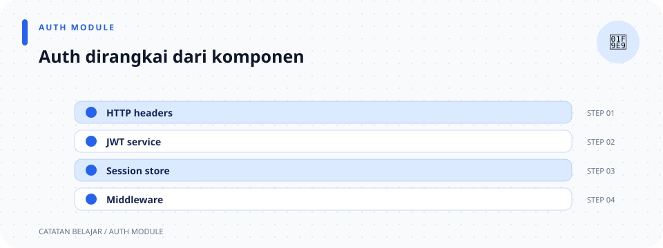

# `src/auth/mod.rs`

> **Navigasi:** [Indeks catatan](../../README.md) · [README proyek](../../../README.md) · [Endpoint API](../../../endpoin.md)




[Buka source](../../../src/auth/mod.rs)

## Gambaran singkat

Modul `auth` mengatur layanan autentikasi: menyiapkan akun admin, mendaftarkan akun, memeriksa username dan password, serta menyediakan middleware untuk melindungi request.

Modul ini tidak menangani query SQL secara langsung. Operasi tabel `users` diteruskan ke [user repository](../repositories/user-repository.md). Middleware autentikasi/otorisasi berada di [`middleware.rs`](middleware.md), pembentukan response HTTP berada di [`response.rs`](response.md), pengelolaan session berada di [`session.rs`](session.md), dan JWT HS256 berada di [`jwt.rs`](jwt.md).

```text
src/auth/
├── mod.rs         # Layanan akun dan pemeriksaan kredensial
├── middleware.rs  # Autentikasi JWT/session dan otorisasi role
├── session.rs     # Helper session
├── jwt.rs         # Penerbitan dan verifikasi JWT HS256
├── role.rs        # Jenis role dan kebijakan akses method/path
└── response.rs    # Pembentuk response JSON auth
```

## Di halaman ini

[Modul](#1-deklarasi-modul) · [Re-export](#2-import-dan-re-export) · [Seed akun](#3-siapkan_pengguna_admin) · [Registrasi](#4-daftarkan_pengguna) · [Verifikasi](#5-verifikasi_kredensial) · [Hash password](#6-hash-password) · [Alur ringkas](#ringkasan-alur)

## 1. Deklarasi modul

Di awal file:

```rust
pub mod middleware;
pub mod jwt;
pub mod role;
pub mod response;
pub mod session;
```

- `mod middleware;` mendaftarkan autentikasi request dan pemeriksaan izin role.
- `mod jwt;` memberi tahu Rust bahwa penerbitan dan verifikasi token ada di `jwt.rs`.
- `mod role;` mendaftarkan tipe `UserRole` dan aturan `boleh_mengakses`.
- `mod session;` memberi tahu Rust bahwa isi modul `session` ada di file `session.rs`.
- `mod response;` mendaftarkan helper response JSON yang digunakan handler dan middleware.
- `pub` membuat nama modul dapat diakses melalui jalur publik, misalnya `auth::response`.

Setiap modul memiliki tanggung jawab berbeda. Lihat [catatan middleware](middleware.md), [catatan response](response.md), [catatan `jwt.rs`](jwt.md) untuk access token, dan [catatan `session.rs`](session.md) untuk helper session.

## 2. Import dan re-export

```rust
use std::error::Error;
use sqlx::PgPool;
use crate::repositories::user_repository;

pub use middleware::wajibkan_autentikasi;
```

| Sintaks | Kegunaan |
| --- | --- |
| `use std::error::Error;` | Mengimpor trait `Error` dari pustaka standar Rust untuk menuliskan tipe error umum. |
| `use sqlx::PgPool;` | Mengimpor pool koneksi PostgreSQL yang dipakai untuk mengakses database. Pool mengelola koneksi agar dapat digunakan kembali. |
| `use crate::repositories::user_repository;` | Mengimpor modul repository user dari crate aplikasi ini. Modul tersebut menjalankan query ke tabel `users`. |
| `pub use middleware::wajibkan_autentikasi;` | Mengimpor sekaligus mengekspor ulang `wajibkan_autentikasi` dari modul `middleware`. Kode lain tetap dapat mengaksesnya melalui `auth::wajibkan_autentikasi`. |

`crate::` berarti jalur dimulai dari akar crate aplikasi ini. `use` membuat nama yang sering dipakai lebih ringkas. `pub use` juga menjadikan nama yang diimpor tersedia bagi pemanggil dari luar modul, sesuai batas visibilitas modul.

`use argon2::password_hash::{PasswordHasher, PasswordVerifier, ...}` juga membawa **trait** ke cakupan file. Trait mendefinisikan perilaku yang dapat dipakai pada tipe: `PasswordHasher` menyediakan `.hash_password(...)`, sedangkan `PasswordVerifier` menyediakan `.verify_password(...)`.

## 3. `siapkan_pengguna_admin`

Kode:

```rust
pub async fn siapkan_pengguna_admin(
    pool: &PgPool,
    username: &str,
    password: &str,
) -> Result<(), Box<dyn Error + Send + Sync>> {
    if verifikasi_kredensial(pool, username, password).await? {
        user_repository::ubah_peran_pengguna(pool, username, UserRole::Admin).await?;
        return Ok(());
    }

    let password_hash = buat_hash_kata_sandi(password).await?;
    user_repository::simpan_atau_perbarui_pengguna(pool, username, &password_hash, UserRole::Admin).await?;
    Ok(())
}
```

### Tujuan penyiapan akun admin

Fungsi ini menyiapkan akun admin dari konfigurasi saat startup. Jika password konfigurasi cocok dengan hash yang ada, fungsi memastikan rolenya `Admin` lalu selesai. Jika username belum ada atau password berbeda, password baru di-hash dengan Argon2id dan akun di-upsert sebagai admin. Mengubah password melalui upsert repository juga menaikkan versi token. Fungsi mengembalikan `Result<(), ...>`: sukses tanpa nilai tambahan atau error konfigurasi/hash/database.

### Cara membaca deklarasinya

- `pub` membuat fungsi bisa dipanggil dari bagian lain crate maupun pemakai crate melalui jalur publik.
- `async` menandai fungsi asinkron. Operasi database dapat menunggu I/O tanpa memblokir thread secara langsung.
- `fn siapkan_pengguna_admin` mendeklarasikan fungsi bernama `siapkan_pengguna_admin`.
- `pool: &PgPool` adalah referensi ke pool koneksi; tanda `&` berarti fungsi meminjamnya, bukan mengambil alih kepemilikannya.
- `username: &str` dan `password: &str` adalah referensi ke teks username dan password.
- `-> Result<(), Box<dyn Error + Send + Sync>>` berarti fungsi dapat berhasil tanpa mengembalikan data (`()`), atau gagal dengan error umum.
  - `Result<T, E>` mewakili hasil yang bisa sukses (`Ok(T)`) atau gagal (`Err(E)`).
  - `Box<dyn Error ...>` memungkinkan beragam jenis error disimpan melalui satu tipe error umum.
  - `Send + Sync` menyatakan syarat agar error aman dipindahkan dan dibagikan antar-thread, sesuai kebutuhan aplikasi asinkron.

### Cara membaca isi fungsi

1. `verifikasi_kredensial(...)` mempertahankan hash lama jika password admin masih cocok.
2. `buat_hash_kata_sandi(...)` menghasilkan hash Argon2id baru jika akun perlu dibuat atau password berubah.
3. `user_repository::simpan_atau_perbarui_pengguna(..., UserRole::Admin)` menyimpan hash dan role melalui query berparameter.
4. `Ok(())` menyatakan sinkronisasi akun selesai sukses.

Fungsi ini dipanggil saat startup setelah migration dan migrasi password lama selesai. Repository memakai `ON CONFLICT` sehingga username yang sudah ada tidak dibuat sebagai baris duplikat.

## 4. `daftarkan_pengguna`

Kode:

```rust
pub async fn daftarkan_pengguna(
    pool: &PgPool,
    username: &str,
    password: &str,
) -> Result<bool, Box<dyn Error + Send + Sync>> {
    daftarkan_pengguna_dengan_peran(pool, username, password, UserRole::Buyer).await
}
```

Fungsi publik ini memilih role default `Buyer`, lalu mendelegasikan pekerjaan ke `daftarkan_pengguna_dengan_peran`. Fungsi tidak meng-hash password secara langsung; helper berikut yang melakukannya. Pemisahan ini mencegah endpoint registrasi umum menentukan role admin.

- Parameter `pool`, `username`, dan `password` memiliki arti yang sama seperti di `siapkan_pengguna_admin`.
- `Result<bool, Box<dyn Error + Send + Sync>>` menyatakan ada dua tingkat hasil:
  - `Ok(true)`: akun berhasil dibuat.
  - `Ok(false)`: username sudah digunakan, jadi tidak ada akun baru yang dibuat.
  - `Err(error)`: hashing atau query database gagal.
- `.await` menunggu fungsi asinkron yang didelegasikan selesai.

Baris terakhir tidak diakhiri titik koma, sehingga `Result<bool, ...>` langsung menjadi hasil fungsi.

### `daftarkan_pengguna_dengan_peran(pool, username, password, role)`

Fungsi asinkron ini meng-hash password, lalu memanggil `user_repository::simpan_pengguna_baru` dengan role tepercaya yang diberikan pemanggil. Hasil `bool` menyatakan apakah username berhasil dibuat (`true`) atau sudah digunakan (`false`); error hashing/query menjadi `Err`. Role harus dipilih oleh pemanggil tepercaya, bukan diterima bebas dari endpoint registrasi publik.

## 5. `verifikasi_kredensial`

Kode:

```rust
pub async fn verifikasi_kredensial(
    pool: &PgPool,
    username: &str,
    password: &str,
) -> Result<bool, Box<dyn Error + Send + Sync>> {
    let Some(password_hash) = user_repository::cari_hash_kata_sandi(pool, username).await? else {
        return Ok(false);
    };

    verifikasi_kata_sandi(password_hash, password).await
}
```

### Tujuannya

Fungsi ini mencari password yang tersimpan untuk username yang diberikan, lalu membandingkannya dengan password dari request.

### Alur baris demi baris

1. `user_repository::cari_hash_kata_sandi(pool, username)` meminta repository mencari hash berdasarkan username.
2. `.await` menunggu query database selesai.
3. `?` meneruskan error database ke pemanggil jika query gagal.
4. Hasil query berbentuk `Option<String>`:
   - `Some(password_hash)` berarti username ditemukan.
   - `None` berarti username tidak ditemukan.
5. Sintaks `let Some(password_hash) = ... else { ... };` adalah *let-else*. Jika hasilnya `Some`, hash dimasukkan ke `password_hash` dan fungsi melanjutkan. Jika hasilnya `None`, blok `else` dijalankan.
6. `return Ok(false);` menghentikan fungsi dengan hasil “kredensial tidak cocok”. Username yang tidak ditemukan bukan error database.
7. Jika username ditemukan, `verifikasi_kata_sandi(...)` menjalankan verifikasi Argon2id pada blocking thread.
8. `Ok(...)` membungkus hasil pemeriksaan sebagai keberhasilan fungsi. Nilai `false` di dalam `Ok` artinya kredensialnya tidak cocok.

Jadi `Ok(false)` berbeda dari `Err(error)`: yang pertama berarti login tidak cocok secara normal, sedangkan yang kedua berarti pemeriksaan gagal karena masalah seperti error database.

## Migrasi password lama

`migrasikan_kata_sandi_lama(pool) -> Result<(), Box<dyn Error + Send + Sync>>` mengamankan perubahan password lama secara berurutan:

1. Meminjam satu koneksi dan memperoleh PostgreSQL advisory lock bernama tetap agar dua proses startup tidak memigrasikan password bersamaan.
2. Menjalankan `migrasikan_kata_sandi_lama_dengan_lock(pool)`, yang memeriksa apakah kolom password legacy masih ada. Jika ada, fungsi membaca pasangan ID/password, meng-hash tiap password, lalu mengganti nilainya dengan hash.
3. Memanggil `tuntaskan_migrasi_hash_kata_sandi` untuk menyelesaikan pembersihan kolom lama.
4. Selalu berusaha melepas lock, lalu memakai `match (migration_result, unlock_result)` untuk menangani hasil migrasi dan unlock secara terpisah. Jika kedua langkah gagal, error gabungan menjelaskan keduanya.

Helper privat `migrasikan_kata_sandi_lama_dengan_lock(pool)` menjalankan langkah migrasi tanpa mengambil lock sendiri: ia berhenti cepat jika kolom legacy sudah tidak ada; jika masih ada, ia mengambil password lama, membuat hash baru satu per satu, mengganti password per ID, lalu meminta repository menyelesaikan migrasi kolom. Helper ini privat karena hanya dipanggil saat lock sudah dipegang.

`match` mencocokkan pola dari nilai `Result`/tuple: `Err(error)` membawa nilai error ke dalam binding, sedangkan `Ok(())` berarti sukses tanpa nilai tambahan. Operator `?` pada operasi database menghentikan fungsi pada error dan mengubahnya ke tipe error umum yang dapat dikembalikan.

## 6. Hash password

`buat_hash_kata_sandi(password: &str) -> Result<String, ...>` menghasilkan salt acak baru untuk tiap password dan menggunakan `Argon2::default()` (Argon2id). `verifikasi_kata_sandi(password_hash: String, password: &str) -> Result<bool, ...>` menolak password kosong, mem-parsing hash, lalu membandingkan password menggunakan verifier Argon2. Keduanya menggunakan `spawn_blocking` agar kerja CPU tidak menghambat runtime async. `password.to_owned()` membuat `String` milik sendiri agar data dapat dipindahkan ke closure; `move` memindahkan nilai tersebut ke closure. `.await??` berarti menunggu task lalu meneruskan dua kemungkinan error: error join task dan error Argon2.

Attribute `#[cfg(test)]` menyertakan modul test hanya saat `cargo test`; `#[tokio::test]` menyediakan runtime async untuk test fungsi `async`. `AuthIdentity` berada di middleware, sedangkan `SessionIdentity` berada di session; keduanya meminta compiler membuat trait `Clone` dan `Debug`.

## 7. Unit test

Di bagian akhir file:

```rust
#[cfg(test)]
mod tests {
    #[tokio::test]
    async fn argon2_password_hash_is_salted_and_verifies_only_matching_password() {
        let hash = super::buat_hash_kata_sandi("secret").await.unwrap();
        let another_hash = super::buat_hash_kata_sandi("secret").await.unwrap();
        assert_ne!(hash, another_hash);
        assert!(hash.starts_with("$argon2id$"));
        assert!(super::verifikasi_kata_sandi(hash.clone(), "secret").await.unwrap());
        assert!(!super::verifikasi_kata_sandi(hash, "wrong").await.unwrap());
    }
}
```

- `#[cfg(test)]` membuat modul test ini dikompilasi saat test dijalankan, bukan sebagai bagian dari aplikasi normal.
- `mod tests` mengelompokkan test untuk modul ini.
- `#[tokio::test]` menandai fungsi asinkron sebagai unit test.
- `assert!(...)` membuat test gagal jika kondisi di dalamnya bernilai `false`.
- Test membuat hash Argon2id, memastikan password yang benar diterima dan password yang salah ditolak.

Test juga membuat dua hash dari password yang sama dan memastikan salt acak menghasilkan hash berbeda.

## Ringkasan alur

```text
Startup ──> siapkan_pengguna_admin ──> upsert akun admin di database

Registrasi ──> daftarkan_pengguna ──> coba insert akun baru
                                ├─ Ok(true): berhasil dibuat
                                ├─ Ok(false): username sudah dipakai
                                └─ Err: ada masalah database

Login ──> verifikasi_kredensial ──> cari password ──> bandingkan
                                ├─ Ok(true): cocok
                                ├─ Ok(false): username/password tidak cocok
                                └─ Err: pemeriksaan mengalami error
```
