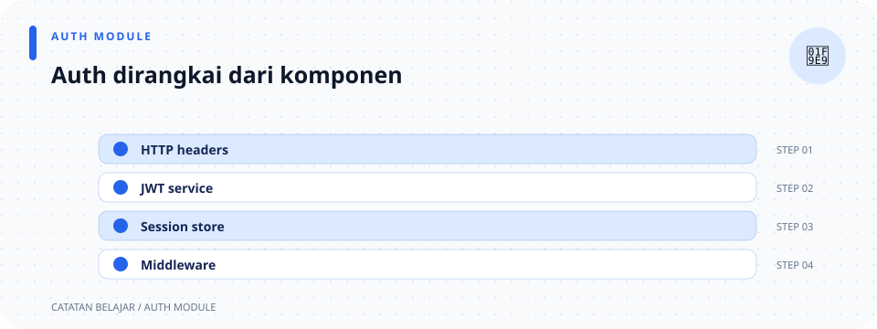

# `src/auth/mod.rs`

> **Navigasi:** [Indeks catatan](../../README.md) · [README proyek](../../../README.md) · [Endpoint API](../../../endpoin.md)




[Buka source](../../../src/auth/mod.rs)

## Gambaran singkat

Modul `auth` mengatur layanan autentikasi: menyiapkan akun admin, mendaftarkan akun, memeriksa username dan password, serta menyediakan middleware untuk melindungi request.

Modul ini tidak menangani query SQL secara langsung. Operasi tabel `users` diteruskan ke [user repository](../repositories/user-repository.md). Pembuatan response HTTP auth berada di [`http.rs`](http.md), pengelolaan session berada di [`session.rs`](session.md), dan JWT HS256 berada di [`jwt.rs`](jwt.md).

```text
src/auth/
├── mod.rs      # Layanan akun dan pemeriksaan kredensial
├── http.rs     # Pembentuk response JSON auth
├── jwt.rs      # Penerbitan dan verifikasi JWT HS256
└── session.rs  # Helper session dan middleware autentikasi
```

## Di halaman ini

[Modul](#1-deklarasi-modul) · [Re-export](#2-import-dan-re-export) · [Seed akun](#3-initialize_admin_user) · [Registrasi](#4-register_user) · [Verifikasi](#5-verify_credentials) · [Hash password](#6-hash-password) · [Alur ringkas](#ringkasan-alur)

## 1. Deklarasi modul

Di awal file:

```rust
pub mod http;
pub mod jwt;
pub mod session;
```

- `mod http;` memberi tahu Rust bahwa isi modul `http` ada di file `http.rs`.
- `mod jwt;` memberi tahu Rust bahwa penerbitan dan verifikasi token ada di `jwt.rs`.
- `mod session;` memberi tahu Rust bahwa isi modul `session` ada di file `session.rs`.
- `pub` membuat nama modul dapat diakses melalui jalur publik, misalnya `auth::http`.

Setiap modul memiliki tanggung jawab berbeda. Lihat [catatan `http.rs`](http.md) untuk response JSON, [catatan `jwt.rs`](jwt.md) untuk access token, dan [catatan `session.rs`](session.md) untuk session serta pemeriksaan login.

## 2. Import dan re-export

```rust
use std::error::Error;
use sqlx::PgPool;
use crate::repositories::user_repository;

pub use session::require_auth;
```

| Sintaks | Kegunaan |
| --- | --- |
| `use std::error::Error;` | Mengimpor trait `Error` dari pustaka standar Rust untuk menuliskan tipe error umum. |
| `use sqlx::PgPool;` | Mengimpor pool koneksi PostgreSQL yang dipakai untuk mengakses database. Pool mengelola koneksi agar dapat digunakan kembali. |
| `use crate::repositories::user_repository;` | Mengimpor modul repository user dari crate aplikasi ini. Modul tersebut menjalankan query ke tabel `users`. |
| `pub use session::require_auth;` | Mengimpor sekaligus mengekspor ulang `require_auth` dari modul `session`. Kode lain dapat mengaksesnya melalui `auth::require_auth`, tanpa menulis `auth::session::require_auth`. |

`crate::` berarti jalur dimulai dari akar crate aplikasi ini. `use` membuat nama yang sering dipakai lebih ringkas. `pub use` juga menjadikan nama yang diimpor tersedia bagi pemanggil dari luar modul, sesuai batas visibilitas modul.

## 3. `initialize_admin_user`

Kode:

```rust
pub async fn initialize_admin_user(
    pool: &PgPool,
    username: &str,
    password: &str,
) -> Result<(), Box<dyn Error + Send + Sync>> {
    if verify_credentials(pool, username, password).await? {
        return Ok(());
    }

    let password_hash = hash_password(password).await?;
    user_repository::upsert_user(pool, username, &password_hash).await?;
    Ok(())
}
```

### Tujuan penyiapan akun admin

Fungsi ini menyiapkan akun admin dari konfigurasi saat startup. Jika password konfigurasi sama dengan hash yang ada, akun tidak diubah. Jika berbeda atau akun belum ada, password di-hash dengan Argon2id lalu disimpan; perubahan password mencabut token lama.

### Cara membaca deklarasinya

- `pub` membuat fungsi bisa dipanggil dari bagian lain crate maupun pemakai crate melalui jalur publik.
- `async` menandai fungsi asinkron. Operasi database dapat menunggu I/O tanpa memblokir thread secara langsung.
- `fn initialize_admin_user` mendeklarasikan fungsi bernama `initialize_admin_user`.
- `pool: &PgPool` adalah referensi ke pool koneksi; tanda `&` berarti fungsi meminjamnya, bukan mengambil alih kepemilikannya.
- `username: &str` dan `password: &str` adalah referensi ke teks username dan password.
- `-> Result<(), Box<dyn Error + Send + Sync>>` berarti fungsi dapat berhasil tanpa mengembalikan data (`()`), atau gagal dengan error umum.
  - `Result<T, E>` mewakili hasil yang bisa sukses (`Ok(T)`) atau gagal (`Err(E)`).
  - `Box<dyn Error ...>` memungkinkan beragam jenis error disimpan melalui satu tipe error umum.
  - `Send + Sync` menyatakan syarat agar error aman dipindahkan dan dibagikan antar-thread, sesuai kebutuhan aplikasi asinkron.

### Cara membaca isi fungsi

1. `verify_credentials(...)` mempertahankan hash lama jika password admin masih cocok.
2. `hash_password(...)` menghasilkan hash Argon2id baru jika akun perlu dibuat atau password berubah.
3. `user_repository::upsert_user(...)` menyimpan hash melalui query berparameter.
4. `Ok(())` menyatakan sinkronisasi akun selesai sukses.

Fungsi ini dipanggil saat startup setelah database siap. Repository memakai `ON CONFLICT` sehingga username yang sudah ada tidak dibuat sebagai baris duplikat.

## 4. `register_user`

Kode:

```rust
pub async fn register_user(
    pool: &PgPool,
    username: &str,
    password: &str,
) -> Result<bool, Box<dyn Error + Send + Sync>> {
    let password_hash = hash_password(password).await?;
    Ok(user_repository::insert_user(pool, username, &password_hash).await?)
}
```

Fungsi ini meng-hash password terlebih dahulu, lalu mencoba membuat akun tanpa menimpa username yang sudah digunakan.

- Parameter `pool`, `username`, dan `password` memiliki arti yang sama seperti di `initialize_admin_user`.
- `Result<bool, Box<dyn Error + Send + Sync>>` menyatakan ada dua tingkat hasil:
  - `Ok(true)`: akun berhasil dibuat.
  - `Ok(false)`: username sudah digunakan, jadi tidak ada akun baru yang dibuat.
  - `Err(error)`: hashing atau query database gagal.
- `user_repository::insert_user(...)` menjalankan operasi insert.
- `.await` menunggu query selesai.

Baris terakhir tidak diakhiri titik koma, sehingga hasil repository langsung menjadi hasil fungsi. Tidak diperlukan `?` atau `Ok(...)` tambahan karena tipe hasil repository sama dengan tipe hasil fungsi ini.

## 5. `verify_credentials`

Kode:

```rust
pub async fn verify_credentials(
    pool: &PgPool,
    username: &str,
    password: &str,
) -> Result<bool, Box<dyn Error + Send + Sync>> {
    let Some(password_hash) = user_repository::find_password_hash(pool, username).await? else {
        return Ok(false);
    };

    verify_password(password_hash, password).await
}
```

### Tujuannya

Fungsi ini mencari password yang tersimpan untuk username yang diberikan, lalu membandingkannya dengan password dari request.

### Alur baris demi baris

1. `user_repository::find_password_hash(pool, username)` meminta repository mencari hash berdasarkan username.
2. `.await` menunggu query database selesai.
3. `?` meneruskan error database ke pemanggil jika query gagal.
4. Hasil query berbentuk `Option<String>`:
   - `Some(password_hash)` berarti username ditemukan.
   - `None` berarti username tidak ditemukan.
5. Sintaks `let Some(password_hash) = ... else { ... };` adalah *let-else*. Jika hasilnya `Some`, hash dimasukkan ke `password_hash` dan fungsi melanjutkan. Jika hasilnya `None`, blok `else` dijalankan.
6. `return Ok(false);` menghentikan fungsi dengan hasil “kredensial tidak cocok”. Username yang tidak ditemukan bukan error database.
7. Jika username ditemukan, `verify_password(...)` menjalankan verifikasi Argon2id pada blocking thread.
8. `Ok(...)` membungkus hasil pemeriksaan sebagai keberhasilan fungsi. Nilai `false` di dalam `Ok` artinya kredensialnya tidak cocok.

Jadi `Ok(false)` berbeda dari `Err(error)`: yang pertama berarti login tidak cocok secara normal, sedangkan yang kedua berarti pemeriksaan gagal karena masalah seperti error database.

## 6. Hash password

`hash_password` menghasilkan salt acak baru untuk tiap password dan menggunakan `Argon2::default()` (Argon2id). Hash dalam format PHC disimpan di database, bukan password asli. `verify_password` mem-parsing hash lalu membandingkan password menggunakan verifier Argon2. Kedua operasi dijalankan dengan `tokio::task::spawn_blocking` agar perhitungan CPU tidak menghambat runtime async.

## 7. Unit test

Di bagian akhir file:

```rust
#[cfg(test)]
mod tests {
    #[tokio::test]
    async fn argon2_password_hash_is_salted_and_verifies_only_matching_password() {
        let hash = super::hash_password("secret").await.unwrap();
        let another_hash = super::hash_password("secret").await.unwrap();
        assert_ne!(hash, another_hash);
        assert!(hash.starts_with("$argon2id$"));
        assert!(super::verify_password(hash.clone(), "secret").await.unwrap());
        assert!(!super::verify_password(hash, "wrong").await.unwrap());
    }
}
```

- `#[cfg(test)]` membuat modul test ini dikompilasi saat test dijalankan, bukan sebagai bagian dari aplikasi normal.
- `mod tests` mengelompokkan test untuk modul ini.
- `#[tokio::test]` menandai fungsi asinkron sebagai unit test.
- `assert!(...)` membuat test gagal jika kondisi di dalamnya bernilai `false`.
- Test membuat hash Argon2id, memastikan password yang benar diterima dan password yang salah ditolak.

Test juga membuat dua hash dari password yang sama dan memastikan salt acak menghasilkan hash berbeda.

## Ringkasan alur

```text
Startup ──> initialize_admin_user ──> upsert akun admin di database

Registrasi ──> register_user ──> coba insert akun baru
                                ├─ Ok(true): berhasil dibuat
                                ├─ Ok(false): username sudah dipakai
                                └─ Err: ada masalah database

Login ──> verify_credentials ──> cari password ──> bandingkan
                                ├─ Ok(true): cocok
                                ├─ Ok(false): username/password tidak cocok
                                └─ Err: pemeriksaan mengalami error
```
