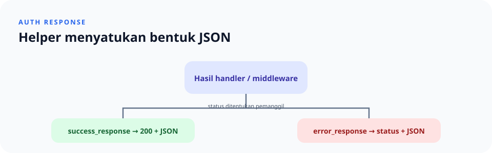

# `src/auth/response.rs`

> **Navigasi:** [Indeks catatan](../../README.md) · [README proyek](../../../README.md) · [Endpoint API](../../../endpoin.md)

[Buka source `response.rs`](../../../src/auth/response.rs)

## Tanggung jawab

Modul ini menyediakan helper pembentuk response HTTP JSON untuk handler dan middleware autentikasi.

| Helper | Dipakai saat | Status |
| --- | --- | --- |
| `error_response(status, message)` | Proses gagal | Ditentukan pemanggil |
| `success_response(body)` | Proses berhasil | `200 OK` |

Kedua fungsi mengubah data menjadi `axum::response::Response`. Helper error menghasilkan JSON dengan field `status: "error"` dan `message`; helper sukses mengirim nilai JSON yang diberikan. Bentuk response ini dipertahankan agar perubahan lokasi modul tidak mengubah kontrak API.
