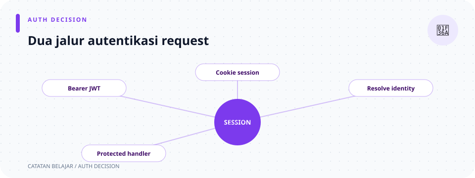

# `src/auth/session.rs`

> **Navigasi:** [Indeks catatan](../../README.md) · [README proyek](../../../README.md) · [Endpoint API](../../../endpoin.md)




[Buka source `session.rs`](../../../src/auth/session.rs)

## Tujuan

File ini mengelola identitas session dan middleware autentikasi untuk endpoint yang memerlukan login. Middleware menerima cookie session atau JWT bearer yang belum kedaluwarsa maupun dicabut.

## Di halaman ini

[Alur login](#alur-autentikasi) · [Helper session](#helper-session) · [Middleware](#middleware-require_auth) · [Batasan store](#penyimpanan-dan-batasannya) · [Contoh curl](#contoh-memakai-cookie) · [File terkait](#file-terkait)

| Bagian | Tugas |
| --- | --- |
| `SESSION_USERNAME_KEY` | Menyamakan nama key username di session. |
| `start_session` | Mengganti ID session setelah login dan menyimpan username. |
| `session_identity` | Membaca username dari session request. |
| `clear_session` | Menghapus isi session dan record pada store. |
| `require_auth` | Meloloskan request dengan JWT atau session yang cocok dengan pengguna di database. |

## Alur autentikasi

```text
Login berhasil
  ├─ start_session: ganti ID session dan simpan username
  └─ handler menerbitkan JWT
       ↓
Request ke endpoint protected
  ├─ JWT valid + ID dan role cocok → teruskan request
  └─ JWT tidak ada/tidak valid → periksa username pada session
       ├─ username masih ada → teruskan request dengan role terbaru
       └─ session kosong/kedaluwarsa/dicabut → 401 Unauthorized
```

JWT diperiksa lebih dulu. Jika signature dan expiry valid, middleware mencari user berdasarkan ID `sub` lalu mencocokkan `role` dan `token_version` dengan database. Proyek ini tidak menyimpan atau memeriksa `jti`/daftar token yang dicabut. Jika JWT tidak ada, tidak valid, atau identitasnya tidak cocok, middleware mencoba session cookie dan mencari user berdasarkan username. Kegagalan teknis saat membaca session atau database menghasilkan `500`; tidak adanya identitas menghasilkan `401`. Role yang dikenali tetapi tidak diizinkan untuk URL/method tersebut menghasilkan `403`.

## Import dan konstanta

```rust
use axum::{
    extract::{Extension, Request, State},
    http::StatusCode,
    middleware::Next,
    response::Response,
};
use tower_sessions::Session;
use sqlx::PgPool;

use super::{http::error_response, jwt::JwtService};

pub const SESSION_USERNAME_KEY: &str = "username";
```

- `Extension<JwtService>` menerima verifier JWT yang dipasang router.
- `State<PgPool>` menyediakan database untuk memeriksa pengguna, role, dan `token_version`.
- `Request` dan `Next` mewakili request saat ini dan langkah handler berikutnya.
- `Session` memberi akses ke session server-side untuk request ini.
- `error_response` membentuk body JSON error yang seragam.
- `SESSION_USERNAME_KEY` menjaga agar semua fungsi memakai ejaan key yang sama.

## Helper session

### `start_session(session, username)`

```rust
session.cycle_id().await?;
session.insert(SESSION_USERNAME_KEY, username).await
```

Signature-nya meminjam `session: &Session` dan `username: &str`, lalu mengembalikan `Result<(), tower_sessions::session::Error>`. Fungsi ini dipanggil setelah kredensial cocok. `cycle_id()` mengganti ID session untuk mengurangi risiko session fixation. Sesudah itu, `insert` menyimpan username dengan key konstan. `.await` menunggu operasi asinkron; `?` langsung mengembalikan error jika operasi gagal. Baris terakhir tidak memakai `?`, sehingga hasil `insert` (yang juga `Result`) langsung dikembalikan.

### `session_identity(session)`

Fungsi asinkron ini mengembalikan `Result<Option<SessionIdentity>, Error>`: `Err` berarti kegagalan membaca store, `Ok(None)` berarti belum ada username, dan `Ok(Some(...))` berarti identitas ditemukan. Pola `let Some(username) = ... else { ... }` mengambil nilai dari `Some` atau segera mengembalikan `Ok(None)`. `SessionIdentity` membungkus username agar tipe identitas session terpisah dari data akun database.

### `clear_session(session)`

Memanggil `session.flush()` untuk menghapus data session aktif dari store dan membersihkan session request. Signature-nya mengembalikan `Result<(), Error>`, jadi kegagalan flush diteruskan ke handler logout. Handler logout juga menaikkan `token_version` pengguna agar semua JWT lama pengguna ditolak.

## Middleware `require_auth`

Signature fungsi menerima extension JWT, session, request, dan `Next`, lalu selalu menghasilkan Axum `Response`.

1. `claims_from_headers` mengurai bearer token dan memverifikasi JWT. Fungsi ini menghasilkan `Option<Claims>`; JWT yang hilang/salah format/tidak valid menghasilkan `None`.
2. Bila claims ada, repository mencari user dari `sub`. Hanya jika user ditemukan dan role serta `token_version` cocok, middleware membuat `AuthIdentity`.
3. Jika langkah JWT tidak menghasilkan identitas, middleware membaca session, lalu mencari user berdasarkan username. Role diambil dari database, bukan dari session.
4. `match` membedakan identitas ada/tidak ada dan error. Request tanpa identitas menerima `401`; kesalahan database/session dicatat di log server dan menerima `500`.
5. `identity.role.can_access(method, path)` memeriksa otorisasi. Identitas valid tetapi role tidak berhak menerima `403`.
6. `request.extensions_mut().insert(identity)` memasang identitas yang sudah diverifikasi pada request. `next.run(request).await` meneruskan request ke handler berikutnya.

Parameter `State(pool)`, `Extension(jwt)`, dan `mut request` memakai pola destructuring: state/extension dikeluarkan dari pembungkusnya, sementara `mut` mengizinkan extension request dimodifikasi. `require_auth` mengembalikan `Response` langsung, bukan `Result`, sehingga setiap cabang error membangun response secara eksplisit.

`AuthIdentity` menyimpan `user_id`, `username`, dan role yang dipercaya setelah dicek ke database; `SessionIdentity` hanya membungkus username hasil baca session sebelum repository memastikan akun masih ada. Keduanya memiliki `#[derive(Clone, Debug)]`, yaitu attribute yang meminta compiler menghasilkan trait untuk menyalin nilai dan format debug. `SESSION_USERNAME_KEY` adalah `pub const`: konstanta teks bersama agar proses simpan dan baca session menggunakan key yang persis sama.

Role menentukan izin sesudah autentikasi: `Admin` boleh semua route protected; `Buyer` boleh membaca daftar/detail laptop dan mengelola session sendiri; `Restocker` boleh membaca laptop serta melakukan `PATCH` pada laptop. Route session/logout diizinkan untuk semua role. Aturan ini berada pada `UserRole::can_access`, bukan di helper session.

Middleware ini dipasang hanya pada grup route protected di [routes.rs](../routes.md). `/health`, registrasi, dan login tetap publik.

## Penyimpanan dan batasannya

Router memakai `MemoryStore`. Session akan hilang ketika server dimulai ulang dan tidak dibagikan ke instance aplikasi lain. Logout menaikkan `token_version` di PostgreSQL sehingga semua JWT lama pengguna langsung ditolak. Hanya session yang dipakai untuk logout yang dihapus; session cookie di perangkat lain tidak dicabut oleh mekanisme versi token.

## Contoh memakai cookie

`curl` dapat menyimpan cookie login ke file lalu mengirimkannya pada request berikutnya:

```bash
curl -i -c cookies.txt \
  -H 'Content-Type: application/json' \
  -d '{"username":"admin","password":"PASSWORD_LOKAL"}' \
  http://127.0.0.1:3001/api/auth/login

curl -i -b cookies.txt http://127.0.0.1:3001/api/laptops
```

File cookie berisi kredensial aktif. Jangan dibagikan atau dimasukkan ke version control. Contoh seluruh request tersedia di [panduan curl](../../curl.md).

## File terkait

- [Handler auth](../handlers/auth.md) memulai dan menghapus session.
- [JWT](jwt.md) menjelaskan pembuatan dan pemeriksaan bearer token.
- [Routes](../routes.md) memasang `require_auth` dan `SessionManagerLayer`.
- Source berisi unit test helper untuk menyimpan, membaca, dan membersihkan session.
