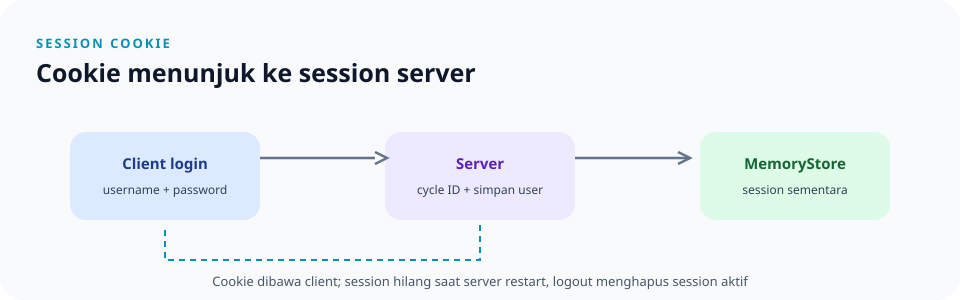

# `src/auth/session.rs`

> **Navigasi:** [Indeks catatan](../../README.md) · [README proyek](../../../README.md) · [Endpoint API](../../../endpoin.md)

[Buka source `session.rs`](../../../src/auth/session.rs)

## Tanggung jawab

File ini khusus mengelola session login melalui `tower-sessions`. Pemeriksaan JWT, autentikasi request, dan otorisasi role berada di [middleware](middleware.md).

| Item | Tugas |
| --- | --- |
| `SESSION_USERNAME_KEY` | Menyamakan nama key username dalam session. |
| `SessionIdentity` | Membungkus username hasil pembacaan session. |
| `start_session` | Mengganti ID session setelah login lalu menyimpan username. |
| `session_identity` | Membaca username dari session request. |
| `clear_session` | Menghapus data session aktif dari store. |

## Helper session

### `start_session(session, username)`

Fungsi ini memanggil `session.cycle_id()` sebelum menyimpan username menggunakan `SESSION_USERNAME_KEY`. Mengganti ID session setelah login membantu mencegah session pra-login dipakai kembali. Error dari operasi session diteruskan sebagai `tower_sessions::session::Error`.

### `session_identity(session)`

Fungsi asinkron ini mengembalikan `Result<Option<SessionIdentity>, Error>`:

- `Ok(None)` berarti belum ada username di session.
- `Ok(Some(identity))` berarti username ditemukan.
- `Err(error)` berarti terjadi kegagalan saat membaca session.

Username dari session belum membuktikan bahwa akun masih ada. Middleware memeriksanya lagi ke database sebelum meneruskan request.

### `clear_session(session)`

Memanggil `session.flush()` untuk menghapus session aktif dari store. Handler logout juga menaikkan `token_version` di database agar JWT lama pengguna ditolak.

## Penyimpanan session

Router memakai `MemoryStore`. Session akan hilang saat server dimulai ulang dan tidak dibagikan ke instance aplikasi lain. Logout menghapus session yang dipakai untuk logout; session cookie di perangkat lain tidak dicabut oleh mekanisme `token_version`.

Contoh login dan request dengan cookie tersedia di [panduan curl](../../curl.md). File cookie berisi kredensial aktif; jangan dibagikan atau dimasukkan ke version control.

## File terkait

- [Middleware](middleware.md) memeriksa identitas session/JWT dan izin role.
- [Handler auth](../handlers/auth.md) memulai session setelah login dan menghapusnya saat logout.
- [Routes](../routes.md) memasang `SessionManagerLayer`.
- Source memiliki unit test untuk menyimpan, membaca, dan membersihkan session.
