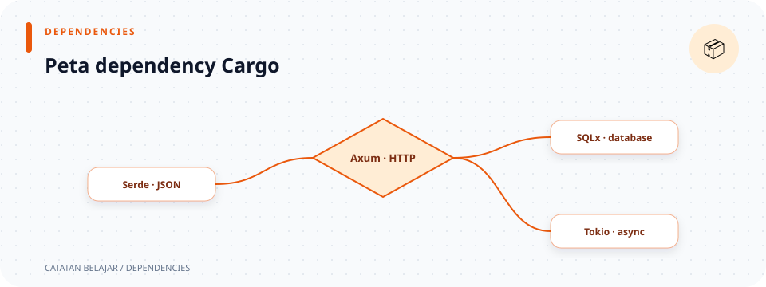

# `Cargo.toml`

> **Navigasi:** [Indeks catatan](../README.md) · [README proyek](../../README.md) · [Endpoint API](../../endpoin.md)




[Buka file `Cargo.toml`](../../Cargo.toml)

## Tanggung jawab file

`Cargo.toml` adalah manifest Cargo di root proyek: file yang memberi nama package, memilih edisi Rust, dan mencatat library yang perlu diunduh/dikompilasi. File ini tidak dijalankan saat request API datang, tetapi tanpa file ini Cargo tidak tahu cara membangun aplikasi.

## Peta dependency

```text
Cargo.toml
├── runtime/server : tokio + axum
├── database       : sqlx (PostgreSQL + migration)
├── data JSON      : serde + serde_json
├── auth           : tower-sessions + jsonwebtoken
└── konfigurasi    : dotenvy
```

`Cargo.lock` kemudian mengunci versi dependency yang benar-benar dipakai dalam build proyek ini.

## Bagian `[package]`

| Baris | Arti |
| --- | --- |
| `default-run = "toko_laptop_app"` | `cargo run` tanpa `--bin` memilih binary dengan nama ini. |
| `name = "toko_laptop_app"` | Nama package/crate. Nama ini dipakai oleh `main.rs` saat `use toko_laptop_app::{...}`. |
| `version = "0.1.0"` | Nomor versi package saat ini. Tidak mengubah perilaku API. |
| `edition = "2024"` | Memilih aturan bahasa Rust edisi 2024 untuk kompilasi. |

## Bagian `[dependencies]`

| Dependency | Versi/fitur | Dipakai di kode untuk |
| --- | --- | --- |
| `axum = "0.8.9"` | Versi 0.8.9 | `Router`, route, extractor `Json`/`Path`/`State`, response, dan menjalankan server. |
| `tokio` | `macros`, `rt-multi-thread`, `net` | `#[tokio::main]`, runtime async multi-thread, dan `TcpListener`. |
| `sqlx` | `default-features = false`; `runtime-tokio`, `tls-rustls`, `postgres`, `macros`, `migrate` | Pool PostgreSQL, query, `FromRow`, migrasi database, dan runtime koneksi. |
| `dotenvy = "0.15"` | Versi 0.15 | Membaca `.env` pada startup. |
| `serde` | fitur `derive` | Membuat derive `Deserialize` pada payload JSON. |
| `serde_json = "1"` | Versi major 1 | `Value` dan macro `json!` untuk response API. |
| `tower-sessions = "0.15.0"` | Store memory dan middleware Axum | Cookie session serta penyimpanan session server-side. |
| `jsonwebtoken = "9.3.1"` | JWT dengan dukungan HMAC | Menerbitkan dan memverifikasi access token HS256. |
| `tower` | dev dependency, fitur `util` | `ServiceExt::oneshot` untuk tes router HTTP. |

### Mengapa fitur SQLx ditulis khusus

`default-features = false` mematikan fitur bawaan SQLx yang tidak diperlukan. Daftar `features` lalu memilih kemampuan yang memang dipakai:

- `runtime-tokio`: SQLx berjalan pada runtime Tokio.
- `tls-rustls`: dukungan TLS memakai Rustls.
- `postgres`: mengaktifkan tipe dan driver PostgreSQL seperti `PgPool`.
- `macros`: mengaktifkan macro/derive SQLx, termasuk `FromRow` yang dipakai model.
- `migrate`: mengaktifkan macro migrasi yang menerapkan file di `database/migrations/` saat startup.

Autentikasi menerima session cookie atau JWT bearer HS256. Password disimpan plaintext hanya untuk latihan lokal. `tower` hanya diperlukan untuk tes. `Cargo.lock` di root menyimpan versi tepat dependency yang akhirnya dipilih Cargo.
