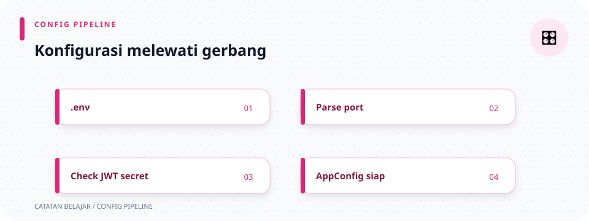

# `src/config.rs`

> **Navigasi:** [Indeks catatan](../README.md) · [README proyek](../../README.md) · [Endpoint API](../../endpoin.md)




[Buka kode sumber `config.rs`](../../src/config.rs)

## Tanggung jawab file

File ini menjadi satu tempat untuk membaca konfigurasi server dan PostgreSQL. `main.rs` tidak perlu mengetahui cara menyusun opsi SQLx atau nama setiap environment variable; ia cukup meminta `AppConfig` membaca konfigurasi dan membuka pool.

## Peta konfigurasi

```text
environment / .env
        ↓ from_env()
    AppConfig
      ├─ APP_HOST + APP_PORT → listener HTTP
      ├─ DB_* → PgPool → repositories
      ├─ ADMIN_* → users table saat startup
      └─ JWT_SECRET → JwtService pada router
```

## Di halaman ini

[Field konfigurasi](#struct-appconfig) · [Pembacaan berurutan](#uraian-kode-berurutan) · [Error konfigurasi](#bentuk-error-yang-mungkin) · [Hubungan file](#hubungan-dengan-file-lain)

## Bagian kode dan kegunaannya

| Bagian | Tanggung jawab |
| --- | --- |
| `use sqlx::postgres::{PgConnectOptions, PgPoolOptions}` | Membawa dua builder SQLx: satu untuk detail koneksi PostgreSQL, satu untuk pengaturan pool. |
| `use std::{env, error::Error, time::Duration}` | `env` membaca environment variable, `Error` menjadi tipe error umum, dan `Duration` menyatakan batas waktu. |
| `AppConfig` | Menyimpan nilai konfigurasi yang sudah dibaca. |
| `from_env` | Membaca dan mengubah teks environment menjadi `AppConfig`. |
| `connect_database` | Membuat `PgPool` dari konfigurasi database. |
| `initialize_admin_user` | Mendelegasikan seed akun awal ke modul auth. |
| `database_name` | Meminjam nama database untuk ditampilkan pada log startup. |

## Struct `AppConfig`

`AppConfig` menyimpan data berikut.

| Field | Tipe | Dari | Alasan |
| --- | --- | --- | --- |
| `app_host` | `String` | `APP_HOST` | Alamat yang dipakai listener HTTP, misalnya `127.0.0.1`. Bersifat `pub` karena dibaca `main.rs`. |
| `app_port` | `u16` | `APP_PORT` | Port server, misalnya `3000`. `u16` cocok karena port selalu bilangan positif dalam rentang kecil. Bersifat `pub`. |
| `session_cookie_secure` | `bool` | `SESSION_COOKIE_SECURE` | Mengaktifkan atribut `Secure` pada cookie; default `false` untuk HTTP lokal, wajib `true` bila memakai HTTPS. |
| `jwt_secret` | `String` | `JWT_SECRET` | Secret HMAC JWT; wajib minimal 32 byte dan tidak boleh dicatat ke log. |
| `db_host` | `String` | `DB_HOST` | Host PostgreSQL. Privat agar detail koneksi tetap dikelola file ini. |
| `db_port` | `u16` | `DB_PORT` | Port PostgreSQL. |
| `db_name` | `String` | `DB_NAME` | Nama database. |
| `db_user` | `String` | `DB_USER` | Pengguna PostgreSQL, bukan akun login aplikasi. |
| `db_password` | `String` | `DB_PASSWORD` | Kata sandi koneksi PostgreSQL. |
| `admin_username` | `String` | `ADMIN_USERNAME` | Username akun latihan yang disinkronkan ke tabel users saat startup. |
| `admin_password` | `String` | `ADMIN_PASSWORD` | Password akun latihan; modul auth meng-hash-nya dengan Argon2id sebelum menyimpan hash di database. Jangan gunakan konfigurasi akun latihan ini untuk produksi. |

`String` dipakai karena nilai dibaca dari environment dan kemudian dimiliki oleh struct. Field `db_*` tidak diberi `pub`, jadi modul lain tidak bisa mengakses detail koneksi langsung.

## Uraian kode berurutan

1. Dua baris `//!` di awal adalah dokumentasi modul. Baris kedua adalah tautan balik ke catatan ini.
2. Import `PgConnectOptions` dan `PgPoolOptions` membuat file dapat memakai builder SQLx tanpa menulis path yang panjang.
3. `pub struct AppConfig { ... }` mendefinisikan bentuk data konfigurasi. Kata `pub` pada nama struct membuat `main.rs` dapat memakai tipe ini.
4. `impl AppConfig` mengelompokkan fungsi yang bekerja untuk `AppConfig`.
5. `from_env() -> Result<Self, Box<dyn Error + Send + Sync>>` tidak menerima `self` karena ia membuat konfigurasi baru. `Self` pada hasil berarti `AppConfig`.
6. `SESSION_COOKIE_SECURE` dibaca sebagai boolean. Bila tidak ada, nilainya `false` agar cookie dapat dipakai selama pengembangan melalui HTTP lokal.
7. `JWT_SECRET` wajib memiliki minimal 32 byte agar kunci HMAC tidak memakai nilai pendek atau default yang diketahui.
8. `ADMIN_USERNAME` dan `ADMIN_PASSWORD` wajib tersedia serta tidak boleh kosong. Keduanya dipakai hanya saat seed akun awal; login selanjutnya memverifikasi data pada tabel users.
9. `env::var("APP_PORT")?.parse()?` membaca port sebagai teks, lalu mengubahnya ke `u16`. `?` pertama mengembalikan error bila variabel tidak ada; `?` kedua mengembalikan error bila isinya bukan angka port yang valid.
10. Pemanggilan `env::var` berikutnya membaca konfigurasi database. Tidak ada default, jadi aplikasi berhenti saat salah satunya tidak tersedia.
11. `initialize_admin_user()` mendelegasikan sinkronisasi username dan password akun latihan kepada modul auth setelah migration dijalankan oleh `main.rs`.
12. `connect_database(&self)` meminjam konfigurasi, sehingga isi `AppConfig` tetap dapat dipakai sesudah pool dibuat. Karena membuka koneksi jaringan, fungsi ini `async`.
13. `PgConnectOptions::new()` membuat opsi PostgreSQL kosong. Rangkaian `.host`, `.port`, `.database`, `.username`, dan `.password` mengisi nilai dari field privat.
14. `PgPoolOptions::new()` memulai pengaturan pool. `.max_connections(5)` membatasi maksimal lima koneksi database aktif. `.acquire_timeout(Duration::from_secs(10))` membuat request gagal bila menunggu koneksi pool lebih dari 10 detik.
15. `.connect_with(options).await` mencoba tersambung lalu mengembalikan `PgPool`. Jika gagal, hasilnya `Err(sqlx::Error)` untuk diteruskan ke `main.rs`.
16. `database_name(&self) -> &str` mengembalikan referensi ke teks `db_name`, bukan membuat salinan `String`. Fungsinya hanya dipakai untuk log.

## Bentuk error yang mungkin

- Environment variable wajib tidak ada → `from_env` mengembalikan error.
- `ADMIN_USERNAME` atau `ADMIN_PASSWORD` kosong → konfigurasi ditolak.
- `SESSION_COOKIE_SECURE` bukan boolean → konfigurasi ditolak.
- `JWT_SECRET` tidak tersedia atau kurang dari 32 byte → konfigurasi ditolak.
- `APP_PORT` atau `DB_PORT` bukan angka/di luar rentang `u16` → `.parse()` gagal.
- Host, port, kredensial, atau database PostgreSQL salah → `connect_database` mengembalikan `sqlx::Error`.

## Sintaks fungsi, hasil, dan peminjaman

- `from_env() -> Result<Self, Box<dyn Error + Send + Sync>>` adalah fungsi pembuat konfigurasi, bukan method pada instance: tidak ada parameter `self`. `Self` adalah singkatan dari `AppConfig`.
- `Result<T, E>` memiliki dua bentuk: `Ok(T)` untuk sukses dan `Err(E)` untuk gagal. Karena pembacaan beberapa variabel bisa gagal dengan jenis error berbeda, `Box<dyn Error + Send + Sync>` menyediakan satu tipe error umum.
- `env::var("APP_PORT")?.parse()?` memiliki dua operasi fallible. `?` pertama berhenti jika environment tidak tersedia; yang kedua jika string tidak bisa diubah menjadi `u16`. Pada keberhasilan, nilai di dalam `Ok` dipakai untuk langkah selanjutnya.
- `match env::var(...)` memeriksa varian `Result`: nilai yang ada diparse; `NotPresent` khusus untuk cookie mendapat default `false`; error lain dikembalikan. `match` harus mencakup semua pola yang mungkin.
- `connect_database(&self)` hanya meminjam konfigurasi agar kredensial tetap tersedia sesudah pool dibuat. `async` diperlukan karena koneksi adalah I/O; `.await` menunggu operasi tersebut.
- `database_name(&self) -> &str` mengembalikan referensi baca-saja ke nama database. Ini menghindari penyalinan `String` hanya untuk logging.

`env::var("APP_HOST").unwrap_or_else(...)` adalah satu-satunya nilai default host: closure hanya dijalankan ketika variabel tidak dapat dibaca. Jangan menyimpulkan bahwa variabel database atau JWT juga memiliki default.

Helper privat `required_non_empty_env(name: &str) -> Result<String, ...>` membaca variable wajib lalu menolak string kosong. Ia meminjam nama variabel tetapi mengembalikan `String` yang dimiliki, sehingga `AppConfig` dapat menyimpan nilainya. `Ok(value)` mengembalikan konfigurasi yang valid; `Err(...)` membawa error environment atau pesan validasi.

## Hubungan dengan file lain

`main.rs` memanggil `AppConfig::from_env()`, `connect_database()`, dan `initialize_admin_user()`. Pool dan secret JWT diberikan ke router; handler login membaca tabel users dan middleware memeriksa session atau JWT sebelum handler laptop. Detail endpoint ada di [routes](routes.md), [auth handler](handlers/auth.md), dan [handlers](handlers.md).
