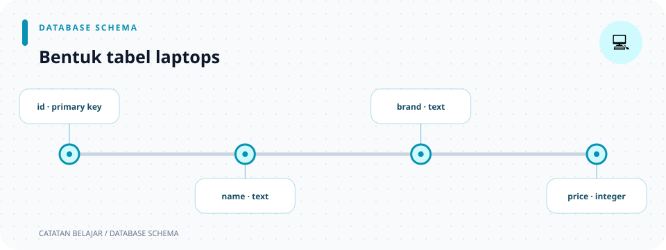

# `database/migrations/0001_create_laptops.sql`

> **Navigasi:** [Indeks catatan](../../README.md) · [README proyek](../../../README.md) · [Endpoint API](../../../endpoin.md)




[Buka file migration SQL](../../../database/migrations/0001_create_laptops.sql)

## Tanggung jawab file

Migration ini membuat tabel `public.laptops`, yaitu tabel yang dipakai semua query di [repositories](../repositories.md). File ini mendefinisikan bentuk data dan batasan terakhir di level PostgreSQL; validasi Rust tetap dilakukan lebih dulu agar client mendapat pesan error yang lebih jelas.

## Peta data

```text
laptops
├── id          → identitas baris
├── nama/merek  → teks wajib dengan batas panjang
├── harga/stok  → angka nol atau lebih
└── created_at / updated_at → waktu pencatatan
```

## Uraian SQL berurutan

1. Baris `-- Tabel utama ...` adalah komentar SQL. PostgreSQL mengabaikannya; komentar berikutnya menjelaskan harga dan timestamp dengan cara yang sama.
2. `CREATE TABLE IF NOT EXISTS public.laptops (` meminta PostgreSQL membuat tabel `laptops` dalam schema `public`, hanya jika tabel itu belum ada. Jika tabel sudah ada, perintah ini tidak menimpa atau memperbaiki struktur lama.
3. `id BIGINT GENERATED BY DEFAULT AS IDENTITY PRIMARY KEY` membuat ID bilangan besar. `IDENTITY` membuat PostgreSQL memberi nomor otomatis saat INSERT biasa; `PRIMARY KEY` membuat nilainya unik dan tidak boleh kosong.
4. `nama VARCHAR(150) NOT NULL` membatasi nama paling banyak 150 karakter dan melarang NULL.
5. `CHECK (LENGTH(BTRIM(nama)) > 0)` dijalankan database setelah nilai diterima. `BTRIM` membuang spasi pinggir; akibatnya nama yang hanya berisi spasi tetap ditolak.
6. `merek VARCHAR(100) NOT NULL` dan CHECK-nya menerapkan aturan yang sama untuk merek, dengan batas 100 karakter.
7. `harga BIGINT NOT NULL CHECK (harga >= 0)` menyimpan harga rupiah utuh dalam bilangan besar dan menolak angka negatif.
8. `stok INTEGER NOT NULL CHECK (stok >= 0)` menyimpan jumlah unit serta menolak stok negatif.
9. `created_at TIMESTAMPTZ NOT NULL DEFAULT CURRENT_TIMESTAMP` mengisi waktu saat baris dibuat bila INSERT tidak memberi nilai timestamp.
10. `updated_at TIMESTAMPTZ NOT NULL DEFAULT CURRENT_TIMESTAMP` memberi nilai awal waktu yang sama saat INSERT. Query PATCH di repository kemudian memperbaruinya dengan `CURRENT_TIMESTAMP`.
11. `);` menutup definisi tabel.

## Kolom tabel dan hubungannya ke kode

| Kolom | Tipe PostgreSQL | Dipakai oleh kode |
| --- | --- | --- |
| `id` | `BIGINT` | `Laptop.id: i64`, path URL, WHERE query. |
| `nama` | `VARCHAR(150)` | Payload, validasi teks, model, presenter. |
| `merek` | `VARCHAR(100)` | Payload, validasi teks, model, presenter. |
| `harga` | `BIGINT` | Payload `i64`, validasi angka, presenter Rupiah. |
| `stok` | `INTEGER` | Payload `i32`, validasi angka. |
| `created_at` | `TIMESTAMPTZ` | Diisi database, belum dipilih query API. |
| `updated_at` | `TIMESTAMPTZ` | Diisi database dan diperbarui query PATCH, belum dikirim API. |

## Mengapa validasi ada dua lapis

- [Validation Rust](../validation.md) menolak data lebih awal dan mengirim pesan JSON 400 yang mudah dibaca client.
- Constraint PostgreSQL menjaga data tetap valid bahkan bila suatu query datang bukan dari handler API.

Contoh: Rust menolak nama kosong setelah `trim`, sedangkan database punya `BTRIM` sebagai pengaman kedua. Kode aktif tidak membuat trigger atau function PostgreSQL; `updated_at` diperbarui langsung dalam query UPDATE.
