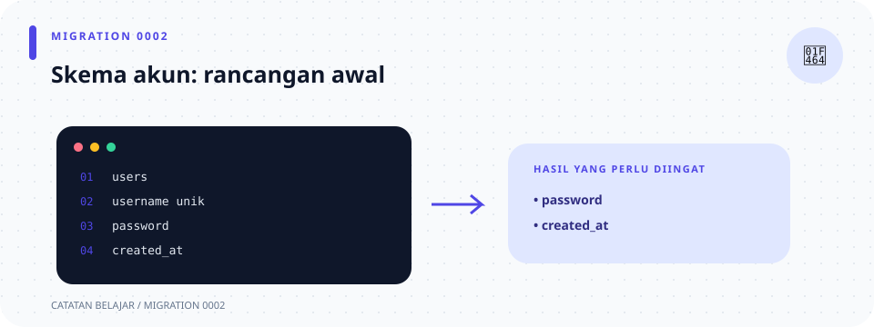

# `database/migrations/0002_create_users.sql` (skema awal)

> **Navigasi:** [Indeks catatan](../../README.md) · [README proyek](../../../README.md) · [Endpoint API](../../../endpoin.md)




[Buka file migration SQL](../../../database/migrations/0002_create_users.sql)

## Tanggung jawab

Migration ini awalnya menyiapkan tabel akun aplikasi `public.users`. SQLx menjalankan file migration yang belum tercatat pada startup dan menyimpan statusnya di tabel `_sqlx_migrations`.

## Kolom tabel

| Kolom | Tipe PostgreSQL | Kegunaan |
| --- | --- | --- |
| `id` | `BIGINT` identity | Primary key akun. |
| `username` | `VARCHAR(100)` | Username unik, tidak boleh kosong. |
| `password_hash` | `TEXT` | Kolom pada skema awal. Diganti menjadi `password` oleh migration [0003](0003-plaintext-password.md). |
| `created_at` | `TIMESTAMPTZ` | Waktu akun dibuat. |

## Membaca SQL

```sql
CREATE TABLE IF NOT EXISTS public.users (
    id BIGINT GENERATED BY DEFAULT AS IDENTITY PRIMARY KEY,
    username VARCHAR(100) NOT NULL UNIQUE
        CHECK (LENGTH(BTRIM(username)) > 0),
    password_hash TEXT NOT NULL,
    created_at TIMESTAMPTZ NOT NULL DEFAULT CURRENT_TIMESTAMP
);
```

- `CREATE TABLE` membuat tabel. `IF NOT EXISTS` mencegah error bila tabel dengan nama itu sudah ada; perintah ini tidak memperbaiki tabel lama yang strukturnya berbeda.
- `public.users` menunjuk tabel `users` pada schema `public`.
- `BIGINT` menyimpan bilangan besar. `GENERATED BY DEFAULT AS IDENTITY` membuat ID otomatis bila insert tidak menyertakan ID. `PRIMARY KEY` menandai ID unik yang tidak boleh `NULL`.
- `VARCHAR(100)` menyimpan teks dengan batas 100 karakter.
- `NOT NULL` mewajibkan kolom memiliki nilai. `UNIQUE` melarang dua akun memakai username yang sama.
- `CHECK (LENGTH(BTRIM(username)) > 0)` memastikan username tidak menjadi kosong setelah spasi pinggir dibuang. `BTRIM` menghapus spasi di pinggir; `LENGTH` menghitung panjang hasilnya.
- `TEXT` menyimpan teks tanpa batas panjang yang ditetapkan di tipe kolom. `password_hash` adalah nama kolom skema awal.
- `TIMESTAMPTZ` menyimpan timestamp dengan zona waktu. `DEFAULT CURRENT_TIMESTAMP` mengisi waktu saat ini jika INSERT tidak memberi nilai.
- Koma memisahkan definisi kolom/constraint, sedangkan `);` menutup definisi tabel dan mengakhiri perintah.

Migration ini sudah mungkin tercatat pada database yang telah dijalankan. Jangan mengubah file migration lama; skema saat ini kemudian diubah oleh migration [0003](0003-plaintext-password.md), [0004](0004-add-auth-version.md), dan [0005](0005-hash-user-passwords.md).

## Ilustrasi perubahan skema

```text
0002: users(id, username, password_hash, created_at)
                         ↓ migration 0003
      users(id, username, password, created_at)
                         ↓ migration 0005 + startup
      users(id, username, password_hash, role, created_at)
```
