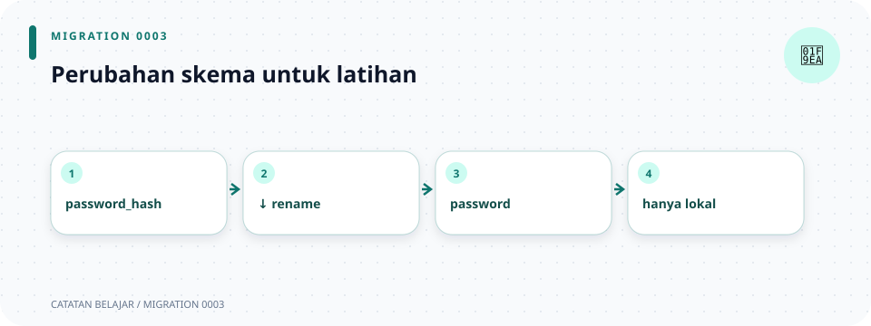

# `database/migrations/0003_use_plaintext_password_for_learning.sql`

> **Navigasi:** [Indeks catatan](../../README.md) · [README proyek](../../../README.md) · [Endpoint API](../../../endpoin.md)




[Buka file migration](../../../database/migrations/0003_use_plaintext_password_for_learning.sql)

## Tujuan

Migration ini secara historis mengubah kolom password pada tabel users dari skema awal `password_hash` menjadi kolom `password` teks biasa. Migration berikutnya, [0005](0005-hash-user-passwords.md), meng-hash ulang nilai lama dan menghapus kolom teks tersebut.

> **Catatan:** migration lama ini tetap disimpan apa adanya karena checksum-nya telah tercatat oleh SQLx. Jangan jalankan ulang atau mengeditnya; migration 0005 memperbaiki penyimpanan password pada skema saat ini.

## SQL berurutan

Source:

```sql
ALTER TABLE public.users
    DROP COLUMN password_hash,
    ADD COLUMN password TEXT NOT NULL DEFAULT '';

ALTER TABLE public.users
    ALTER COLUMN password DROP DEFAULT;
```

Komentar di bagian paling atas source dimulai dengan `--`. PostgreSQL hanya mengabaikannya; komentar itu menjelaskan bahwa data password lama akan di-reset.

### Perintah pertama: ubah tabel

`ALTER TABLE public.users` menyatakan bahwa perubahan berikutnya diterapkan pada tabel `users` di schema `public`.

- `DROP COLUMN password_hash` menghapus kolom hash dari skema.
- `ADD COLUMN password TEXT NOT NULL DEFAULT ''` menambahkan kolom teks baru:
  - `TEXT` menyimpan teks dengan panjang fleksibel.
  - `NOT NULL` melarang nilai SQL `NULL`.
  - `DEFAULT ''` sementara memberi string kosong pada baris lama, sehingga penambahan kolom wajib tidak gagal hanya karena baris telah ada.
- Koma memisahkan dua perubahan yang dilakukan pada tabel yang sama.
- Titik koma mengakhiri perintah SQL.

### Perintah kedua: hapus nilai default

`ALTER TABLE public.users ALTER COLUMN password DROP DEFAULT` menghapus default kosong setelah kolom berhasil ditambahkan. Sesudah migration, query baru harus mengirim nilai password secara eksplisit, dan constraint `NOT NULL` tetap berlaku.

## Dampak pada akun

Username dan ID yang ada tetap dipertahankan, tetapi password hash lama tidak dapat dikembalikan menjadi password asli. Akun latihan disinkronkan kembali saat startup dari `ADMIN_USERNAME` dan `ADMIN_PASSWORD`; akun lain perlu dibuat atau diatur ulang sesuai alur aplikasi.

Migration berikutnya tidak seharusnya mengubah file migration ini setelah diterapkan di database. Tambahkan file migration baru untuk perubahan skema di masa depan.

## Ringkasan dampak

| Sebelum migration | Sesudah migration | Dampak |
| --- | --- | --- |
| Kolom `password_hash`. | Kolom `password` bertipe `TEXT`. | Perubahan historis ini kemudian dibalik oleh migration 0005. |
| Password hash lama. | Password lama berada sementara sebagai teks biasa. | Migration 0005 meng-hash nilai yang masih tersedia; akun tanpa password valid mungkin perlu diatur ulang. |
| Skema setelah migration 0005. | Kolom `password_hash` Argon2id. | Aplikasi tidak lagi menyimpan password asli. |

## Ilustrasi langkah SQL

```text
DROP password_hash
        ↓
ADD password TEXT NOT NULL DEFAULT empty string
        ↓
DROP DEFAULT agar akun baru mengirim password eksplisit
```
