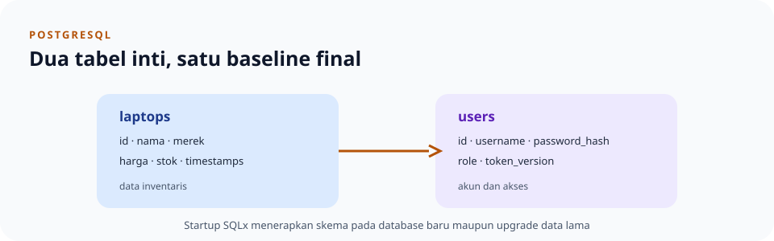

# Skema database final

> **Navigasi:** [Indeks catatan](../../README.md) · [README proyek](../../../README.md) · [Endpoint API](../../../endpoin.md)

## Tujuan

Skema final aplikasi terdiri dari tabel `laptops` dan `users`. Database PostgreSQL kosong mendapat skema yang sama melalui urutan migration saat aplikasi dijalankan dengan `cargo run`; akun admin awal kemudian disinkronkan dari konfigurasi. Siapkan server PostgreSQL, database kosong, dan kredensial `.env` di mesin tujuan, lalu jalankan aplikasi—tidak perlu membuat tabel atau menyalin skema manual.

Migration aktif diringkas menjadi satu baseline, [0001_final_schema.sql](../../../database/migrations/0001_final_schema.sql). Saat startup, aplikasi mencocokkan versi dan checksum baseline pada riwayat SQLx. Jika belum cocok, metadata riwayat lama dibersihkan agar tidak bentrok dengan nomor versi baseline; data tabel aplikasi tidak dihapus, lalu baseline dijalankan untuk melengkapi skema. Migration baseline juga merapikan catatan versi lama. Jika password legacy masih ada, kolom dipertahankan sementara agar proses startup dapat meng-hash datanya dengan Argon2id sebelum menghapus kolom tersebut.

Database baru dan database lama memakai skema akhir yang sama. Setelah baseline diterapkan, jangan mengubah file migration; tambahkan migration bernomor baru untuk perubahan skema selanjutnya.

## Tabel `laptops`

| Kolom | Tipe | Kegunaan |
| --- | --- | --- |
| `id` | `BIGINT` identity | Primary key. |
| `nama`, `merek` | `VARCHAR` | Nama dan merek wajib; nilai kosong ditolak. |
| `harga` | `BIGINT` | Harga rupiah, tidak boleh negatif. |
| `stok` | `INTEGER` | Jumlah stok, tidak boleh negatif. |
| `created_at`, `updated_at` | `TIMESTAMPTZ` | Waktu pembuatan dan perubahan. |

Validasi di database menjadi lapisan perlindungan tambahan bagi [validasi Rust](../validation.md). Query PATCH memperbarui `updated_at`.

## Tabel `users`

| Kolom | Tipe | Kegunaan |
| --- | --- | --- |
| `id` | `BIGINT` identity | Primary key. |
| `username` | `VARCHAR(100)` | Username unik dan tidak boleh kosong. |
| `password_hash` | `TEXT` | Hash password Argon2id. |
| `role` | `VARCHAR(20)` | Role `admin`, `buyer`, atau `restocker`; default `buyer`. |
| `token_version` | `BIGINT` | Versi JWT; logout menaikkannya untuk mencabut semua JWT lama pengguna. |
| `created_at` | `TIMESTAMPTZ` | Waktu akun dibuat. |

Baseline final memastikan `token_version` tersedia dan tidak negatif; tabel lama `revoked_jwts` tidak digunakan. Akun lama tetap dipertahankan, termasuk hash password-nya. Versi disimpan per pengguna; logout menaikkannya, lalu middleware membandingkan versi pada JWT dengan database. Ini mencabut semua JWT lama pengguna sekaligus, bukan session cookie lain.

## Istilah SQL dalam skema

- **Primary key** (`id`) mengidentifikasi satu baris secara unik. `BIGINT ... IDENTITY` meminta PostgreSQL menghasilkan angka ID.
- **Unique** pada username mencegah dua akun memakai nama yang sama; **NOT NULL** mewajibkan kolom memiliki nilai.
- `TIMESTAMPTZ` menyimpan suatu instant waktu dengan dukungan zona waktu; PostgreSQL menormalisasinya dan tidak menyimpan nama zona asli yang diberikan client. `DEFAULT` mengisi nilai bila query tidak menyediakannya.
- Constraint `CHECK` dapat membatasi nilai (misalnya harga/stok tidak negatif); validasi Rust memberi pesan ramah lebih awal, sedangkan constraint database melindungi data dari semua jalur penulisan.
- Tipe `BIGINT`/`INTEGER` membatasi rentang bilangan; nilai Rupiah disimpan sebagai bilangan bulat, bukan pecahan floating-point.
