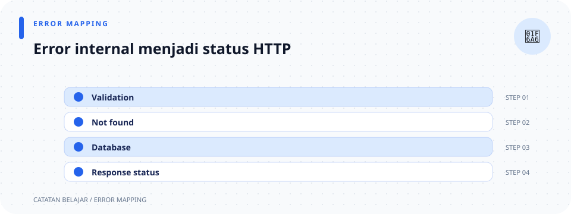

# `src/error.rs`

> **Navigasi:** [Indeks catatan](../README.md) · [README proyek](../../README.md) · [Endpoint API](../../endpoin.md)




[Buka kode sumber `error.rs`](../../src/error.rs)

## Tanggung jawab file

File ini menyatukan semua kegagalan API menjadi response JSON yang bentuknya sama:

```json
{ "status": "error", "message": "..." }
```

Dengan begitu handler cukup mengembalikan `ApiError`; handler tidak perlu membuat status HTTP dan JSON error berulang-ulang.

## Import

| Import | Kegunaan nyata di file ini |
| --- | --- |
| `Json` | Memberi tahu Axum bahwa body error adalah JSON. |
| `StatusCode` | Menentukan 400, 404, atau 500. |
| `IntoResponse` | Trait yang memberi tahu Axum cara mengubah `ApiError` menjadi response HTTP. |
| `Response` | Tipe hasil akhir yang diminta oleh `IntoResponse`. |
| `serde_json::json` | Macro untuk membuat object JSON. |

## Enum `ApiError`

`enum` membatasi error aplikasi hanya ke tiga keadaan berikut.

| Varian | Data yang disimpan | Response ke client |
| --- | --- | --- |
| `BadRequest(String)` | Pesan kesalahan input, misalnya ID tidak positif. | `400 Bad Request` dan pesan tersebut. |
| `NotFound(String)` | Pesan bahwa resource tidak ada. | `404 Not Found` dan pesan tersebut. |
| `Database(sqlx::Error)` | Error asli dari SQLx/PostgreSQL. | `500 Internal Server Error` dengan pesan umum. |

`String` pada dua varian pertama memang aman untuk ditampilkan. Sebaliknya, detail `sqlx::Error` tidak dikirim ke client karena dapat membocorkan detail database.

## Uraian kode berurutan

1. Baris `//!` menjelaskan modul dan memberi tautan ke catatan ini.
2. Blok `use axum::{...}` mengambil semua tipe Axum yang diperlukan untuk membuat response error.
3. `pub enum ApiError` membuat tipe error yang bisa digunakan modul lain, terutama [validation](validation.md) dan [handlers](handlers.md).
4. `impl From<sqlx::Error> for ApiError` mendefinisikan konversi dari error SQLx ke `ApiError::Database`.
5. Fungsi `from(error)` menerima error SQLx dan membungkusnya dengan `Self::Database(error)`. `Self` di sini berarti `ApiError`.
6. Karena implementasi `From` ini ada, ekspresi query seperti `repositories::laptop_repository::list_laptops(&pool).await?` pada handler dapat memakai `?`. Rust otomatis mengubah `sqlx::Error` menjadi `ApiError`.
7. `impl IntoResponse for ApiError` mengajari Axum cara merespons ketika sebuah handler mengembalikan `Err(ApiError)`.
8. `into_response(self)` menerima kepemilikan error. Error tidak lagi diperlukan setelah diubah menjadi HTTP response.
9. `match self` memilih pasangan `(status, message)` untuk masing-masing varian: `BadRequest` menjadi 400, `NotFound` menjadi 404.
10. Pada `Database(error)`, `eprintln!` mencetak detail asli ke terminal server. Setelah itu client hanya menerima status 500 serta teks umum `Terjadi kesalahan pada database`.
11. `(status, Json(json!({ ... })))` membuat tuple status dan body. Macro `json!` membuat object dengan field `status` dan `message`.
12. `.into_response()` terakhir mengubah tuple itu menjadi tipe `Response` yang dipahami Axum.

## Contoh alur

Saat `validate_laptop_id(0)` mengembalikan `ApiError::BadRequest`, Axum menjalankan `into_response` dan client menerima HTTP 400. Saat `get_laptop` tidak menemukan baris, helper handler membuat `ApiError::NotFound` dan client menerima 404. Saat query SQL gagal, `?` membuat `ApiError::Database`, lalu client menerima 500 tanpa detail internal.

## Hubungan dengan file lain

- [Validation](validation.md) menghasilkan `BadRequest`.
- [Handlers](handlers.md) menghasilkan `NotFound` dan meneruskan error query dengan `?`.
- Axum memakai `IntoResponse` agar `ApiError` dapat menjadi response HTTP otomatis.

## Ilustrasi pemetaan error

```text
ApiError
├── BadRequest(message) → 400 + pesan input
├── NotFound(message)   → 404 + pesan resource
└── Database(error)     → log server + 500 + pesan umum
```

## Membaca `match`, `From`, dan ownership

`ApiError` adalah `enum`: satu nilai hanya berada pada salah satu varian dan tiap varian dapat membawa data. `BadRequest(String)` serta `NotFound(String)` memiliki pesan; `Database(sqlx::Error)` membawa error database asli. Saat `into_response(self)` dipanggil, `self` dikonsumsi (dimiliki fungsi), lalu `match self` memindahkan nilai yang cocok ke variabel `message` atau `error`. Ini aman karena setelah diubah menjadi response, error aslinya tidak diperlukan lagi.

Setiap lengan `match` menghasilkan tuple `(StatusCode, String)`. Semua lengan harus menghasilkan tipe tuple yang sama agar hasil `match` dapat diikat ke `let (status, message)`. Lengan database mencatat `error` di server tetapi membuat pesan client yang baru dan umum.

`impl From<sqlx::Error> for ApiError` menerapkan trait konversi standar. Trait ini membuat `?` dapat mengubah `Err(sqlx::Error)` menjadi `Err(ApiError)` pada fungsi yang mengembalikan hasil `ApiError`. `impl IntoResponse for ApiError` menerapkan trait Axum; method `into_response(self)` mengonsumsi error lalu mengembalikan `Response`. Tipe parameter dan hasil pada trait harus persis cocok dengan kontrak trait tersebut.

Perhatikan dua jalur kegagalan: error input/resource yang memang aman ditampilkan menjadi pesan spesifik 400/404; error database dilog internal dan disamarkan menjadi 500. Jangan mengirim `error.to_string()` untuk kegagalan internal.
