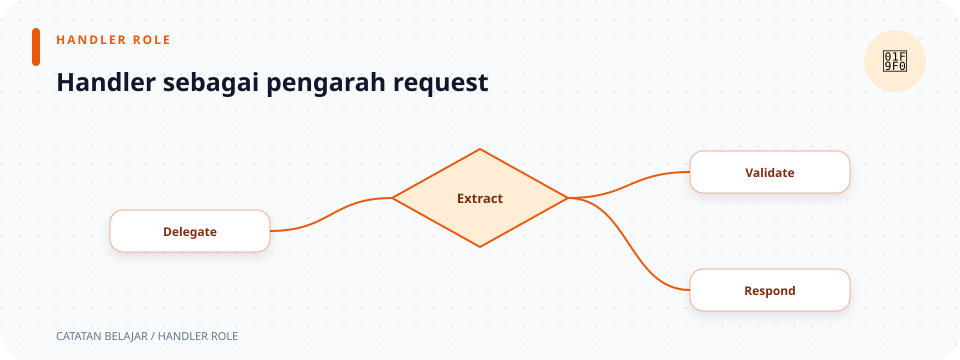

# Handler HTTP

> **Navigasi:** [Indeks catatan](../README.md) · [README proyek](../../README.md) · [Endpoint API](../../endpoin.md)




[Buka modul handler](../../src/handlers/mod.rs)

## Peran handler

Handler menjadi penghubung antara request HTTP dan logika aplikasi. Handler membaca nilai dari URL, body JSON, atau state Axum; memvalidasi input; memanggil repository; lalu membentuk response.

Handler tidak menyusun query SQL. Pembagian ini membuat alur request mudah diikuti dan menghindari detail database bercampur dengan detail HTTP.

## Struktur modul

```text
handlers/
├── mod.rs                 # Mengekspor modul resource
├── auth.rs                # Registrasi, login, identitas, dan logout
├── system.rs              # Health check HTTP
└── laptops/
    ├── mod.rs             # Ekspor handler laptop dan helper response
    ├── create.rs          # POST
    ├── read.rs            # GET daftar dan detail
    ├── update.rs          # PATCH
    └── delete.rs          # DELETE
```

| Catatan dan source | Tanggung jawab |
| --- | --- |
| [auth.rs](handlers/auth.md) | Registrasi, login, baca identitas session/JWT, dan logout. |
| [system.rs](handlers/system.md) | `GET /health`; hanya memeriksa server HTTP, bukan database. |
| [laptops/mod.rs](handlers/laptops/mod.md) | Modul, helper response sukses, dan pesan 404. |
| [laptops/create.rs](handlers/laptops/create.md) | Validasi dan pembuatan laptop. |
| [laptops/read.rs](handlers/laptops/read.md) | Membaca semua laptop atau satu laptop. |
| [laptops/update.rs](handlers/laptops/update.md) | Validasi dan penerapan perubahan parsial. |
| [laptops/delete.rs](handlers/laptops/delete.md) | Penghapusan berdasarkan ID. |

## Alur request umum

1. Axum memilih handler berdasarkan route dan method di [routes.rs](routes.md).
2. Axum menjalankan extractor yang tertulis di parameter fungsi, misalnya `State<PgPool>` untuk pool, `Path<i64>` untuk ID URL, dan `Json<T>` untuk body JSON bertipe `T`.
3. Handler memanggil [validation](validation.md) bila ada input yang perlu diperiksa. Bila validator mengembalikan `Err`, operator `?` mengakhiri handler dan meneruskan error.
4. Handler memanggil [repository](repositories.md) untuk operasi PostgreSQL. Pemanggilan asynchronous diikuti `.await`; `?` meneruskan kegagalan query.
5. Untuk data laptop, [Presenter](presenters.md) mengubah model hasil query ke format response API.
6. Nilai sukses dibungkus menjadi response Axum. Pada handler CRUD, error aplikasi diteruskan sebagai [`ApiError`](error.md), lalu diubah menjadi status dan JSON. Handler auth biasanya memilih status dan body sendiri, lalu mengembalikan `Response`.

Jika body tidak dapat di-deserialize ke tipe parameter `Json<T>`—misalnya teks dikirim untuk field harga bertipe integer—fungsi handler belum berjalan. Axum menangani kegagalan extractor itu.

## Membaca signature handler

Contoh signature create laptop:

```rust
pub async fn create_laptop(
    State(pool): State<PgPool>,
    Json(payload): Json<CreateLaptopPayload>,
) -> Result<(StatusCode, Json<Value>), ApiError>
```

`pub` membuka fungsi bagi router; `async` memungkinkan fungsi menunggu operasi I/O. Setiap parameter adalah extractor Axum, bukan argumen yang dikirim langsung oleh kode pemanggil. Pola `State(pool)` dan `Json(payload)` membongkar wrapper extractor sekaligus memberi nama pada nilai yang diambil. `->` memperkenalkan tipe hasil. `Result<T, E>` menyatakan fungsi dapat sukses dengan `T` atau gagal dengan `E`; di sini sukses membawa status HTTP dan JSON, sedangkan kegagalan membawa `ApiError`.

Sebaliknya, sebagian handler auth mengembalikan `Response` langsung. Bentuk ini berguna ketika fungsi memilih status dan body yang berbeda melalui beberapa cabang `match` atau `return`.

## Sintaks yang sering muncul di handler

| Sintaks | Arti |
| --- | --- |
| `async fn` | Fungsi dapat menunggu operasi I/O seperti query database atau operasi session. |
| `State(pool): State<PgPool>` | Extractor Axum mengambil state bersama dari router, lalu pola destructuring memberi nama `pool` pada nilai yang diambil. |
| `Path(id): Path<i64>` | Membaca parameter path, misalnya `{id}`, lalu meminta Axum mengubahnya menjadi `i64`. |
| `Json(payload): Json<T>` | Membaca body JSON dan mengubahnya menjadi tipe `T` melalui Serde. |
| `&pool` / `&payload` | Meminjam nilai agar fungsi yang dipanggil bisa menggunakannya tanpa mengambil kepemilikan. |
| `.await` | Menunggu hasil pemanggilan asinkron sebelum melanjutkan. |
| `?` | Jika hasil `Result` adalah `Err`, hentikan fungsi dan teruskan error; jika `Ok`, lanjut dengan nilainya. |
| `Ok(value)` / `Err(error)` | Mewakili hasil sukses atau gagal pada `Result`. |
| `Option<T>` | Mewakili nilai yang mungkin ada (`Some`) atau tidak ada (`None`), misalnya baris yang tidak ditemukan. |
| `map(...)` | Mengubah setiap item di iterator dengan fungsi yang diberikan. |
| `collect::<Vec<_>>()` | Mengumpulkan hasil iterator menjadi `Vec`; `_` meminta compiler menyimpulkan tipe item. |
| `return` | Mengakhiri fungsi segera dengan nilai yang disebut sesudahnya. |

## Kontrak response yang dipertahankan

| Endpoint | Sukses | Bentuk body |
| --- | --- | --- |
| `GET /health` | 200 | Object status layanan. |
| `POST /api/auth/register` | 201 | Username dan role buyer akun yang dibuat. |
| `POST /api/auth/login` | 200 | Username, role, access token, dan masa berlaku; session cookie juga dikelola middleware session. |
| `GET /api/auth/session` | 200 | Username dan role dari identitas JWT atau session yang diverifikasi. |
| `POST /api/auth/logout` | 200 | Pesan sukses; token lama pengguna dicabut dan session aktif dihapus. |
| `POST /api/admin/users` | 201 | Akun dengan role buyer atau restocker. |
| `PATCH /api/admin/users/{username}/role` | 200 | Role pengguna yang berhasil diperbarui. |
| `GET /api/laptops` | 200 | `data` berupa daftar array laptop. |
| `GET /api/laptops/{id}` | 200 | `data` berupa satu array laptop. |
| `POST /api/laptops` | 201 | `data` berupa object laptop serta pesan. |
| `PATCH /api/laptops/{id}` | 200 | `data` berupa array laptop terbaru serta pesan. |
| `DELETE /api/laptops/{id}` | 200 | Status, pesan, dan ID yang dihapus. |

Data laptop pada array mengikuti urutan `[id, nama, merek, harga, stok]`.
