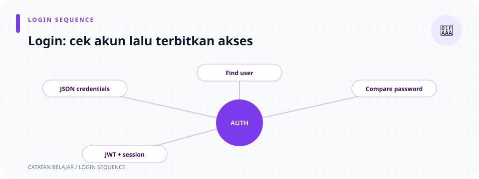

# `src/handlers/auth.rs`

> **Navigasi:** [Indeks catatan](../../README.md) · [README proyek](../../../README.md) · [Endpoint API](../../../endpoin.md)



[Buka kode sumber `auth.rs`](../../../src/handlers/auth.rs)

## Tanggung jawab dan alur request

Handler ini menerima request akun, memeriksa input, memanggil layanan/repository auth, dan menyusun response HTTP. Query database, penerbitan JWT, verifikasi identitas, dan pengelolaan session berada di modul lain.

```text
public register/login ──→ validasi input ──→ auth/repository ──→ response
protected request ──→ middleware memverifikasi identitas ──→ current_user/logout/admin
```

Route login dan registrasi bersifat publik. Route identitas, logout, dan admin dilindungi middleware; middleware memasukkan `AuthIdentity` ke request sebelum memanggil handler. Session cookie tetap dikelola `tower-sessions`.

Middleware tidak hanya memeriksa apakah pengguna login: ia juga memeriksa izin berdasarkan role dan HTTP method/path. Role admin dapat mengakses route terlindungi; buyer hanya dapat membaca laptop; restocker dapat membaca dan melakukan PATCH laptop. Operasi admin memerlukan role admin. Handler `create_user` dan `update_user_role` tetap melarang menetapkan role admin dari request.

## Sintaks dan tipe yang dipakai

### Extractor dan signature

Contoh parameter login:

```rust
pub async fn login(
    State(pool): State<PgPool>,
    Extension(jwt): Extension<JwtService>,
    session: Session,
    Json(payload): Json<LoginPayload>,
) -> Response
```

- `pub` membuat fungsi tersedia bagi router; `async` memungkinkan operasi I/O ditunggu dengan `.await`.
- `State<PgPool>` mengambil pool bersama dari state router. Pola `State(pool)` langsung membongkar wrapper dan mengikat isi ke variabel `pool`.
- `Extension<JwtService>` mengambil layanan JWT yang dipasang sebagai extension oleh router. Pola `Extension(jwt)` juga membongkar wrapper.
- `Session` adalah extractor session dari `tower-sessions`.
- `Json<LoginPayload>` membaca body JSON dan mencoba men-deserialize-nya menjadi tipe payload. `Json(payload)` mengikat nilai hasil baca ke `payload`.
- `-> Response` berarti fungsi mengembalikan response HTTP umum, bukan `Result` dengan satu tipe sukses. Bentuk ini cocok untuk handler yang memilih banyak status berbeda.

Jika body tidak cocok dengan tipe payload, extractor `Json` menolak request sebelum badan fungsi berjalan. `Response` bukan `Result`: kegagalan dan keberhasilan dibentuk sebagai response secara eksplisit, biasanya melalui helper `response`.

### Payload dan `derive`

`LoginPayload` mempunyai field `username: String` dan `password: String`; `CreateUserPayload` juga mempunyai `role: UserRole`; `UpdateUserRolePayload` hanya mempunyai `role`. Atribut `#[derive(Deserialize)]` meminta Serde menghasilkan kode untuk membaca field JSON ke struct. `#[serde(deny_unknown_fields)]` membuat field JSON yang tidak dikenal ditolak. Field payload bersifat privat pada modul, tetapi fungsi handler di file yang sama dapat membacanya.

Deserialize hanya memeriksa bentuk dan tipe JSON. Aturan seperti username tidak kosong, batas 100 karakter, password tidak kosong, dan larangan menetapkan role admin diperiksa oleh handler.

### `Result`, `match`, `if let`, dan `await`

Fungsi `validate_username` memakai `Result<&str, &'static str>`: `Ok(&str)` berisi potongan teks yang meminjam username asli, sedangkan `Err(&'static str)` berisi pesan statis dari string literal. Referensi `&str` pada hasil tetap mengacu ke string dalam payload yang masih hidup selama handler memakainya. Handler menggunakan `match` untuk menangani kedua kemungkinan secara eksplisit. Pada pemanggilan database, `.await` menunggu operasi asinkron. Handler auth biasanya memakai `match` atau `if let Err(...)` alih-alih `?`, karena perlu mencatat error dan mengubahnya menjadi pesan/status HTTP tertentu.

`match` harus mencakup hasil yang mungkin, seperti `Ok(true)`, `Ok(false)`, dan `Err(error)`. `if let Err(error) = ...` menangani hanya bentuk error yang relevan; jika bukan error, bloknya dilewati.

## Pemeriksaan username

### `validate_username(username: &str) -> Result<&str, &'static str>`

Fungsi privat ini meminjam teks (`&str`) alih-alih mengambil kepemilikan `String`. `trim()` menghasilkan potongan teks tanpa whitespace pinggir, lalu `chars().count()` menghitung karakter Unicode. Fungsi menolak username kosong dan yang panjangnya lebih dari 100 karakter; batas 100 diterima. Nilai `Ok(username)` mengembalikan potongan yang telah dibersihkan untuk digunakan handler.

```text
"  rizki  " → trim → Ok("rizki")
"   "       → Err("Username wajib diisi")
101 karakter → Err("Username maksimal 100 karakter")
```

## Fungsi handler, satu per satu

### `login(State(pool), Extension(jwt), session, Json(payload))`

1. Memanggil `validate_username` dan memakai `match`: username valid diteruskan, sedangkan `Err(message)` langsung menjadi `400 Bad Request`. Password kosong juga menghasilkan 400.
2. Menunggu `auth::verify_credentials(&pool, username, &payload.password).await`. Hasil `Ok(false)` menjadi `401 Unauthorized`; `Err(error)` dicatat di log server dan menjadi 500. Username/password yang tidak cocok memakai pesan umum yang sama.
3. Jika kredensial cocok, mencari tuple identitas dengan `find_login_identity(...).await`: nilai `Ok(Some(...))` berisi ID, role, dan `token_version`; `Ok(None)` tetap menghasilkan 401; error menjadi 500.
4. Meminta `jwt.issue_token(user_id, role, token_version)` membuat token. Error penerbitan dicatat dan menghasilkan 500.
5. Memanggil `session::start_session(&session, username).await`. Jika gagal, handler mengembalikan 500.
6. Mengembalikan response sukses berisi username, role, access token, tipe `Bearer`, dan `expires_in`. Session manager mengurus cookie; handler tidak merakit header cookie sendiri.

`match` dipakai untuk setiap operasi yang dapat gagal agar handler bisa memilih pesan yang sesuai untuk client sekaligus mencatat detail internal server. Kredensial, role, dan versi token diperiksa/dikelola di layanan auth dan repository, bukan lewat SQL di handler.

### `register(State(pool), Json(payload))`

Menggunakan `LoginPayload` (username dan password), memangkas serta memeriksa username, dan menolak password kosong dengan 400. Lalu `auth::register_user(...).await` menghasilkan:

| Hasil | Arti | Response |
| --- | --- | --- |
| `Ok(true)` | Akun dibuat | `201 Created`, username dan role default buyer. |
| `Ok(false)` | Username sudah terpakai | `409 Conflict`. |
| `Err(error)` | Operasi gagal | Error dicatat, lalu `500 Internal Server Error`. |

Registrasi publik tidak menerima pilihan role dan tidak membuat login session.

### `create_user(State(pool), Json(payload))`

Endpoint admin ini membaca `CreateUserPayload` yang berisi username, password, dan role. Ia menjalankan pemeriksaan username/password yang sama, lalu menolak `UserRole::Admin`: role admin hanya boleh diberikan melalui konfigurasi server. `register_user_with_role(...).await` menyimpan role buyer/restocker yang diminta. Cabang hasilnya sama seperti register: 201, 409, atau 500, dengan role pada data sukses.

### `update_user_role(State(pool), Extension(identity), Path(username), Json(payload))`

Middleware menyediakan `identity`; `Path(username)` mengambil nama akun dari URL dan `Json(payload)` membaca role baru. Handler menolak username yang tidak valid, perubahan role untuk akun yang sedang dipakai, dan target role admin dengan 400. Kemudian `set_user_role(...).await` menghasilkan 200 saat berubah, 404 bila pengguna tidak ada, atau 500 bila query gagal. Repository menangani perubahan role dan pencabutan kredensial terkait.

### `current_user(Extension(identity))`

Tidak mencari identitas sendiri. Middleware di [`auth/middleware.rs`](../auth/middleware.md) sudah memverifikasi JWT atau session dan menyisipkan `AuthIdentity`; fungsi ini mengembalikan username dan role dari nilai tersebut dalam response sukses.

### `logout(State(pool), Extension(identity), session)`

Pertama, menaikkan `token_version` pengguna di database menggunakan ID dari `identity`. Jika operasi gagal, handler langsung mengembalikan 500. Setelah berhasil, `clear_session(&session).await` menghapus session aktif; kegagalan ini juga menghasilkan 500. Jika keduanya sukses, response menyatakan logout berhasil. Perubahan versi token membuat JWT lama pengguna tidak lagi lolos verifikasi; penghapusan session hanya menghapus session yang dikirim request ini.

## Ringkasan route

| Method dan path | Handler | Akses dan hasil utama |
| --- | --- | --- |
| `POST /api/auth/register` | `register` | Publik; membuat akun buyer. |
| `POST /api/auth/login` | `login` | Publik; membuat JWT dan session. |
| `GET /api/auth/session` | `current_user` | Dilindungi; membaca identitas terverifikasi. |
| `POST /api/auth/logout` | `logout` | Dilindungi; mencabut JWT lama dan menghapus session aktif. |
| `POST /api/admin/users` | `create_user` | Dilindungi; membuat akun buyer/restocker. |
| `PATCH /api/admin/users/{username}/role` | `update_user_role` | Dilindungi; mengubah role target yang diizinkan. |

Untuk konfigurasi route, lihat [routes](../routes.md); untuk helper session dan response auth, lihat [session](../auth/session.md) dan [response auth](../auth/response.md).
