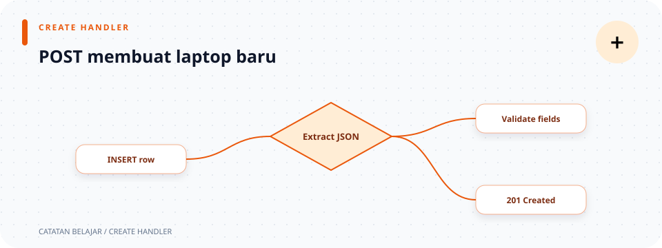

# `src/handlers/laptops/create.rs`

> **Navigasi:** [Indeks catatan](../../../README.md) · [README proyek](../../../../README.md) · [Endpoint API](../../../../endpoin.md)




[Buka source `create.rs`](../../../../src/handlers/laptops/create.rs)

## Tujuan

`tambah_laptop` menangani `POST /api/laptops`. Handler menghubungkan body request dengan validator, repository, dan presenter. Ia tidak menjalankan SQL sendiri dan tidak menyimpan aturan validasi di dalam handler.

## Data masuk dan hasil

```rust
pub async fn tambah_laptop(
    State(pool): State<PgPool>,
    Extension(identity): Extension<AuthIdentity>,
    Json(payload): Json<CreateLaptopPayload>,
) -> Result<(StatusCode, Json<Value>), ApiError>
```

| Bagian | Makna |
| --- | --- |
| `State(pool)` | Mengambil pool PostgreSQL yang dipasang pada router. |
| `Extension(identity)` | Mengambil `AuthIdentity` yang sudah diverifikasi middleware; `user_id` dipakai trigger sebagai actor log. |
| `Json(payload)` | Membaca body JSON menjadi `CreateLaptopPayload`. |
| `Result<T, ApiError>` | Mengembalikan `Ok(T)` saat berhasil atau `Err(ApiError)` saat input/query gagal. |
| `(StatusCode, Json<Value>)` | Tuple hasil sukses berisi kode status dan body JSON; Axum mengubahnya menjadi response HTTP. |

`State(pool): State<PgPool>` dan `Json(payload): Json<CreateLaptopPayload>` adalah parameter extractor. Bentuk `Extractor(nama)` membongkar wrapper extractor dan mengikat isi ke variabel lokal. `PgPool` adalah tipe pool SQLx, sedangkan `Value` adalah tipe JSON dinamis dari `serde_json`.

Request wajib membawa `nama`, `merek`, `harga`, dan `stok`. Bentuk payload dan contoh JSON ada di [model create](../../models/laptop/create-payload.md).

## Alur proses

1. `validasi_laptop_baru(payload)?` memangkas spasi pinggir nama/merek, menolak teks kosong atau terlalu panjang, dan menolak harga/stok negatif. Fungsi validator sendiri mengembalikan `Result<CreateLaptopPayload, ApiError>`. Operator `?` mengambil nilai dari `Ok`, atau langsung mengembalikan `Err` dari handler.
2. `repository::tambah_laptop(&pool, identity.user_id, &payload).await?` meneruskan ID actor yang disediakan middleware. Repository menyetel actor di transaksi lokal, lalu `INSERT ... RETURNING` memicu audit log. `?` meneruskan error query yang dikonversi ke `ApiError`.
3. `laptop_ke_objek(&laptop)` mengubah entity menjadi object JSON dengan key bernama.
4. `respons_berhasil_dengan_pesan(...)` menambahkan `status: "success"` dan pesan berhasil.
5. Handler memasangkan body dengan `StatusCode::CREATED`, sehingga client menerima `201 Created`. Ekspresi `Ok((..., Json(...)))` membentuk nilai sukses dari tipe `Result`; `Err` tidak ditulis di sini karena kegagalan sudah diteruskan menggunakan `?`.

```text
Json<CreateLaptopPayload>
  → AuthIdentity dari middleware
  → validasi_laptop_baru
  → transaksi + set_config(actor) + INSERT ... RETURNING
  → trigger INSERT ke laptop_logs
  → laptop_ke_objek
  → 201 Created + JSON
```

## Contoh request dan response

Body request:

```json
{"nama":"ThinkPad E14","merek":"Lenovo","harga":12500000,"stok":5}
```

Response sukses memakai object bernama. Harga sudah diformat sebagai string Rupiah:

```json
{
  "status": "success",
  "message": "Laptop berhasil ditambahkan",
  "data": {
    "id": 1,
    "nama": "ThinkPad E14",
    "merek": "Lenovo",
    "harga": "Rp 12.500.000",
    "stok": 5
  }
}
```

Input yang tidak valid menghasilkan `400 Bad Request`; kegagalan query diteruskan sebagai [`ApiError`](../../error.md) dan menghasilkan `500 Internal Server Error` dengan pesan aman.

## Hubungan dengan file lain

- [Payload create](../../models/laptop/create-payload.md) mendefinisikan body JSON.
- [Validation create](../../validation/create.md) menerapkan aturan input.
- [Repository laptop](../../repositories/laptop-repository.md) menjalankan `INSERT`.
- [Presenter laptop](../../presenters/laptop-response.md) menyusun object response.
- [Helper handler laptop](mod.md) membentuk envelope sukses dan pesan.
