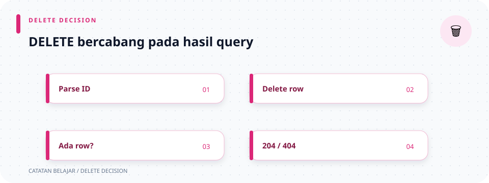

# `src/handlers/laptops/delete.rs`

> **Navigasi:** [Indeks catatan](../../../README.md) · [README proyek](../../../../README.md) · [Endpoint API](../../../../endpoin.md)




[Buka source `delete.rs`](../../../../src/handlers/laptops/delete.rs)

## Tujuan

Handler ini melayani `DELETE /api/laptops/{id}`. Ia memeriksa ID, meminta repository menghapus baris, lalu mengirim response sukses atau 404.

## Import

```rust
use axum::{
    Json,
    extract::{Path, State},
};
use serde_json::{Value, json};
use sqlx::PgPool;
```

- `Json` membungkus body response sebagai JSON.
- `Path` mengambil parameter seperti `{id}` dari URL.
- `State` mengambil state bersama router, yaitu pool database.
- `Value` adalah tipe umum nilai JSON; `json!` menyusun object JSON.
- `PgPool` adalah pool koneksi PostgreSQL SQLx.

Import `crate::{...}` di bawah file mengimpor `ApiError`, helper pesan not-found, repository laptop (diberi nama lokal `repository`), dan validator ID. `as repository` adalah alias agar nama panjang repository lebih ringkas di fungsi.

## Fungsi `delete_laptop`

```rust
pub async fn delete_laptop(
    State(pool): State<PgPool>,
    Path(id): Path<i64>,
) -> Result<Json<Value>, ApiError> {
    validate_laptop_id(id)?;

    if !repository::delete_laptop(&pool, id).await? {
        return Err(not_found_laptop(id));
    }

    Ok(Json(
        json!({"status": "success", "message": "Laptop berhasil dihapus", "id": id}),
    ))
}
```

### Parameter dan hasil

- `pub` membuat handler dapat dipasang oleh router.
- `async` diperlukan karena query database asynchronous.
- `State(pool): State<PgPool>` adalah pola *destructuring*: extractor `State` mengambil pool dari router, lalu mengikat nilainya ke nama `pool`.
- `Path(id): Path<i64>` mengambil ID dari URL dan meminta Axum membacanya sebagai bilangan `i64`.
- `-> Result<Json<Value>, ApiError>` berarti handler menghasilkan response JSON jika sukses, atau error aplikasi jika gagal.

### Urutan proses

1. `validate_laptop_id(id)?` menolak ID nol atau negatif. Operator `?` menghentikan handler dan meneruskan error validasi.
2. `repository::delete_laptop(&pool, id)` meminta repository menghapus baris. `&pool` meminjam pool yang sama; `.await` menunggu query selesai.
3. Repository mengembalikan `Result<bool, sqlx::Error>`. Operator `?` meneruskan error database jika query gagal; jika sukses, `bool` menunjukkan apakah ada baris terhapus.
4. `if !...` memakai `!` untuk membalik boolean. Jika tidak ada baris yang terhapus (`false`), fungsi mengembalikan `Err(not_found_laptop(id))`.
5. Jika baris berhasil dihapus, `json!({...})` menyusun object dengan tiga field: status, pesan, dan ID.
6. `Json(...)` menandai nilai tersebut sebagai JSON. `Ok(...)` menandai bahwa handler selesai sukses.

### Hasil yang terlihat client

- Laptop ditemukan dan dihapus: `200 OK`, dengan JSON `{"status":"success","message":"Laptop berhasil dihapus","id":...}`.
- ID positif tetapi tidak ditemukan: `404 Not Found`.
- ID nol/negatif: `400 Bad Request`.
- Query database gagal: error diteruskan ke penanganan [`ApiError`](../../error.md).

Tidak ada presenter di handler ini karena response hanya membutuhkan ID dan pesan, bukan seluruh data laptop.

## Ringkasan hasil

| Keadaan | Hasil repository | Response client |
| --- | --- | --- |
| ID valid dan baris dihapus | `Ok(true)` | `200 OK` dengan pesan dan ID. |
| ID positif tidak ada | `Ok(false)` | `404 Not Found`. |
| ID nol atau negatif | Belum menjalankan query. | `400 Bad Request`. |
| Query database gagal | `Err(sqlx::Error)` | `500 Internal Server Error` melalui `ApiError`. |

## Ilustrasi alur hapus

```text
DELETE /api/laptops/{id}
  → validasi ID
  → DELETE ... WHERE id = $1
  → rows_affected > 0 ? 200 : 404
```
