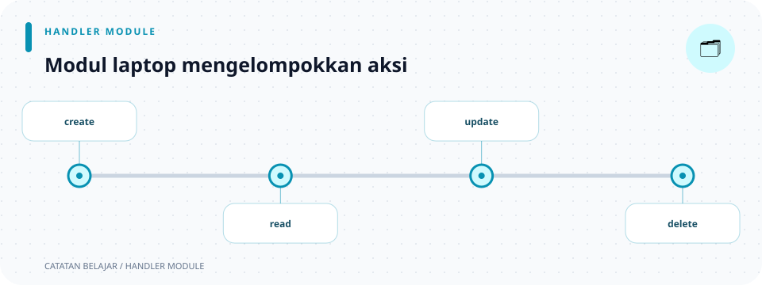

# `src/handlers/laptops/mod.rs`

> **Navigasi:** [Indeks catatan](../../../README.md) · [README proyek](../../../../README.md) · [Endpoint API](../../../../endpoin.md)




[Buka source `laptops/mod.rs`](../../../../src/handlers/laptops/mod.rs)

## Tujuan

Modul ini mengelompokkan handler resource laptop, mengekspor fungsi untuk dipakai router, dan menyediakan helper response bersama. Modul ini tidak membaca request sendiri dan tidak menjalankan SQL.

## Pembagian file

| File | Endpoint/tugas | Hasil utama |
| --- | --- | --- |
| [`create.rs`](create.md) | `POST /api/laptops` | Membuat laptop dan mengembalikan object. |
| [`read.rs`](read.md) | `GET /api/laptops` dan `GET /api/laptops/{id}` | Mengembalikan daftar atau satu array laptop. |
| [`update.rs`](update.md) | `PATCH /api/laptops/{id}` | Mengembalikan array laptop terbaru. |
| [`delete.rs`](delete.md) | `DELETE /api/laptops/{id}` | Mengembalikan pesan dan ID yang dihapus. |

Setiap file operasi tetap menjadi modul internal (`mod create;`, dan seterusnya). Dengan cara itu, detail organisasi file terpisah dari jalur publik yang dipakai router.

## Ekspor handler

`pub use create::create_laptop;` mengekspor ulang satu fungsi dari modul anak. Baris yang sejenis mengekspor handler delete, read, dan update. Router kemudian dapat menggunakan jalur pendek seperti `handlers::laptops::create_laptop` tanpa mengimpor file implementasi satu per satu.

`pub use read::{get_laptop, list_laptops};` memakai kurung kurawal untuk memilih dua nama dari modul `read`. Re-export hanya membuat jalur nama yang lebih ringkas; ia tidak menyalin atau mengubah fungsi.

## Helper response

| Helper | Bentuk JSON | Dipakai untuk |
| --- | --- | --- |
| `success_response(data)` | `{"status":"success","data":...}` | GET daftar dan detail. |
| `success_response_with_message(message, data)` | Menambahkan `message` pada envelope sukses. | Create dan update. |
| `not_found_laptop(id)` | `ApiError::NotFound` dengan ID pada pesan. | Detail, update, dan delete. |

Helper menggunakan `serde_json::Value` agar dapat menerima array maupun object: `data` dapat berupa array atau object, sementara `message` adalah `&str`. Pada source, ketiga helper dideklarasikan `pub fn`, sehingga dapat dipanggil melalui jalur modul publik `handlers::laptops`. `pub` mengatur visibilitas item; ia tidak berarti fungsi otomatis menjadi endpoint HTTP.

### Signature helper

| Signature | Arti |
| --- | --- |
| `success_response(data: Value) -> Value` | Mengambil nilai JSON yang dimiliki fungsi dan membungkusnya dengan `status`. |
| `success_response_with_message(message: &str, data: Value) -> Value` | Meminjam pesan teks, mengambil data JSON, lalu membuat envelope sukses dengan pesan. |
| `not_found_laptop(id: i64) -> ApiError` | Membentuk error aplikasi `NotFound` untuk ID tertentu. |

Ketiga fungsi sinkron (`fn`, bukan `async fn`), karena hanya menyusun nilai di memori dan tidak menunggu I/O. `json!` adalah macro yang membuat nilai JSON. `not_found_laptop` memakai `format!` untuk menyisipkan ID ke dalam pesan.

## Alur pemanggilan

```text
routes.rs → handler operasi → helper bersama (jika dibutuhkan) → JSON/ApiError
```

Handler tetap menentukan urutan validasi dan query. Hasil query opsional biasanya dipetakan menjadi `Option<Laptop>`; bila tidak ada, handler memakai `not_found_laptop` untuk menghasilkan `ApiError::NotFound`. Helper di file ini hanya menyamakan bentuk response dan pesan not-found. Untuk alur tiap method, buka halaman [handlers](../../handlers.md) atau halaman operasi di tabel atas.
