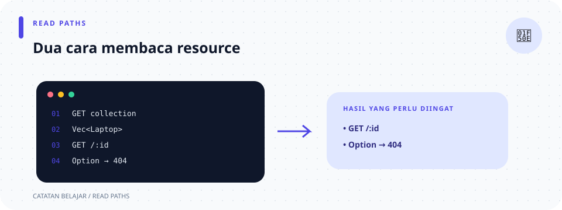

# `src/handlers/laptops/read.rs`

> **Navigasi:** [Indeks catatan](../../../README.md) · [README proyek](../../../../README.md) · [Endpoint API](../../../../endpoin.md)




[Buka source `read.rs`](../../../../src/handlers/laptops/read.rs)

## Tujuan

File ini menyediakan dua operasi baca: `GET /api/laptops` untuk daftar dan `GET /api/laptops/{id}` untuk detail. Kedua handler mengambil data melalui repository, kemudian memakai presenter untuk menyiapkan bentuk JSON API.

## `list_laptops`

Alur handler daftar:

1. `State(pool)` mengambil pool dari state router.
2. `repository::list_laptops(&pool).await?` meminta semua baris, diurutkan berdasarkan ID.
3. Repository mengembalikan `Vec<Laptop>`. `iter()` meminjam setiap item; `map(laptop_to_array)` mengubahnya menjadi array response; `collect::<Vec<_>>()` mengumpulkan semua array.
4. `json!(data)` membentuk nilai JSON, lalu `success_response` membungkusnya dengan `status: "success"`.

Daftar kosong adalah kondisi sukses: response `200 OK` berisi `"data": []`.

## `get_laptop`

Alur handler detail:

1. `Path(id)` membaca parameter `{id}` dari URL sebagai `i64`.
2. `validate_laptop_id(id)?` menolak nilai nol atau negatif sebelum query.
3. `repository::get_laptop(...)` mengembalikan `Result<Option<Laptop>, sqlx::Error>`.
4. `await?` menunggu query dan meneruskan kegagalan database. `.ok_or_else(...)` mengubah `None` menjadi error 404 dan membuka nilai dari `Some(laptop)`.
5. `laptop_to_array` membentuk data response dan `success_response` menambahkan status sukses.

ID positif yang tidak ada menghasilkan `404 Not Found`; ID nol/negatif menghasilkan `400 Bad Request`.

## Bentuk response

Kedua handler mengirim laptop sebagai array berurutan `[id, nama, merek, harga, stok]`. Harga telah diformat menjadi string Rupiah.

```json
{
  "status": "success",
  "data": [1, "ThinkPad E14", "Lenovo", "Rp 12.500.000", 5]
}
```

Daftar memakai array of arrays pada `data`; detail memakai satu array. Lihat [kontrak presenter](../../presenters/laptop-response.md) untuk alasan dan pemetaan field.

## Hubungan dengan file lain

- [Routes](../../routes.md) memasang kedua fungsi pada method `GET`.
- [Validator ID](../../validation/id.md) memeriksa parameter detail.
- [Repository laptop](../../repositories/laptop-repository.md) menjalankan query SELECT.
- [Presenter laptop](../../presenters/laptop-response.md) menetapkan format array.
- [Helper handler laptop](mod.md) membungkus response sukses.

## Ringkasan endpoint

| Route | Input khusus | Hasil normal | Jika data tidak ada |
| --- | --- | --- | --- |
| `GET /api/laptops` | Tidak ada body atau path ID. | `200 OK`, `data` berisi array laptop. | Daftar kosong tetap `200 OK`. |
| `GET /api/laptops/{id}` | Path ID positif. | `200 OK`, `data` berisi satu array laptop. | `404 Not Found`. |

## Ilustrasi baca data

```text
GET /api/laptops       → SELECT semua → Vec<Laptop> → array of arrays
GET /api/laptops/{id}  → SELECT satu  → Option<Laptop> → array / 404
```
