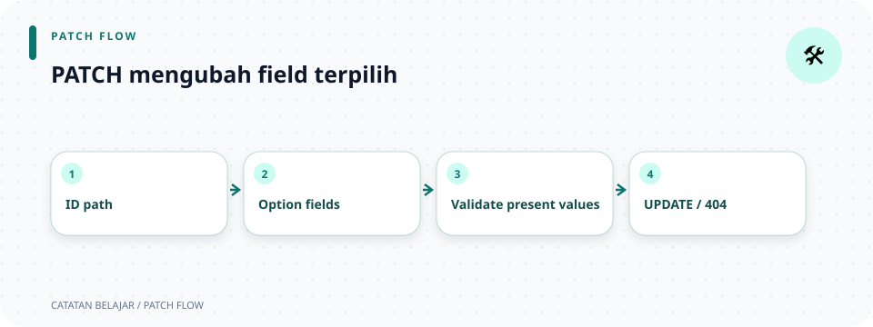

# `src/handlers/laptops/update.rs`

> **Navigasi:** [Indeks catatan](../../../README.md) · [README proyek](../../../../README.md) · [Endpoint API](../../../../endpoin.md)




[Buka source `update.rs`](../../../../src/handlers/laptops/update.rs)

## Tujuan

`update_laptop` menangani `PATCH /api/laptops/{id}`. Client boleh mengirim satu atau beberapa field; field yang tidak dikirim harus tetap memakai nilai lama. Handler memeriksa input, memanggil repository, lalu mengembalikan data terbaru.

## Data masuk

```rust
pub async fn update_laptop(
    State(pool): State<PgPool>,
    Path(id): Path<i64>,
    Json(payload): Json<UpdateLaptopPayload>,
) -> Result<Json<Value>, ApiError>
```

- `State(pool)` mengambil pool PostgreSQL dari router.
- `Path(id)` mengambil ID dari URL.
- `Json(payload)` membaca body sebagai `UpdateLaptopPayload`; tiap field menggunakan `Option`.
- `Result<Json<Value>, ApiError>` menyatakan `Ok` berisi JSON sukses, sementara `Err` membawa error aplikasi.
- `pub` membuat fungsi bisa dipasang router; `async` memungkinkan handler menunggu query database.

`State(pool)`, `Path(id)`, dan `Json(payload)` adalah pola pembongkaran extractor Axum. Bagian sesudah titik dua menyatakan tipe wrapper yang diharapkan. Jika ID atau JSON tidak dapat diubah ke tipe yang diminta, Axum menolak request sebelum handler berjalan.

## Alur proses

1. `validate_laptop_id(id)?` menolak ID nol atau negatif.
2. `validate_update_laptop(payload)?` membersihkan field teks yang dikirim, memeriksa angka agar tidak negatif, dan menolak body tanpa field.
3. `repository::update_laptop(&pool, id, &payload).await?` meminjam pool dan payload, lalu menunggu query asynchronous. Repository memakai `COALESCE` supaya parameter `None` mempertahankan nilai lama. Hasilnya bertipe `Result<Option<Laptop>, sqlx::Error>`.
4. `?` meneruskan error query; setelah query sukses, `.ok_or_else(...)` mengubah `None` (ID tidak ditemukan) menjadi error 404 dan membuka `Some(Laptop)` menjadi laptop terbaru. Closure not-found dibuat/dijalankan hanya saat nilai adalah `None`.
5. Presenter memformat data terbaru sebagai array; helper response menambahkan status dan pesan.

```text
ID + PATCH body
  → validate ID dan field yang dikirim
  → UPDATE dengan COALESCE
  → Some(Laptop) atau None
  → array response terbaru atau 404
```

## Contoh

Request berikut hanya mengganti nama dan harga:

```json
{"nama":"ThinkPad E14 Gen 5","harga":13500000}
```

Response `200 OK` berisi semua nilai terbaru. Field merek dan stok tetap sama, dan harga ditampilkan sebagai teks Rupiah:

```json
{
  "status": "success",
  "message": "Laptop berhasil diperbarui",
  "data": [1, "ThinkPad E14 Gen 5", "Lenovo", "Rp 13.500.000", 5]
}
```

Body `{}` atau angka negatif menghasilkan `400 Bad Request`; ID positif yang tidak ditemukan menghasilkan `404 Not Found`; kegagalan database menghasilkan `500` dengan pesan umum.

## Hubungan dengan file lain

- [Payload update](../../models/laptop/update-payload.md) membedakan field yang dikirim dan yang tidak.
- [Validation update](../../validation/update.md) menerapkan aturan PATCH.
- [Repository laptop](../../repositories/laptop-repository.md) memakai `COALESCE` untuk mempertahankan nilai.
- [Presenter laptop](../../presenters/laptop-response.md) membentuk array response.

## Ringkasan hasil

| Kondisi request | Hasil |
| --- | --- |
| ID ada dan payload berisi field valid | `200 OK` dengan data laptop terbaru. |
| ID positif tidak ada | `404 Not Found`. |
| ID bukan positif, payload kosong, teks tidak valid, atau angka negatif | `400 Bad Request`. |
| Database gagal memproses query | `500 Internal Server Error` dengan pesan umum. |
