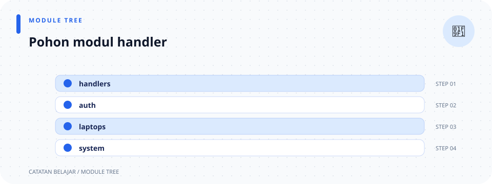

# `handlers/mod.rs`

> **Navigasi:** [Indeks catatan](../../README.md) · [README proyek](../../../README.md) · [Endpoint API](../../../endpoin.md)




[Buka source `handlers/mod.rs`](../../../src/handlers/mod.rs)

## Tujuan

File ini mendaftarkan tiga kelompok handler dan mengekspor fungsi yang dipasang router. Ia tidak menjalankan request atau query sendiri.

## Peta modul

```text
handlers
├── auth.rs    → akun dan login
├── system.rs  → health check HTTP
└── laptops/   → CRUD inventaris
```

## Penjelasan kode

- `//!` mendeskripsikan modul dan memberi tautan ke catatan ini.
- `pub mod auth;` membuat registrasi, login, pemeriksaan identitas, dan logout tersedia melalui `handlers::auth`.
- `pub mod laptops;` mengelompokkan operasi CRUD pada `handlers::laptops`.
- `pub mod system;` menyediakan pemeriksaan server melalui `handlers::system`.
- `pub use ...;` mengekspor ulang fungsi endpoint langsung pada `handlers::...`, sehingga [routes](../routes.md) dapat memakai satu namespace.

Rust mencari `auth.rs` dan `system.rs` di folder `handlers/`, serta `laptops/mod.rs` untuk modul laptop. Ekspor ulang pada source memetakan fungsi seperti berikut:

| Ekspor | Sumber | Dipakai untuk |
| --- | --- | --- |
| `current_user`, `login`, `logout`, `register` | `auth.rs` | Endpoint autentikasi. |
| `create_laptop`, `delete_laptop`, `get_laptop`, `list_laptops`, `update_laptop` | `laptops/` | Endpoint CRUD laptop. |
| `health` | `system.rs` | `GET /health`. |

Detail fungsi ada pada [auth](auth.md), [system](system.md), dan [operasi laptop](laptops/mod.md).

## Posisi dalam alur

[routes.rs](../routes.md) menghubungkan URL dan method ke fungsi yang diekspor dari modul-modul ini. Setiap handler meneruskan validasi, query, dan pemformatan response ke lapisannya masing-masing.
