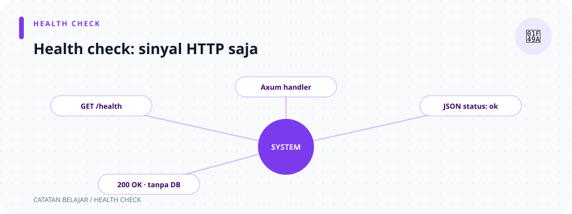

# `handlers/system.rs`

> **Navigasi:** [Indeks catatan](../../README.md) · [README proyek](../../../README.md) · [Endpoint API](../../../endpoin.md)




[Buka source `system.rs`](../../../src/handlers/system.rs)

## Tujuan

Berisi health check publik untuk memastikan server HTTP merespons. Fungsi ini tidak mengubah data dan **tidak** memeriksa koneksi database.

## Ilustrasi request

```text
GET /health → health() → JSON status → 200 OK
```

## Import

| Sintaks | Arti di file ini |
| --- | --- |
| `use axum::Json;` | Mengimpor pembungkus response JSON dari Axum. |
| `use serde_json::{Value, json};` | Mengimpor tipe JSON dinamis `Value` dan macro `json!` untuk membuat object JSON. Kurung kurawal mengimpor beberapa nama dari modul yang sama. |

## Fungsi

### `health()`

Deklarasi `pub async fn health() -> Json<Value>` dibaca seperti ini:

- `pub` membuat fungsi dapat dipanggil dari modul route.
- `async` menandai fungsi asynchronous agar cocok dengan handler Axum. Fungsi ini tidak memiliki `.await` karena tidak menunggu operasi lain.
- `fn health()` mendeklarasikan fungsi bernama `health` tanpa argumen. Karena tidak ada `State`, parameter path, atau payload, handler ini tidak membaca database maupun body request.
- `-> Json<Value>` menyatakan tipe hasil: JSON Axum yang berisi nilai JSON umum, bukan struct khusus.
- `Json(json!({...}))` membuat object dari macro `json!`, lalu membungkusnya sebagai response JSON. Field `status` dan `service` adalah pasangan nama dan nilai.

Fungsi ini langsung mengembalikan `{"status":"ok","service":"toko-laptop-app"}`.

| Hasil | Makna |
| --- | --- |
| `200 OK` dengan `status: "ok"` | Proses server menerima dan menjawab request HTTP. |
| Tidak ada hasil dari database | Database bisa saja bermasalah meskipun endpoint ini tetap sukses. |

Pemeriksaan koneksi PostgreSQL dilakukan saat startup. Jika dibutuhkan health check database, perilaku tersebut belum tersedia pada endpoint ini.

## Route

Fungsi ini dipasang sebagai `GET /health` di [routes.rs](../routes.md).
