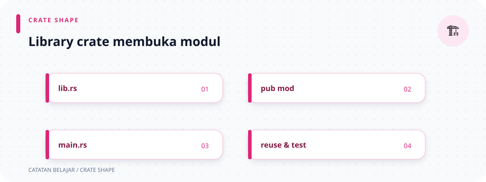

# `src/lib.rs`

> **Navigasi:** [Indeks catatan](../README.md) · [README proyek](../../README.md) · [Endpoint API](../../endpoin.md)




[Buka kode sumber `lib.rs`](../../src/lib.rs)

## Tanggung jawab file

`lib.rs` adalah daftar pintu modul library `toko_laptop_app`. File ini tidak menyalakan server, tidak menjalankan query, dan tidak menerima request. Perannya hanya memberi tahu Rust bahwa file-file source lain adalah bagian dari library dan boleh dipakai melalui path yang jelas.

## Peta modul utama

```text
crate
├── config / routes / error
├── auth / handlers
├── models / validation
└── repositories / presenters
```

Binary `main.rs` menggunakan library yang sama. Karena itu ia bisa menulis `toko_laptop_app::config::AppConfig` dan `toko_laptop_app::routes`.

## Arti `pub mod`

`mod nama;` mendaftarkan modul bernama `nama`. Dengan struktur sekarang, Rust mencari file `nama.rs` di folder `src`.

Tambahan `pub` membuka modul untuk pemakai di luar modul induk, termasuk binary `main.rs`. Kata `pub` pada modul tidak otomatis membuat semua isi modul publik: fungsi/struct di dalamnya tetap harus memakai `pub` atau `pub(crate)` sesuai kebutuhannya.

## Uraian setiap baris modul

| Deklarasi | File yang didaftarkan | Isi/tanggung jawab |
| --- | --- | --- |
| `pub mod config;` | `config.rs` | Membaca environment dan membuat pool PostgreSQL. |
| `pub mod error;` | `error.rs` | Mengubah error aplikasi menjadi response HTTP JSON. |
| `pub mod auth;` | `auth/mod.rs` | Layanan akun, pemeriksaan kredensial, session, dan JWT. |
| `pub mod handlers;` | `handlers/mod.rs` | Mengekspor handler autentikasi, sistem, dan laptop. |
| `pub mod models;` | `models/mod.rs` | Mengekspor entity dan payload request. |
| `pub mod presenters;` | `presenters/mod.rs` | Mengubah laptop ke format JSON response dan Rupiah. |
| `pub mod repositories;` | `repositories/mod.rs` | Mengekspor query PostgreSQL CRUD. |
| `pub mod routes;` | `routes.rs` | Mendaftarkan URL dan method HTTP ke handler. |
| `pub mod validation;` | `validation/mod.rs` | Memeriksa ID dan body request sebelum query. |

## Uraian kode berurutan

1. Dua `//!` di atas adalah dokumentasi tingkat crate/modul dan tautan ke halaman ini.
2. Deklarasi `pub mod` membuat namespace publik. Untuk modul yang berisi folder, Rust membaca `mod.rs` di folder tersebut; untuk modul tunggal seperti `config` dan `routes`, Rust membaca file `.rs`.
3. Deklarasi modul tidak menjalankan handler atau query. Deklarasi tersebut hanya menyusun namespace saat kompilasi.
4. Binary dapat mengimpor `toko_laptop_app::config::AppConfig` dan `toko_laptop_app::routes` karena keduanya diekspor dari akar library. Modul `auth` juga tersedia di jalur `toko_laptop_app::auth`.
5. Di dalam library, `crate::handlers` menunjuk kembali ke akar crate ini, kemudian handler diakses lewat submodul seperti `handlers::laptops`.

## Mengapa file ini berguna

Pemisahan library dan binary membuat startup tetap kecil, sementara modul aplikasi dapat diuji terpisah. Modul validation/presenter dan unit test-nya dikompilasi melalui library ini.

## Sintaks dan konsep Rust

- File ini hanya berisi deklarasi `pub mod`; ia tidak memiliki fungsi yang perlu dijalankan satu per satu. Deklarasi modul bekerja saat kompilasi: ia menamai dan menghubungkan source, bukan mengeksekusi isinya.
- `//!` adalah dokumentasi untuk crate/modul yang ditulis di awal file. Berbeda dari `///`, yang mendokumentasikan item setelahnya, dan `//`, komentar biasa yang tidak menjadi dokumentasi API.
- `pub` mengatur visibilitas nama modul. Isi modul tetap punya visibilitas masing-masing: `pub mod routes;` tidak otomatis membuat setiap fungsi internal menjadi publik.
- `crate::` berarti mulai dari akar library; `super::` berarti modul induk; path `toko_laptop_app::...` dipakai binary sebagai nama library package.
- Tipe crate dapat memiliki atribut `#[derive(...)]` untuk menghasilkan implementasi trait seperti `Debug`, `Clone`, atau `Serialize`; atribut tersebut ditempatkan pada tipe, bukan pada deklarasi modul di file ini.

## Struktur file module

Deklarasi `pub mod auth;` menghubungkan modul bernama `auth` dengan `auth/mod.rs` pada struktur source ini. `pub mod config;` menghubungkan ke `config.rs`. Nama modul menjadi bagian path yang digunakan pemanggil—misalnya `toko_laptop_app::config::AppConfig`—dan compiler memeriksa visibilitas tiap bagian path.

## Hubungan dengan file lain

[Main](main.md) adalah binary yang memakai modul ini. Halaman lain yang terkait dapat dibuka dari tabel di atas. Urutan request dari routes sampai response dijelaskan di [alur aplikasi](../02-alur-kerja-aplikasi.md).
