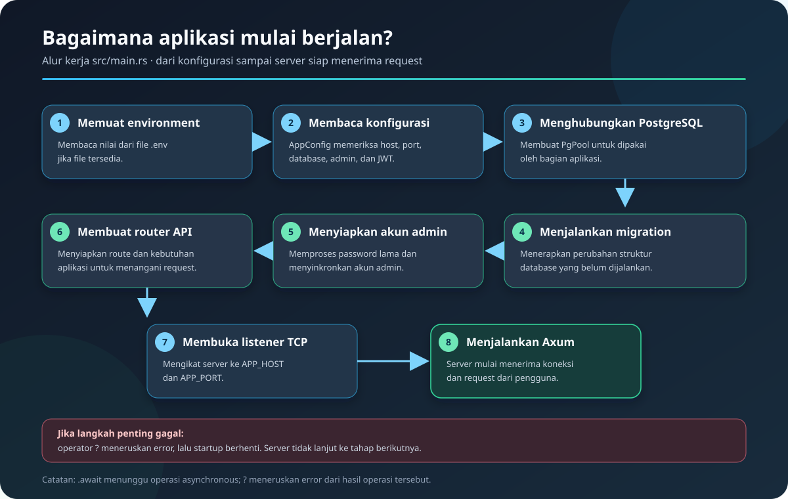

# `src/main.rs`

> **Navigasi:** [Indeks catatan](../README.md) · [README proyek](../../README.md) · [Endpoint API](../../endpoin.md)




[Buka kode `main.rs`](../../src/main.rs)

## Tujuan file

`main.rs` adalah titik masuk aplikasi. File ini menyiapkan seluruh kebutuhan
startup secara berurutan: memuat konfigurasi, membuka koneksi PostgreSQL,
menjalankan migration, menyiapkan akun admin, membuat router, lalu menjalankan
server HTTP.

## Di halaman ini

[Runtime](#runtime-dan-hasil-fungsi-main) · [Environment](#memuat-environment-variable) · [Database](#membaca-konfigurasi-dan-membuka-database) · [Migration](#menyiapkan-struktur-dan-akun-database) · [Router](#membuat-router-dan-listener-tcp) · [Urutan startup](#ringkasan-urutan-startup)

## Import

```rust
use std::error::Error;
use toko_laptop_app::{config::AppConfig, routes};
```

- `std::error::Error` adalah trait umum untuk nilai error. Dipakai agar `main`
  dapat mengembalikan berbagai jenis error dalam satu tipe.
- `AppConfig` adalah struktur konfigurasi dari `src/config.rs`. Struktur ini
  membaca environment variable dan membuat pool PostgreSQL.
- `routes` adalah modul yang menyediakan `create_router`, yaitu fungsi untuk
  menyusun endpoint API, middleware autentikasi, session, dan state database.

## Runtime dan hasil fungsi `main`

```rust
#[tokio::main]
async fn main() -> Result<(), Box<dyn Error + Send + Sync>>
```

- `#[tokio::main]` menyiapkan alat yang dibutuhkan agar aplikasi bisa
  menjalankan pekerjaan yang menunggu hal lain, seperti koneksi database atau
  request dari pengguna. Dengan ini, kita tidak perlu menyiapkan alat tersebut
  sendiri.
- `async` menandai bahwa `main` dapat melakukan pekerjaan semacam itu. Kata
  `.await` di dalam fungsi berarti “tunggu langkah ini selesai sebelum lanjut”.
  Saat menunggu, aplikasi tetap bisa mengerjakan hal lain, bukan hanya diam.
- `Result` memberi tahu bahwa fungsi bisa berakhir dengan dua cara:
  - `Ok(())` berarti aplikasi selesai tanpa masalah. `()` artinya tidak ada
    hasil tambahan yang perlu dikirim kembali.
  - `Err(...)` berarti ada masalah, misalnya konfigurasi salah, database tidak
    bisa dihubungi, atau server gagal berjalan.
- `Box<dyn Error + Send + Sync>` adalah cara untuk membawa berbagai jenis
  masalah dengan satu bentuk yang sama. Jadi `main` dapat meneruskan error
  konfigurasi, database, migration, maupun server tanpa perlu membuat satu tipe
  khusus untuk semuanya.
  - `Error` berarti nilai tersebut menjelaskan suatu masalah.
  - `Box` membungkus masalah itu agar berbagai jenis error bisa dikembalikan
    lewat bentuk yang sama.
  - `Send + Sync` berarti error aman digunakan oleh Tokio, termasuk saat
    pekerjaan aplikasi dibagi antar-thread.
- Tanda `?` pada operasi seperti membaca konfigurasi, menghubungi database,
  dan menjalankan server berarti: jika langkah itu gagal, hentikan startup dan
  teruskan masalahnya sebagai hasil `Err`. Jika berhasil, lanjutkan ke langkah
  berikutnya.

Jadi, secara sederhana, baris tersebut berarti: “Jalankan aplikasi dengan
dukungan pekerjaan asynchronous. Jika semua berjalan baik, selesai tanpa hasil
tambahan; jika ada masalah, teruskan keterangannya agar kegagalan tidak
disembunyikan.”

## Memuat environment variable

```rust
dotenvy::dotenv().ok();
```

`dotenvy::dotenv()` mencoba membaca file `.env` di direktori proyek lalu
menempatkan nilainya ke environment proses. `.ok()` sengaja mengabaikan error
jika file tidak ada; aplikasi tetap dapat dijalankan menggunakan environment
variable yang sudah disediakan oleh sistem. Nilai yang wajib tetap diperiksa
pada langkah berikutnya.

## Membaca konfigurasi dan membuka database

```rust
let config = AppConfig::from_env()?;
let pool = config.connect_database().await?;
```

- `AppConfig::from_env()` membaca nilai seperti `APP_HOST`, `APP_PORT`,
  `DB_HOST`, `DB_PORT`, `DB_NAME`, `DB_USER`, `DB_PASSWORD`,
  `ADMIN_USERNAME`, dan `ADMIN_PASSWORD`.
- `config.connect_database()` membuat `PgPool`, yaitu kumpulan koneksi
  PostgreSQL yang dapat dipakai bersama oleh handler API.
- `?` mengembalikan error dari `main` bila konfigurasi tidak valid atau koneksi
  database gagal. Server tidak akan mulai dalam kondisi tersebut.

## Menyiapkan struktur dan akun database

```rust
sqlx::migrate!("./database/migrations").run(&pool).await?;
toko_laptop_app::auth::migrate_legacy_passwords(&pool).await?;
config.initialize_admin_user(&pool).await?;
```

- `sqlx::migrate!("./database/migrations")` memasukkan berkas migration SQL
  dari folder tersebut ke program saat proses kompilasi.
- `.run(&pool).await?` menerapkan migration yang belum tercatat sebagai sudah
  dijalankan pada database yang terhubung melalui `pool`.
- `migrate_legacy_passwords(&pool)` meng-hash password lama dengan Argon2id,
  menghapus nilai password lama, dan memastikan kolom hash wajib terisi.
- `initialize_admin_user(&pool)` menyinkronkan akun admin dari
  `ADMIN_USERNAME` dan `ADMIN_PASSWORD` ke tabel pengguna. Password hanya
  disimpan dalam bentuk hash. Ini memastikan akun admin tersedia sebelum
  endpoint login dipakai.
- `await` menunggu proses database asynchronous selesai. Jika migration atau
  sinkronisasi admin gagal, `?` menghentikan startup dan mengembalikan error.

## Log startup

```rust
println!("Koneksi PostgreSQL berhasil.");
println!("Database migrations berhasil dijalankan.");
println!("Akun disinkronkan dari ADMIN_USERNAME dan ADMIN_PASSWORD.");
println!("Database: {}", config.database_name());
```

Empat `println!` menampilkan status ke terminal. `config.database_name()`
mengembalikan nama database untuk informasi log; password tidak pernah dicetak.

## Membuat router dan listener TCP

```rust
let app = routes::create_router(
    pool,
    config.session_cookie_secure,
    config.jwt_secret.clone(),
);
let address = (config.app_host.as_str(), config.app_port);
let listener = tokio::net::TcpListener::bind(address).await?;
```

- `create_router(...)` menerima pool PostgreSQL, pengaturan cookie Secure, dan
  secret JWT untuk memeriksa atau menerbitkan bearer token.
- `config.app_host.as_str()` mengambil `&str` dari host, sedangkan
  `config.app_port` adalah port server. Keduanya digabung menjadi alamat
  `(host, port)`.
- `TcpListener::bind(address).await?` membuka socket TCP pada alamat tersebut.
  Jika port sedang dipakai atau host tidak valid, startup gagal.

## Menjalankan server

```rust
println!(
    "Server berjalan di http://{}:{}",
    config.app_host, config.app_port
);
axum::serve(listener, app).await?;
Ok(())
```

`println!` menampilkan URL server. `axum::serve(listener, app)` menerima
koneksi dari `listener` dan meneruskannya ke router `app`. Pemanggilan ini
normalnya berjalan sampai aplikasi dihentikan. `Ok(())` hanya dicapai bila
server berakhir tanpa error.

## Ringkasan urutan startup

1. Memuat `.env` bila tersedia.
2. Membaca dan memvalidasi konfigurasi aplikasi.
3. Membuka pool koneksi PostgreSQL.
4. Menjalankan migration database yang belum diterapkan.
5. Membuat atau memperbarui akun admin dari environment.
6. Menyusun router API beserta session dan state database.
7. Membuka listener TCP pada `APP_HOST:APP_PORT`.
8. Menjalankan server Axum.

| Tahap | Hasil yang disiapkan | Jika gagal |
| --- | --- | --- |
| Memuat environment dan membaca config | Nilai host, port, database, admin, dan JWT. | Startup berhenti karena variabel wajib atau format tidak valid. |
| Membuka koneksi PostgreSQL | `PgPool` bersama untuk request. | Server belum membuka listener HTTP. |
| Menjalankan migration | Tabel dan skema database yang dibutuhkan aplikasi. | Startup berhenti jika migration gagal. |
| Menyinkronkan akun admin | Akun dari `ADMIN_USERNAME` dan `ADMIN_PASSWORD`. | Startup berhenti bila query user gagal. |
| Membuat router dan listener | Route, middleware, session store, dan socket HTTP. | Server tidak mulai menerima request. |
| Menjalankan Axum | Server siap menerima request sampai proses dihentikan. | Error server diteruskan dari `main`. |

## Ilustrasi startup

```text
.env → AppConfig → PostgreSQL → migrations → akun admin
                                      ↓
                            router + listener → Axum
```

## Ownership dan alur error pada `main`

`config` dimiliki oleh `main` selama startup. Pemanggilan `connect_database(&self)` hanya meminjamnya sehingga konfigurasi masih bisa dipakai untuk membuat router dan mencetak alamat. `pool` dipakai sebagai referensi `&pool` saat migration serta seed berjalan, lalu dipindahkan ke `create_router(pool, ...)`: sesudah itu pemilik pool adalah router. `config.jwt_secret.clone()` membuat salinan secret yang dimiliki untuk router karena konfigurasi masih diperlukan untuk membaca host/port.

Hasil operasi startup dibungkus `Result`. `?` hanya boleh dipakai di fungsi yang tipe hasilnya dapat menerima error itu; di sini semua error dapat dikonversi ke `Box<dyn Error + Send + Sync>`. Tanpa `?`, setiap panggilan perlu ditangani manual dengan `match`. `.await` berbeda: ia menunggu sebuah `Future` asynchronous, sedangkan `?` menangani hasil `Ok`/`Err` setelah future selesai.

`#[tokio::main]` adalah attribute macro yang menyiapkan runtime dan mengubah fungsi `async main` menjadi entry point yang dapat dijalankan sistem operasi. `println!` juga macro—tanda `!` membedakannya dari pemanggilan fungsi biasa. Macro `sqlx::migrate!` menyertakan migration pada build.
