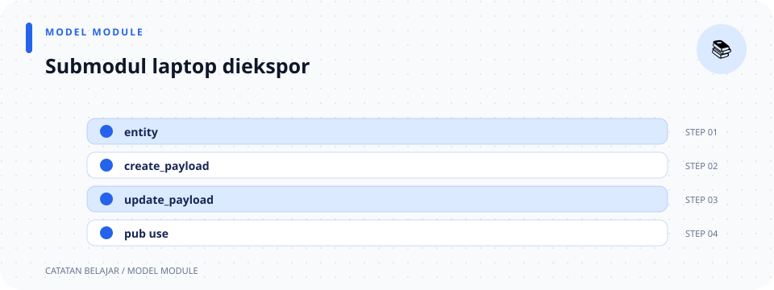

# `src/models/laptop/mod.rs`

> **Navigasi:** [Indeks catatan](../../../README.md) · [README proyek](../../../../README.md) · [Endpoint API](../../../../endpoin.md)




[Buka source `laptop/mod.rs`](../../../../src/models/laptop/mod.rs)

## Tujuan

Modul ini mengelompokkan entity database dan payload request yang berkaitan dengan laptop. File ini mendaftarkan file tipe data, lalu mengekspor tipe yang boleh digunakan oleh lapisan lain.

## 1. Deklarasi modul internal

```rust
mod create_payload;
mod entity;
mod update_payload;
```

Masing-masing `mod nama;` memberitahu Rust bahwa source modul berada di file terpisah pada folder ini:

- `create_payload.rs` berisi tipe body POST.
- `entity.rs` berisi model hasil query database.
- `update_payload.rs` berisi tipe body PATCH.

Deklarasi tidak memakai `pub`, jadi pemakai modul tidak mengakses file-file tersebut sebagai namespace publik langsung.

## 2. Ekspor ulang tipe

```rust
pub use create_payload::CreateLaptopPayload;
pub use entity::Laptop;
pub use update_payload::UpdateLaptopPayload;
```

- `use` membawa nama dari modul anak ke modul ini.
- `pub use` juga mengekspor ulang nama itu agar modul di luar `models::laptop` dapat menggunakannya.
- `nama_modul::NamaTipe` adalah jalur ke tipe dalam modul tersebut.

Karena ekspor ulang ini, lapisan lain dapat menulis `crate::models::Laptop` daripada `crate::models::laptop::entity::Laptop`. Re-export tidak menyalin tipe atau mengubah perilakunya; hanya memudahkan jalur akses dan menjaga batas modul.

## Tiga tipe yang diekspor

| Tipe | Kegunaan |
| --- | --- |
| [`Laptop`](entity.md) | Data satu laptop yang dibaca atau disimpan ke database. |
| [`CreateLaptopPayload`](create-payload.md) | Field yang diperlukan untuk membuat laptop baru. |
| [`UpdateLaptopPayload`](update-payload.md) | Field yang boleh dikirim untuk perubahan parsial. |

## Ilustrasi modul

```text
laptop/mod.rs
├── create_payload.rs → CreateLaptopPayload
├── entity.rs         → Laptop
└── update_payload.rs → UpdateLaptopPayload
```
