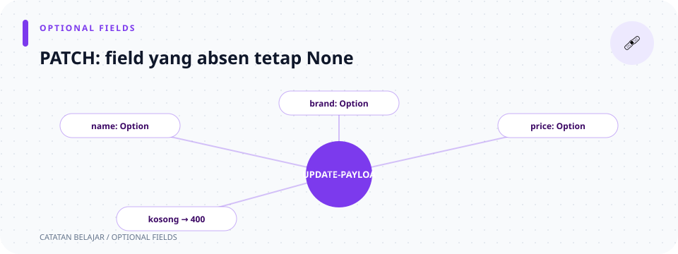

# `src/models/laptop/update_payload.rs`

> **Navigasi:** [Indeks catatan](../../../README.md) · [README proyek](../../../../README.md) · [Endpoint API](../../../../endpoin.md)




[Buka source `update_payload.rs`](../../../../src/models/laptop/update_payload.rs)

## Tujuan

`UpdateLaptopPayload` menampung body JSON dari `PATCH /api/laptops/{id}`. Berbeda dari payload create, setiap field adalah opsional agar client dapat mengubah hanya nilai yang dipilih.

## Import

```rust
use serde::Deserialize;
```

Trait `Deserialize` memungkinkan Serde membaca JSON dan mengisinya ke struct Rust.

## Struct payload

```rust
#[derive(Debug, Deserialize)]
pub struct UpdateLaptopPayload {
    pub nama: Option<String>,
    pub merek: Option<String>,
    pub harga: Option<i64>,
    pub stok: Option<i32>,
}
```

- `#[derive(Debug, Deserialize)]` menghasilkan dukungan debug dan pembacaan JSON.
- `pub struct UpdateLaptopPayload` mendeklarasikan tipe publik untuk body perubahan laptop.
- Setiap field menggunakan sintaks `nama_field: Tipe`.
- `Option<T>` berarti nilai mungkin ada (`Some(value)`) atau tidak ada (`None`). Misalnya `Option<String>` dapat berisi teks atau kosong.

| Field | Tipe | Jika tidak dikirim atau `null` |
| --- | --- | --- |
| `nama` | `Option<String>` | Nama lama tetap dipakai. |
| `merek` | `Option<String>` | Merek lama tetap dipakai. |
| `harga` | `Option<i64>` | Harga lama tetap dipakai. |
| `stok` | `Option<i32>` | Stok lama tetap dipakai. |

Contoh body yang mengubah hanya stok:

```json
{"stok": 4}
```

Field lain akan bernilai `None`. Untuk `Option<T>`, Serde juga membaca nilai JSON `null` sebagai `None`; jadi `null` tidak berarti mengosongkan kolom, melainkan tidak meminta perubahan pada field itu. Validator kemudian memeriksa field yang ada dan menolak body jika semua field menjadi `None`. Lihat [validator update](../../validation/update.md) dan [query PATCH](../../repositories/laptop-repository.md).

## Ilustrasi PATCH parsial

```text
Body hanya berisi stok
   ↓ Deserialize
nama=None, merek=None, harga=None, stok=Some(angka)
   ↓ validator + COALESCE
nilai lama dipertahankan, stok diperbarui
```
