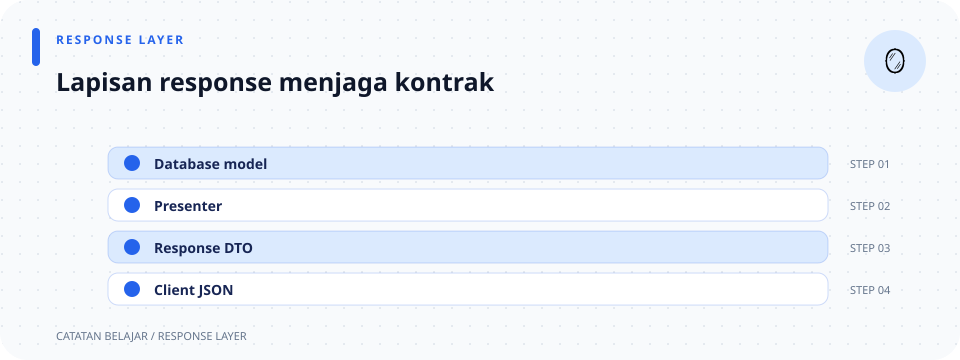

# Presenter response

> **Navigasi:** [Indeks catatan](../README.md) · [README proyek](../../README.md) · [Endpoint API](../../endpoin.md)




[Buka modul presenter](../../src/presenters/mod.rs)

## Tanggung jawab

Presenter memisahkan bentuk model internal dari bentuk JSON yang diterima client. Di lapisan ini harga angka `i64` diformat sebagai teks Rupiah.

`serde_json::Value` adalah representasi umum JSON: bisa berupa array, object, string, angka, boolean, atau `null`. Presenter tidak mengirim HTTP; handler membungkus `Value` ke `Json<Value>` dan memilih status response.

## Struktur

```text
presenters/
├── mod.rs
├── laptop_response.rs
└── rupiah.rs
```

| Catatan | Tanggung jawab |
| --- | --- |
| [presenters/mod.rs](presenters/mod.md) | Mengekspor presenter response dan menyimpan formatter sebagai modul internal. |
| [presenters/laptop-response.rs](presenters/laptop-response.md) | Mengubah `Laptop` menjadi array atau object JSON. |
| [presenters/rupiah.rs](presenters/rupiah.md) | Memformat harga dengan awalan `Rp` dan pemisah titik. |

## Format response laptop

| Endpoint | Fungsi presenter | Bentuk `data` |
| --- | --- | --- |
| `GET /api/laptops` | `laptop_to_array` untuk setiap baris. | Daftar array laptop. |
| `GET /api/laptops/{id}` | `laptop_to_array`. | Satu array laptop. |
| `PATCH /api/laptops/{id}` | `laptop_to_array`. | Array laptop terbaru. |
| `POST /api/laptops` | `laptop_to_object`. | Object dengan nama field. |

Array laptop selalu berurutan `[id, nama, merek, harga, stok]`. Nilai `harga` pada response berupa string Rupiah, walaupun model, database, dan request create menggunakan angka. Karena array dibaca berdasarkan posisi, client harus memakai urutan yang sama.

Perbedaan bentuk response tersebut adalah kontrak API yang sudah ada, bukan pilihan yang dibuat oleh presenter secara otomatis.

## Jalur data

```text
Laptop entity → laptop_response → formatkan_rupiah → JSON Value → handler → HTTP response
```

Presenter tidak mengirim status HTTP atau header; handler tetap bertanggung jawab membungkus JSON dan menentukan `200 OK` atau `201 Created`. Rincian implementasi ada pada [pemetaan laptop](presenters/laptop-response.md) dan [format Rupiah](presenters/rupiah.md).
