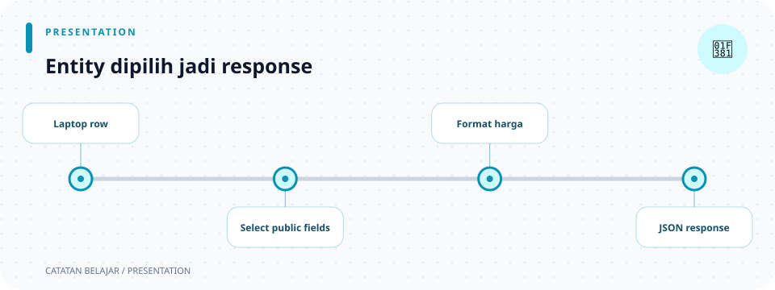

# `src/presenters/laptop_response.rs`

> **Navigasi:** [Indeks catatan](../../README.md) · [README proyek](../../../README.md) · [Endpoint API](../../../endpoin.md)




[Buka source `laptop_response.rs`](../../../src/presenters/laptop_response.rs)

## Tujuan

Presenter mengubah model [`Laptop`](../models/laptop/entity.md) menjadi nilai JSON. Fungsi di file ini tidak membuat status HTTP; handler membungkus hasil JSON menjadi response.

## Import

```rust
use crate::models::Laptop;
use serde_json::{Value, json};
use super::rupiah::formatkan_rupiah;
```

- `crate::models::Laptop` mengambil model dari akar crate.
- `Value` adalah tipe umum nilai JSON.
- `json!` adalah macro `serde_json` yang menyusun array atau object JSON; macro ini bukan fungsi HTTP dan tidak mengirim response.
- `super::rupiah::formatkan_rupiah` mengambil formatter dari modul `presenters` induk.

## 1. `laptop_to_array`

```rust
pub fn laptop_to_array(laptop: &Laptop) -> Value {
    json!([
        laptop.id,
        laptop.nama,
        laptop.merek,
        formatkan_rupiah(laptop.harga),
        laptop.stok
    ])
}
```

- `pub` membuat fungsi terlihat lewat modul yang menampungnya. Di aplikasi ini fungsi dipakai handler melalui jalur `presenters::laptop_response`.
- `laptop: &Laptop` meminjam model; presenter tidak mengambil alih kepemilikan atau mengubah field-nya.
- `-> Value` menyatakan bahwa fungsi menghasilkan nilai JSON.
- `json!([ ... ])` membuat array JSON. Urutan nilai menjadi kontrak response: `[id, nama, merek, harga, stok]`.
- `formatkan_rupiah(laptop.harga)` mengubah angka harga menjadi teks Rupiah sebelum memasukkannya ke array.

GET daftar, GET detail, dan PATCH menggunakan format array ini. Client bergantung pada posisi field, jadi urutannya harus tetap konsisten.

## 2. `laptop_to_object`

```rust
pub(crate) fn laptop_to_object(laptop: &Laptop) -> Value {
    json!({
        "id": laptop.id,
        "nama": laptop.nama,
        "merek": laptop.merek,
        "harga": formatkan_rupiah(laptop.harga),
        "stok": laptop.stok
    })
}
```

Fungsi ini juga meminjam `&Laptop` dan mengembalikan `Value`. Bedanya, `json!({ ... })` membuat object dengan nama field eksplisit, sehingga client membaca nilai melalui key seperti `"nama"` atau `"harga"`. Handler POST memakai object ini.

## Contoh hasil

Untuk laptop dengan harga angka `12_500_000`, array yang dihasilkan:

```json
[12, "ThinkPad E14", "Lenovo", "Rp 12.500.000", 5]
```

Object yang dihasilkan:

```json
{
  "id": 12,
  "nama": "ThinkPad E14",
  "merek": "Lenovo",
  "harga": "Rp 12.500.000",
  "stok": 5
}
```

Harga menjadi string Rupiah, walaupun model dan database menyimpannya sebagai angka.

## Pemetaan endpoint ke bentuk data

| Operasi | Presenter | Bentuk `data` |
| --- | --- | --- |
| GET daftar | `laptop_to_array` untuk setiap baris. | Array berisi array laptop. |
| GET detail | `laptop_to_array`. | Satu array `[id, nama, merek, harga, stok]`. |
| PATCH | `laptop_to_array`. | Array laptop setelah perubahan. |
| POST | `laptop_to_object`. | Object dengan key bernama. |

## 3. Unit test

`#[cfg(test)]` menyertakan modul test hanya saat test dijalankan. `sample_laptop()` membuat data contoh yang dipakai dua test; `assert_eq!` membandingkan hasil presenter dengan JSON yang diharapkan. Test memeriksa urutan array dan key object, termasuk format harga.

`json!` mengubah nilai Rust menjadi `Value` JSON yang dapat dibungkus Axum sebagai `Json<Value>`. Jenis data tetap penting: `id` dan `stok` dikirim sebagai angka, sedangkan `harga` dikirim sebagai string hasil formatter. `Value` sendiri tidak menentukan HTTP status; handler memilihnya.

## Ilustrasi pemilihan bentuk

```text
Laptop
  ├─ GET / PATCH → [id, nama, merek, harga, stok]
  └─ POST         → object bernama
                       harga menjadi string Rupiah
```
