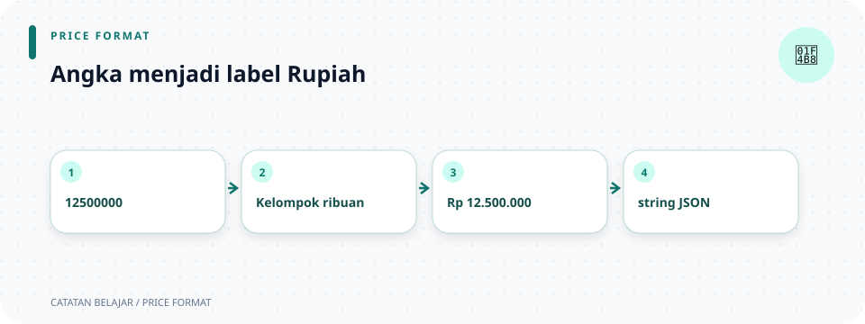

# `src/presenters/rupiah.rs`

> **Navigasi:** [Indeks catatan](../../README.md) · [README proyek](../../../README.md) · [Endpoint API](../../../endpoin.md)




[Buka source `rupiah.rs`](../../../src/presenters/rupiah.rs)

## Tujuan

File ini mengubah angka harga menjadi teks Rupiah untuk response API. Nilai di database tetap angka; pemformatan hanya dilakukan saat presenter menyiapkan output.

## 1. `formatkan_rupiah`

```rust
pub(super) fn formatkan_rupiah(nilai: i64) -> String {
    let tanda = if nilai < 0 { "-" } else { "" };
    format!("Rp {tanda}{}", kelompokkan_ribuan(nilai.unsigned_abs()))
}
```

- `pub(super)` mengizinkan pemakaian dari modul induk `presenters` dan turunannya, tetapi tidak mengekspor helper ini ke seluruh crate.
- `fn` mendeklarasikan fungsi.
- `nilai: i64` menerima angka bertanda agar juga dapat menangani nilai negatif.
- `-> String` berarti hasilnya teks yang dimiliki fungsi.
- `if nilai < 0 { "-" } else { "" }` memilih tanda minus hanya untuk nilai negatif.
- `format!` menyusun string baru; `{tanda}` menyisipkan variabel bernama `tanda`.
- `nilai.unsigned_abs()` mengambil nilai absolut dalam bentuk `u64`. Ini juga menangani nilai minimum `i64`, yang nilai absolutnya tidak muat dalam `i64`.
- Nilai absolut dikirim ke helper `kelompokkan_ribuan`, lalu awalan `"Rp "` dan tanda ditambahkan.

Contoh: `formatkan_rupiah(1_600_000)` menghasilkan `"Rp 1.600.000"`, sedangkan `formatkan_rupiah(-1_600_000)` menghasilkan `"Rp -1.600.000"`.

## 2. `kelompokkan_ribuan`

```rust
fn kelompokkan_ribuan(nilai: u64) -> String {
    let mut angka = nilai.to_string();
    let mut posisi = angka.len();

    while posisi > 3 {
        posisi -= 3;
        angka.insert(posisi, '.');
    }

    angka
}
```

Fungsi ini privat karena tidak memiliki `pub`; hanya kode modul presenter yang menggunakannya.

1. `nilai.to_string()` mengubah angka menjadi teks.
2. `let mut angka` dan `let mut posisi` membuat binding yang boleh diubah. `mut` diperlukan karena loop mengubah teks serta posisi.
3. `angka.len()` mendapatkan panjang teks dalam byte. Input di sini hanya digit ASCII, jadi jumlah byte sama dengan jumlah digit.
4. `while posisi > 3` mengulang selama masih ada kelompok digit di sebelah kiri yang perlu dipisahkan.
5. `posisi -= 3` memundurkan posisi tiga digit dari kanan.
6. `angka.insert(posisi, '.')` menyisipkan titik pada posisi tersebut.
7. `angka` adalah ekspresi terakhir tanpa titik koma, sehingga string yang sudah diformat menjadi hasil fungsi.

Contoh angka `12500000` diproses menjadi `12.500.000`.

| Angka internal | String response |
| ---: | --- |
| `0` | `Rp 0` |
| `999` | `Rp 999` |
| `1_000` | `Rp 1.000` |
| `12_500_000` | `Rp 12.500.000` |
| `-1_600_000` | `Rp -1.600.000` |

## 3. Unit test

Test memastikan pemisah titik benar untuk angka besar, nol, angka di bawah seribu, batas seribu, dan nilai negatif. `assert_eq!(aktual, harapan)` membuat test gagal jika dua nilai berbeda.

## Ilustrasi pemformatan

```text
12_500_000 → digit tanpa pemisah → kelompok tiga digit → Rp 12.500.000
```
