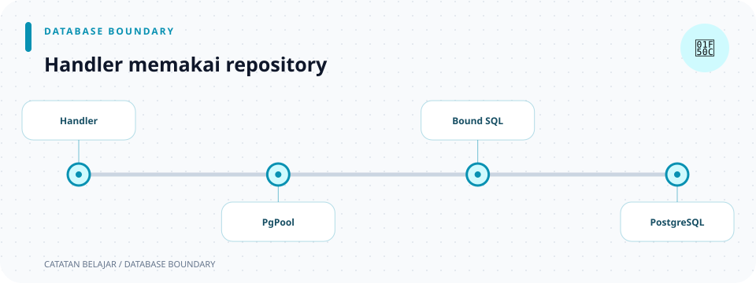

# Repository database

> **Navigasi:** [Indeks catatan](../README.md) · [README proyek](../../README.md) · [Endpoint API](../../endpoin.md)




[Buka modul repository](../../src/repositories/mod.rs)

## Tanggung jawab

Repository menjadi lapisan yang menyusun query database per domain. Saat ini modul laptop menangani CRUD `laptops`, sedangkan modul user menangani pencarian dan pembuatan akun. Fungsi menerima `PgPool`, mengikat nilai dengan `.bind(...)`, dan mengembalikan model atau hasil operasi database.

Repository tidak mengetahui status HTTP, JSON, atau cara membaca request. Handler yang memanggil repository mengubah `sqlx::Error` menjadi [`ApiError`](error.md).

## Susunan modul

```text
repositories/
├── mod.rs
├── laptop_repository.rs
└── user_repository.rs
```

- [repositories/mod.rs](repositories/mod.md) mendaftarkan setiap repository domain.
- [repositories/laptop-repository.rs](repositories/laptop-repository.md) berisi query daftar, detail, insert, update, dan delete beserta penjelasan placeholder SQL.
- [user_repository.rs](repositories/user-repository.md) berisi query akun, hash password, dan migrasi password lama tanpa mengurus HTTP.

### Makna sintaks modul

- `pub mod laptop_repository;` dan `pub mod user_repository;` pada `mod.rs` mendaftarkan file sebagai modul dan membuatnya dapat diakses melalui `repositories::...`.
- `use sqlx::PgPool;` mengimpor tipe pool SQLx. Fungsi repository menerima `&PgPool` agar dapat meminjam pool bersama, bukan membuat koneksi baru untuk setiap query.
- `sqlx::query(...)` dan `query_scalar(...)` membangun query. `.bind(...)` mengirim nilai sebagai parameter terpisah dari teks SQL.
- `.await` menunggu operasi database asynchronous selesai.
- `Result<T, sqlx::Error>` menyatakan query dapat berhasil dengan nilai `T` atau gagal dengan error SQLx.

## Hasil operasi repository

| Operasi | Bentuk hasil | Cara memahaminya |
| --- | --- | --- |
| Daftar | `Vec<Laptop>` | `Vec` adalah daftar dinamis. Daftar kosong berarti belum ada data, bukan error. |
| Detail | `Option<Laptop>` | `Some(laptop)` jika ditemukan; `None` jika ID tidak ada. |
| Insert | `Laptop` | Baris yang berhasil disimpan, termasuk nilai hasil database seperti ID. |
| Update | `Option<Laptop>` | `Some(laptop)` jika baris diperbarui; `None` jika tidak ditemukan. |
| Delete | `bool` | `true` jika ada baris yang terhapus; `false` jika tidak ada baris dengan ID tersebut. |

Nilai hasil tersebut tetap dibungkus `Result`, sehingga error query dibedakan dari hasil normal seperti `None` atau `false`.

## Alur umum

```text
Handler -> repository + PgPool -> query parameterized -> PostgreSQL -> Result
```

Nilai SQL dikirim memakai parameter, bukan digabung ke teks query. Struktur tabel serta batasan database dijelaskan pada [migration laptop](database/0001-create-laptops.md).
Skema akun dijelaskan pada [migration users](database/0002-create-users.md), [migration password latihan](database/0003-plaintext-password.md), dan [migration hash Argon2id](database/0005-hash-user-passwords.md).
