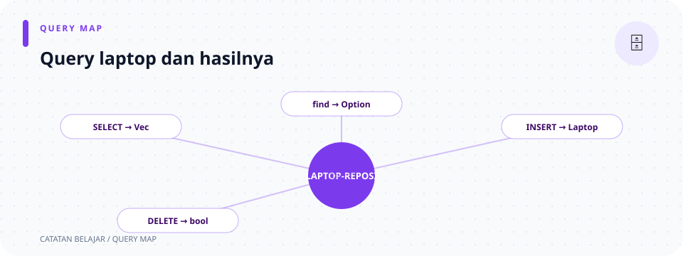

# `src/repositories/laptop_repository.rs`

> **Navigasi:** [Indeks catatan](../../README.md) · [README proyek](../../../README.md) · [Endpoint API](../../../endpoin.md)




[Buka source `laptop_repository.rs`](../../../src/repositories/laptop_repository.rs)

## Tujuan

Repository ini menjalankan query PostgreSQL pada tabel laptop. Ia menerima pool koneksi dan parameter data, lalu mengembalikan model atau hasil operasi. Repository tidak mengetahui status HTTP maupun bentuk JSON response.

## Import

```rust
use crate::models::{CreateLaptopPayload, Laptop, UpdateLaptopPayload};
use sqlx::PgPool;
```

- `crate::models::{...}` mengimpor tiga tipe dari crate aplikasi.
- `PgPool` adalah kumpulan koneksi PostgreSQL SQLx yang dibuat saat startup.
- Tanda `&PgPool` pada parameter berarti fungsi meminjam pool yang sama.

## Pola query SQLx

Semua fungsi bersifat `async` karena database adalah I/O yang perlu ditunggu. `.await` menunggu query selesai. Error SQLx dikembalikan sebagai `Result<..., sqlx::Error>`, lalu handler mengubahnya menjadi error HTTP.

- `sqlx::query_as::<_, Laptop>(...)` meminta SQLx memetakan baris hasil ke `Laptop`. `_` berarti compiler menyimpulkan tipe argumen generik yang pertama.
- `.bind(value)` mengisi placeholder `$1`, `$2`, dan seterusnya. Nilai request dikirim sebagai parameter terpisah dari teks SQL.
- `fetch_all` membaca semua baris; `fetch_one` meminta satu baris; `fetch_optional` menerima nol atau satu baris; `execute` menjalankan query tanpa mengambil model.

## 1. `list_laptops`

```rust
pub async fn list_laptops(pool: &PgPool) -> Result<Vec<Laptop>, sqlx::Error> {
    sqlx::query_as::<_, Laptop>(
        "SELECT id, nama, merek, harga, stok FROM laptops ORDER BY id",
    )
    .fetch_all(pool)
    .await
}
```

`SELECT` mengambil kolom yang dipakai model, `ORDER BY id` mengurutkan hasil berdasarkan ID, dan `fetch_all` mengembalikan `Vec<Laptop>`. `Vec` kosong berarti tabel belum berisi laptop, bukan error.

## 2. `get_laptop`

```rust
pub async fn get_laptop(pool: &PgPool, id: i64) -> Result<Option<Laptop>, sqlx::Error> {
    sqlx::query_as::<_, Laptop>(
        "SELECT id, nama, merek, harga, stok FROM laptops WHERE id = $1",
    )
    .bind(id)
    .fetch_optional(pool)
    .await
}
```

`WHERE id = $1` mencari satu ID; `.bind(id)` memasangkan nilai ke placeholder. Hasilnya `Ok(Some(laptop))` jika ditemukan atau `Ok(None)` jika tidak. Error database menjadi `Err(sqlx::Error)`.

## 3. `create_laptop`

```rust
pub async fn create_laptop(
    pool: &PgPool,
    payload: &CreateLaptopPayload,
) -> Result<Laptop, sqlx::Error> {
    sqlx::query_as::<_, Laptop>(
        "INSERT INTO laptops (nama, merek, harga, stok)
         VALUES ($1, $2, $3, $4)
         RETURNING id, nama, merek, harga, stok",
    )
    .bind(&payload.nama)
    .bind(&payload.merek)
    .bind(payload.harga)
    .bind(payload.stok)
    .fetch_one(pool)
    .await
}
```

`INSERT` menambahkan satu baris. Nilai `$1` sampai `$4` diisi sesuai urutan pemanggilan `.bind(...)`. Referensi `&payload.nama` dan `&payload.merek` meminjam teks; harga dan stok bertipe angka. `RETURNING` meminta PostgreSQL mengirim kolom baris yang baru dibuat. `fetch_one` menghasilkan `Laptop` yang siap dipakai presenter.

## 4. `update_laptop`

```rust
pub async fn update_laptop(
    pool: &PgPool,
    id: i64,
    payload: &UpdateLaptopPayload,
) -> Result<Option<Laptop>, sqlx::Error> {
    sqlx::query_as::<_, Laptop>(
        "UPDATE laptops
            SET nama = COALESCE($1, nama),
               merek = COALESCE($2, merek),
               harga = COALESCE($3, harga),
               stok = COALESCE($4, stok),
               updated_at = CURRENT_TIMESTAMP
            WHERE id = $5
            RETURNING id, nama, merek, harga, stok",
    )
    .bind(payload.nama.as_deref())
    .bind(payload.merek.as_deref())
    .bind(payload.harga)
    .bind(payload.stok)
    .bind(id)
    .fetch_optional(pool)
    .await
}
```

- `UpdateLaptopPayload` berisi field opsional. `as_deref()` mengubah `Option<String>` yang dipinjam menjadi `Option<&str>` tanpa memindahkan teks.
- Jika placeholder berisi SQL `NULL`, `COALESCE(nilai_baru, nilai_lama)` memilih nilai lama. Dengan begitu field yang tidak dikirim tidak berubah.
- `$5` adalah ID target dan diisi oleh `.bind(id)`.
- `CURRENT_TIMESTAMP` memperbarui waktu perubahan saat query berjalan.
- `RETURNING` meminta baris terbaru. `fetch_optional` menghasilkan `None` jika tidak ada ID tersebut.

## 5. `delete_laptop`

```rust
pub async fn delete_laptop(pool: &PgPool, id: i64) -> Result<bool, sqlx::Error> {
    let result = sqlx::query("DELETE FROM laptops WHERE id = $1")
        .bind(id)
        .execute(pool)
        .await?;

    Ok(result.rows_affected() > 0)
}
```

`query` menjalankan DELETE tanpa membaca model. `.execute(pool)` mengembalikan metadata hasil query; `?` meneruskan error jika gagal. `rows_affected()` memberi jumlah baris yang terhapus, lalu `> 0` mengubahnya menjadi `bool`: `true` jika ada baris, `false` jika ID tidak ditemukan.

## Keamanan query

Parameter request selalu diberikan melalui `.bind(...)`, bukan digabung ke teks SQL. Handler juga melakukan validasi sebelum query. Constraint database menjadi perlindungan tambahan; lihat [migration laptops](../database/0001-create-laptops.md).

## Ringkasan hasil fungsi

| Fungsi | Query | Hasil sukses | Arti hasil kosong |
| --- | --- | --- | --- |
| `list_laptops` | `SELECT ... ORDER BY id` | `Vec<Laptop>` | `Vec` kosong berarti belum ada data. |
| `get_laptop` | `SELECT ... WHERE id` | `Option<Laptop>` | `None` berarti ID tidak ditemukan. |
| `create_laptop` | `INSERT ... RETURNING` | `Laptop` | Tidak ada hasil kosong normal; query harus membuat satu baris. |
| `update_laptop` | `UPDATE ... COALESCE ... RETURNING` | `Option<Laptop>` | `None` berarti ID tidak ditemukan. |
| `delete_laptop` | `DELETE ...` | `bool` | `false` berarti tidak ada baris terhapus. |

## Ilustrasi alur query

```text
handler → repository → SQL + .bind(parameter) → PostgreSQL
              ↓                                  ↓
         Result<T, Error> ← model / jumlah baris ┘
```
