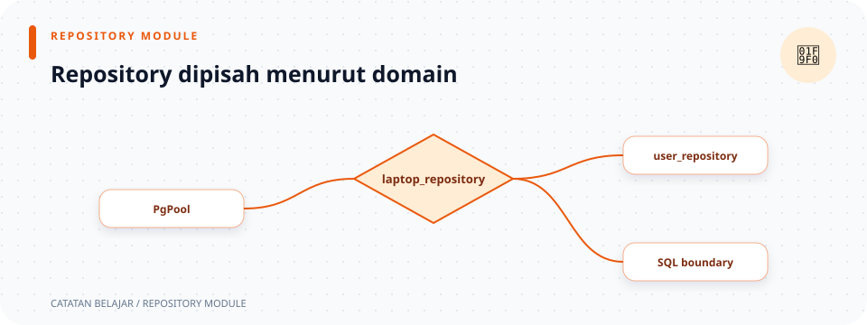

# `src/repositories/mod.rs`

> **Navigasi:** [Indeks catatan](../../README.md) · [README proyek](../../../README.md) · [Endpoint API](../../../endpoin.md)




[Buka source `repositories/mod.rs`](../../../src/repositories/mod.rs)

## Tujuan

Modul ini mendaftarkan file query database yang dikelompokkan menurut jenis data: laptop dan user. File ini hanya mengatur struktur modul; koneksi dan query database berada di file repository masing-masing.

## Kode dan urutannya

```rust
pub mod laptop_repository;
pub mod user_repository;
```

### Baris 1: repository laptop

`pub mod laptop_repository;` memberitahu Rust bahwa source modul ada di `laptop_repository.rs` dan membuat namanya bisa dipakai melalui `repositories::laptop_repository`.

### Baris 2: repository user

`pub mod user_repository;` melakukan hal yang sama untuk `user_repository.rs`. Urutan kedua deklarasi tidak mengubah urutan query atau perilaku aplikasi; keduanya hanya mendaftarkan modul.

Dalam sintaks `pub mod nama;`:

- `pub` mengatur visibilitas, sehingga modul dapat diakses dari bagian crate lain lewat jalur yang tersedia.
- `mod` mendeklarasikan modul.
- `nama` adalah nama modul dan umumnya sama dengan nama file tanpa `.rs`.
- `;` menandakan isi modul berada di file terpisah. Isi `laptop_repository.rs` dan `user_repository.rs` tidak ditulis ulang di file ini.

Contohnya, `use crate::repositories::laptop_repository;` mengimpor modul agar kode dapat memanggil `laptop_repository::list_laptops(...)`. Deklarasi modul hanya mengatur nama dan akses kode; deklarasi itu tidak membuat koneksi atau menjalankan query. Fungsi repository tetap harus dipanggil dan hasilnya ditunggu dengan `.await`.

| Modul | Tabel PostgreSQL | Kegunaan utama |
| --- | --- | --- |
| `laptop_repository` | `public.laptops` | Membaca daftar/detail, membuat, mengubah, dan menghapus laptop. |
| `user_repository` | `public.users` | Mencari password latihan, membuat akun, dan menyinkronkan akun admin. |

## Koneksi database

File ini tidak membuat koneksi. `PgPool` dibuat saat startup oleh [config](../config.md), lalu diberikan ke handler. Handler meneruskan referensi pool ke fungsi repository untuk menjalankan query.

## Buka implementasi query

- [laptop_repository.rs](laptop-repository.md) menjelaskan query CRUD untuk tabel laptops.
- [user_repository.rs](user-repository.md) menjelaskan query akun pada tabel users.

## Ilustrasi perjalanan query

```text
main membuat PgPool → router membagikan pool → handler → repository → PostgreSQL
```
