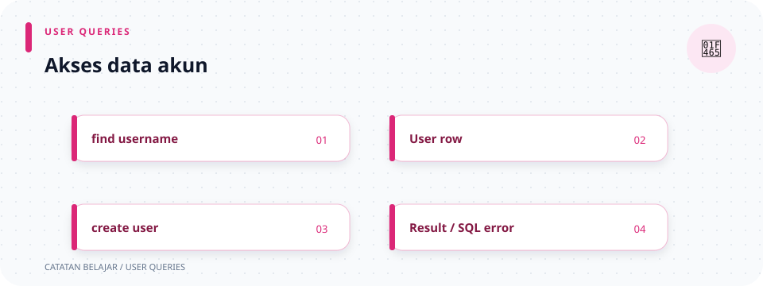

# `src/repositories/user_repository.rs`

> **Navigasi:** [Indeks catatan](../../README.md) · [README proyek](../../../README.md) · [Endpoint API](../../../endpoin.md)




[Buka source `user_repository.rs`](../../../src/repositories/user_repository.rs)

## Tujuan

File ini mengisolasi query PostgreSQL pada tabel `public.users`. Layanan auth dan handler memanggil fungsi-fungsinya; repository tidak membaca HTTP, memverifikasi password, ataupun membuat session/JWT. Password yang tersimpan adalah hash Argon2id pada `password_hash`, bukan password asli.

## Sintaks yang dipakai

```rust
pub async fn find_password_hash(
    pool: &PgPool,
    username: &str,
) -> Result<Option<String>, sqlx::Error>
```

- `pub` membuat fungsi dapat dipanggil melalui modul repository.
- `async` memungkinkan fungsi menunggu I/O database; pemanggil menggunakan `.await`.
- `&PgPool` dan `&str` meminjam pool dan username, bukan mengambil kepemilikannya.
- `Result<T, sqlx::Error>` memisahkan operasi sukses (`Ok(T)`) dari kegagalan query (`Err`).
- `Option<T>` berarti nilai mungkin ada (`Some`) atau tidak ada (`None`). `None` hasil pencarian normal bukan error database.
- `$1`, `$2`, dan seterusnya adalah placeholder PostgreSQL. `.bind(...)` memasang nilainya sebagai parameter terpisah dari SQL.
- `.await?` menunggu query lalu meneruskan `sqlx::Error` ke pemanggil; handler/service yang memanggilnya menentukan respons atau tindakan berikutnya.

## Mencari dan memeriksa akun

### `find_password_hash`

```rust
sqlx::query_scalar("SELECT password_hash FROM public.users WHERE username = $1")
    .bind(username)
    .fetch_optional(pool)
    .await
```

`query_scalar` mengambil satu kolom, bukan seluruh baris. Fungsi menghasilkan `Ok(Some(hash))` bila username ditemukan, `Ok(None)` bila tidak ada, atau `Err(error)` bila query gagal. Hash kemudian dipakai auth service untuk memverifikasi password.

### `find_user_by_username`

Mengambil `id` dan `role` dengan `query_as`, lalu mengubah teks role dari database menjadi `UserRole`. Hasil normalnya `Some((id, role))` atau `None`. Parsing role yang gagal diubah menjadi `sqlx::Error::Decode`, agar data role tak dikenal tidak dianggap identitas yang valid.

`map` mengubah isi `Option`; `transpose` mengubah `Option<Result<T, E>>` menjadi `Result<Option<T>, E>`. Karena itu signature dapat menyatakan sekaligus “akun mungkin tidak ditemukan” dan “konversi/query mungkin gagal”.

### `find_login_identity`

Membaca tuple `(id, role, token_version)` untuk login. `query_as::<_, (i64, String, i64)>` meminta SQLx memetakan baris ke tuple tersebut; `_` membiarkan compiler menyimpulkan parameter generik pertama. Role teks diparse menjadi `UserRole`, dengan penanganan error dan `transpose` yang sama seperti pencarian username.

### `find_user_by_id`

Mencari `(username, role, token_version)` menggunakan ID pengguna dan placeholder `$1`. Fungsi ini juga mem-parsing role lalu mengembalikan `Result<Option<(String, UserRole, i64)>, sqlx::Error>`.

## Upgrade password lama

Fungsi-fungsi ini mendukung transisi bertahap dari kolom password lama. Alur pemanggil berada di auth saat startup; password lama di-hash sebelum kolom lama dihapus.

### `find_legacy_passwords`

Mengambil pasangan `(id, legacy_password)` yang belum mempunyai `password_hash`, diurutkan berdasarkan ID. `fetch_all` mengembalikan `Vec<(i64, String)>`; vector kosong berarti tidak ada baris yang perlu diproses.

### `has_legacy_password_column`

Menjalankan `SELECT EXISTS` terhadap `information_schema.columns`. `fetch_one` mengambil satu hasil boolean: `true` jika kolom masih ada dan `false` jika sudah dihapus.

### `replace_legacy_password`

Mengisi `password_hash` dan mengosongkan `legacy_password` untuk ID tertentu, tetapi hanya jika `password_hash IS NULL`. Kondisi tambahan itu mencegah proses yang berjalan bersamaan menimpa hash yang sudah lebih dahulu dibuat. `.execute(...).await?` meneruskan error; `Ok(())` berarti operasi selesai tanpa mengembalikan baris.

### `finalize_password_hash_migration`

Menjalankan dua perintah skema: menetapkan `password_hash` sebagai `NOT NULL`, lalu menghapus kolom `legacy_password`. Masing-masing `.execute(pool).await?` harus sukses sebelum fungsi menghasilkan `Ok(())`.

Migration historis perlu dipertahankan agar checksum SQLx tetap cocok. Perubahan skema berikutnya harus berupa migration baru; lihat [panduan skema dan migration](../database/initial-schema.md).

## Membuat dan mengubah akun

### `increment_token_version`

Menjalankan `UPDATE users SET token_version = token_version + 1 WHERE id = $1`. Hasilnya `Result<(), sqlx::Error>`. Kenaikan versi membuat JWT lama pengguna tidak cocok dengan versi di database. Makna dan alurnya dijelaskan pada [catatan token_version](../../token_ver.md); logout memanggil fungsi ini sebelum menghapus session aktif.

### `set_user_role`

Memperbarui role berdasarkan username dan menaikkan `token_version` hanya jika role memang berubah. SQL `IS DISTINCT FROM` membandingkan nilai secara aman termasuk kemungkinan `NULL`; `CASE ... THEN 1 ELSE 0 END` menentukan kenaikan versi. `RETURNING` dan `fetch_optional` menghasilkan `Some(username)` bila akun ditemukan atau `None` bila tidak, lalu `.is_some()` mengubah hasil menjadi `bool`.

### `upsert_user`

Memasukkan akun atau menyinkronkan akun yang sudah ada. `.bind(username)`, `.bind(password_hash)`, dan `.bind(role.as_str())` memasangkan tiga nilai ke `$1`–`$3`. `ON CONFLICT (username) DO UPDATE` menangani benturan username; `EXCLUDED` merujuk nilai baris yang sedang dicoba untuk dimasukkan. Jika hash password berbeda, `CASE` menaikkan `token_version`; jika sama, versinya tetap. Fungsi mengembalikan `Ok(())` tanpa membaca baris.

### `insert_user`

Membuat akun baru tanpa menimpa akun yang ada. `ON CONFLICT (username) DO NOTHING` menghindari race antara pemeriksaan username dan insert. `RETURNING username` menghasilkan nilai hanya jika baris baru benar-benar dibuat; `fetch_optional` lalu membedakan hasilnya. `Some` menjadi `true`, sedangkan konflik menjadi `false`. Keduanya adalah hasil operasi normal dalam `Ok(bool)`, bukan error.

## Ringkasan hasil

| Fungsi | Hasil sukses | Arti hasil tanpa data |
| --- | --- | --- |
| `find_password_hash` | `Option<String>` | Username tidak ditemukan. |
| `find_legacy_passwords` | `Vec<(i64, String)>` | Vector kosong: tidak ada password lama. |
| `has_legacy_password_column` | `bool` | `false`: kolom sudah tidak ada. |
| `replace_legacy_password`, `finalize_password_hash_migration`, `increment_token_version`, `upsert_user` | `()` | Tidak mengembalikan baris; error tetap dapat terjadi. |
| `find_user_by_username`, `find_login_identity`, `find_user_by_id` | `Option<tuple>` | Akun tidak ditemukan. |
| `set_user_role`, `insert_user` | `bool` | `false`: target tak ditemukan atau username sudah dipakai. |

Semua hasil di atas dibungkus `Result<..., sqlx::Error>`. Untuk gambaran lengkap auth, lihat [layanan auth](../auth/mod.md) dan [alur JWT](../auth/jwt.md).

## Ilustrasi alur akun

```text
login → cari hash + identitas → verifikasi password → JWT memuat token_version
logout → naikkan token_version → hapus session aktif
startup → temukan password lama → hash → simpan hash → hapus kolom lama
register/admin → insert atau sinkronkan akun melalui parameter SQL
```
