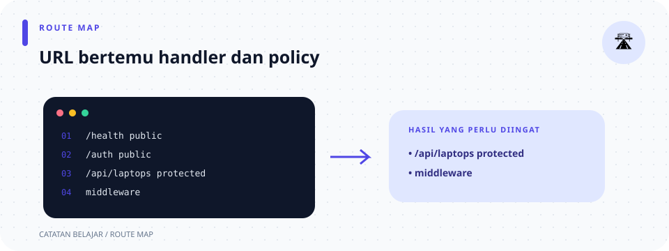

# `src/routes.rs`

> **Navigasi:** [Indeks catatan](../README.md) · [README proyek](../../README.md) · [Endpoint API](../../endpoin.md)




[Buka kode sumber `routes.rs`](../../src/routes.rs)

## Tanggung jawab file

File ini menjadi peta URL API. Ia menentukan method HTTP mana yang memanggil fungsi handler mana, memasang `PgPool` dan verifikator JWT, dan melindungi route admin dengan session cookie atau bearer JWT.

Tidak ada validasi, SQL, atau format response di sini. Pemisahan ini membuat daftar endpoint mudah dilihat dari satu file.

## Peta route

```text
Router
├── public: /health, /api/auth/register, /api/auth/login
└── protected: /api/auth/session, /api/auth/logout, /api/laptops/**, /api/admin/users/**
                 ↓ require_auth (JWT bearer atau session cookie)
               handler
```

## Di halaman ini

[Import](#import) · [Fungsi router](#fungsi-create_router) · [Urutan setup](#uraian-kode-berurutan) · [Daftar endpoint](#peta-endpoint) · [File terkait](#hubungan-dengan-file-lain)

## Import

| Import | Kegunaan |
| --- | --- |
| `Router` | Tipe router Axum yang menyimpan semua route. |
| `routing::{get, post}` | Pembuat route GET dan POST. Method lain dipanggil sebagai `.patch`, dan `.delete` dari route yang sama. |
| `PgPool` | Tipe state database yang diterima dan dipasang pada router. |
| `SessionManagerLayer` dan `MemoryStore` | Menyimpan data session di server dan mengelola cookie session. |
| `crate::handlers` | Mengimpor modul yang mengekspor seluruh fungsi handler pada satu namespace. |

## Fungsi `create_router(...)`

Signature lengkapnya adalah `pub fn create_router(pool: PgPool, session_cookie_secure: bool, jwt_secret: String) -> Router`.

- `pub` membuat fungsi dapat dipanggil oleh `main.rs` melalui `routes::create_router`.
- `pool: PgPool` menerima pool yang sudah dibuat di `config.rs`.
- `session_cookie_secure` menentukan apakah cookie wajib menggunakan HTTPS.
- `jwt_secret` adalah kunci HMAC HS256 untuk menerbitkan dan memeriksa JWT.
- `-> Router` berarti hasil fungsi adalah router yang siap diberikan ke `axum::serve`.
- Fungsi tidak `async` karena ia hanya menyusun konfigurasi route; tidak ada operasi jaringan yang ditunggu.

## Uraian kode berurutan

1. Router publik mendaftarkan `GET /health`, `POST /api/auth/register`, dan `POST /api/auth/login`. Registrasi membuat akun; login memeriksa tabel user, membuat session baru, dan menerbitkan JWT saat password cocok.
2. `protected_routes` mendaftarkan session/logout, operasi laptop, serta route admin untuk membuat pengguna dan mengubah role.
3. `.route_layer(middleware::from_fn_with_state(pool.clone(), auth::require_auth))` memanggil middleware dari [`auth/session.rs`](auth/session.md) sebelum request mencapai handler pada grup protected. Middleware memverifikasi bearer JWT atau session; JWT dicocokkan dengan `token_version` dan role terkini di database.
4. Route `"/api/laptops"` memakai satu URL untuk dua method:
   - `get(handlers::list_laptops)` untuk mengambil daftar.
   - `.post(handlers::create_laptop)` untuk menambah data.
5. Route `"/api/laptops/{id}"` memakai `{id}` sebagai parameter dinamis. Axum mengambil nilai itu sebagai `Path<i64>` pada handler:
   - `get(handlers::get_laptop)` untuk detail.
   - `.patch(handlers::update_laptop)` untuk perubahan parsial.
   - `.delete(handlers::delete_laptop)` untuk penghapusan.
6. `Extension<JwtService>` menyediakan konfigurasi JWT kepada middleware dan handler login.
7. `SessionManagerLayer` menggunakan `MemoryStore` untuk menyimpan session server-side. Cookie Secure diaktifkan sesuai konfigurasi; cookie tetap dikelola middleware session.
8. `.with_state(pool)` memindahkan pool ke router sebagai state. Setiap request kemudian dapat meminta `State<PgPool>` tanpa membuat koneksi baru.

### Cara membaca signature dan builder

`pub fn create_router(pool: PgPool, session_cookie_secure: bool, jwt_secret: String) -> Router` menerima tiga parameter yang dimiliki fungsi, lalu mengembalikan `Router` secara langsung. `PgPool` dimasukkan ke router sebagai state; secret dipindahkan ke `JwtService`, sementara `.clone()` pada pool sebelum pemasangan middleware membuat pegangan pool tambahan yang murah. Builder calls seperti `.route(...).layer(...).with_state(...)` menghasilkan konfigurasi berantai; fungsi tidak memakai `async` karena tidak membuka koneksi atau menunggu operasi I/O.

`get(handler).post(handler)` memasang beberapa method pada path yang sama. `Router::new()` membuat router kosong, `.merge(protected_routes)` menggabungkan route, dan layer menerapkan middleware/session ke router. Karena route protected dibangun terpisah, middleware autentikasi tidak mengunci endpoint publik.

Method yang tidak didaftarkan pada URL tersebut tidak akan menuju handler ini. Contoh, `POST /health` bukan route yang dibuat file ini. Middleware autentikasi menjawab “siapa yang login”; pemeriksaan `can_access` pada role menjawab “apakah role itu boleh memakai method/path ini”.

## Peta endpoint

| Method | URL | Handler | Data tambahan |
| --- | --- | --- | --- |
| GET | `/health` | `health` | Tidak ada. |
| POST | `/api/auth/register` | `register` | `State(pool)`, JSON username/password; publik dan tidak membuat session. |
| POST | `/api/auth/login` | `login` | `State(pool)`, `JwtService`, JSON username/password; membuat session dan token bila cocok dengan tabel users. |
| GET | `/api/auth/session` | `current_user` | Session aktif atau JWT bearer valid (wajib login). |
| POST | `/api/auth/logout` | `logout` | Session aktif atau JWT bearer valid (wajib login); mencabut semua JWT pengguna dan session yang dipakai. |
| GET | `/api/laptops` | `list_laptops` | `State(pool)`. |
| POST | `/api/laptops` | `create_laptop` | `State(pool)` dan `Json<CreateLaptopPayload>`. |
| GET | `/api/laptops/{id}` | `get_laptop` | `State(pool)` dan `Path<i64>`. |
| PATCH | `/api/laptops/{id}` | `update_laptop` | `State(pool)`, `Path<i64>`, dan `Json<UpdateLaptopPayload>`. |
| DELETE | `/api/laptops/{id}` | `delete_laptop` | `State(pool)` dan `Path<i64>`. |
| POST | `/api/admin/users` | `create_user` | Dilindungi autentikasi; policy role menentukan akses. |
| PATCH | `/api/admin/users/{username}/role` | `update_user_role` | Dilindungi autentikasi; username berasal dari path. |

## Hubungan dengan file lain

[Main](main.md) membuat pool lebih dulu lalu memanggil fungsi ini. [Handlers](handlers.md) menyediakan semua fungsi yang dipasang. State `PgPool` berasal dari [config](config.md). Handler autentikasi dijelaskan di [auth](handlers/auth.md). Untuk perjalanan request lengkap, lihat [alur aplikasi](../02-alur-kerja-aplikasi.md).
