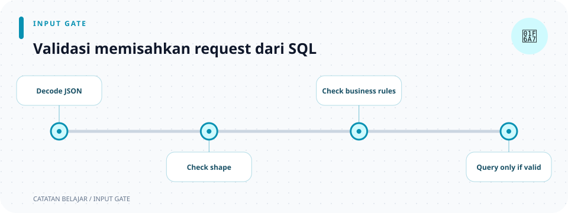

# Validasi input

> **Navigasi:** [Indeks catatan](../README.md) · [README proyek](../../README.md) · [Endpoint API](../../endpoin.md)




[Buka modul validation](../../src/validation/mod.rs)

## Tanggung jawab

Validasi memastikan nilai dari request layak diproses sebelum handler memanggil repository. Aturan dipisahkan dari handler supaya alur HTTP tidak bercampur dengan pemeriksaan nilai.

## Struktur

```text
validation/
├── mod.rs
├── id.rs
├── text.rs
├── create.rs
└── update.rs
```

| Catatan | Aturan |
| --- | --- |
| [validation/mod.rs](validation/mod.md) | Mendaftarkan aturan dan mengekspor validator publik. |
| [validation/id.rs](validation/id.md) | ID harus lebih besar dari nol. |
| [validation/text.rs](validation/text.md) | Menghapus spasi pinggir, menolak teks kosong, dan membatasi karakter. |
| [validation/create.rs](validation/create.md) | Memeriksa seluruh payload POST. |
| [validation/update.rs](validation/update.md) | Memeriksa field yang dikirim pada PATCH dan menolak payload kosong. |

## Perilaku umum

Validator mengembalikan `Result`. `Ok(...)` berisi nilai yang sudah valid dan/atau dinormalisasi. `Err(ApiError::BadRequest(...))` diteruskan handler dan dipetakan menjadi HTTP 400 oleh [error handler](error.md).

Validasi aplikasi memberi pesan yang mudah dipahami client. Constraint pada PostgreSQL di [migration](database/0001-create-laptops.md) tetap menjadi perlindungan terakhir untuk data yang ditulis melalui jalur lain.

## Aturan yang diterapkan

| Data | Aturan | Hasil jika tidak valid |
| --- | --- | --- |
| Path `{id}` | Bilangan bulat positif. | `400 Bad Request`; ID positif yang tidak ditemukan menjadi `404`. |
| `nama` | Spasi pinggir dibuang, tidak boleh kosong, maksimum 150 karakter. | `400 Bad Request`. |
| `merek` | Spasi pinggir dibuang, tidak boleh kosong, maksimum 100 karakter. | `400 Bad Request`. |
| `harga` | Bilangan bulat nol atau lebih. | `400 Bad Request`. |
| `stok` | Bilangan bulat nol atau lebih. | `400 Bad Request`. |
| Body PATCH | Minimal satu dari empat field harus dikirim. | `400 Bad Request`. |

`validate_text` menghitung karakter Unicode dengan `.chars().count()`, bukan byte UTF-8. Validator create memeriksa semua field; validator update hanya memeriksa field bernilai `Some`, sehingga `None` tetap berarti “jangan ubah”.

## Urutan pada request laptop

```text
Axum membaca tipe request → handler memanggil validator → validasi sukses? → repository
                                    └─ gagal → ApiError → HTTP 400 JSON
```

Deserialisasi JSON terjadi sebelum validator. Jika body tidak cocok dengan tipe Rust (misalnya string dikirim untuk `harga`), extractor Axum menghentikan request sebelum fungsi validator berjalan. Error extractor ditangani Axum, bukan `ApiError` aplikasi.

## Buka penjelasan tiap aturan

- [ID](validation/id.md): pemeriksaan path dan contoh hasil `Result`.
- [Teks](validation/text.md): trim, panjang Unicode, dan pesan error.
- [Create](validation/create.md): aturan body `POST`.
- [Update](validation/update.md): `Option`, `take()`, dan body `PATCH`.
