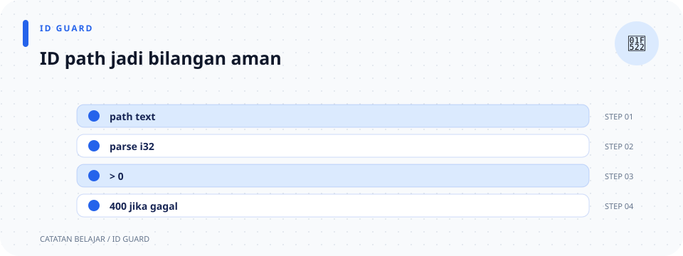

# `src/validation/id.rs`

> **Navigasi:** [Indeks catatan](../../README.md) · [README proyek](../../../README.md) · [Endpoint API](../../../endpoin.md)




[Buka source `id.rs`](../../../src/validation/id.rs)

## Tujuan

File ini memeriksa ID laptop sebelum handler mengirim query ke database. ID harus lebih besar dari nol. ID yang lolos pemeriksaan belum tentu ada di database; pemeriksaan keberadaan dilakukan oleh repository.

## Import

```rust
use crate::error::ApiError;
```

- `use` membawa nama agar dapat dipakai langsung di file ini.
- `crate::` berarti jalur dimulai dari akar crate aplikasi.
- `ApiError` adalah tipe error aplikasi. Validator memakai varian `BadRequest` untuk input yang tidak valid.

## Fungsi `validate_laptop_id`

Kode:

```rust
pub fn validate_laptop_id(id: i64) -> Result<(), ApiError> {
    if id <= 0 {
        return Err(ApiError::BadRequest("ID harus berupa angka positif".into()));
    }

    Ok(())
}
```

### Deklarasi fungsi

- `pub` membuat fungsi dapat dipakai oleh modul lain, misalnya handler detail, update, dan delete.
- `fn` menandai deklarasi fungsi.
- `id: i64` adalah parameter ID bertipe bilangan bulat 64-bit bertanda. Ia dapat menampung angka negatif, sehingga fungsi tetap perlu memeriksa nilainya.
- `-> Result<(), ApiError>` berarti fungsi dapat berhasil tanpa menghasilkan data (`Ok(())`), atau gagal dengan `ApiError`.
- `()` disebut *unit type*: penanda bahwa tidak ada nilai khusus yang perlu dikembalikan saat validasi berhasil.

### Isi fungsi baris demi baris

1. `if id <= 0` memeriksa apakah ID nol atau negatif. Operator `<=` berarti “lebih kecil dari atau sama dengan”.
2. `return` langsung mengakhiri fungsi dengan nilai yang disebut sesudahnya.
3. `Err(...)` menandakan validasi gagal. `ApiError::BadRequest(...)` memilih jenis error HTTP 400 dan membawa pesan yang dapat ditampilkan kepada client.
4. `"ID harus berupa angka positif".into()` mengubah string literal menjadi tipe pesan yang dibutuhkan varian `BadRequest` (sebuah `String`).
5. Jika kondisi `if` tidak terpenuhi, fungsi mencapai `Ok(())`. `Ok` menandakan validasi berjalan normal dan tidak menemukan kesalahan.

### Contoh hasil

| Input | Hasil validasi | Arti |
| --- | --- | --- |
| `1` | `Ok(())` | Format ID memenuhi aturan positif. Repository masih perlu memastikan ID ini ada. |
| `0` | `Err(ApiError::BadRequest(...))` | Ditolak sebagai request tidak valid. |
| `-1` | `Err(ApiError::BadRequest(...))` | Ditolak sebagai request tidak valid. |

Handler biasanya memakai `?` saat memanggil fungsi ini. Jika hasilnya `Err`, `?` menghentikan handler dan meneruskan error agar diubah menjadi response HTTP.

## Unit test

```rust
#[cfg(test)]
mod tests {
    use super::validate_laptop_id;

    #[test]
    fn laptop_id_must_be_positive() {
        assert!(validate_laptop_id(1).is_ok());
        assert!(validate_laptop_id(0).is_err());
        assert!(validate_laptop_id(-1).is_err());
    }
}
```

- `#[cfg(test)]` membuat modul ini aktif ketika test dijalankan.
- `mod tests` mengelompokkan test.
- `use super::...` mengambil fungsi dari modul satu tingkat di atas (`validation`).
- `#[test]` menandai fungsi sebagai unit test.
- `assert!(...)` membuat test gagal jika kondisi di dalamnya `false`.
- `.is_ok()` dan `.is_err()` memeriksa varian hasil `Result`.

Test mencakup ID positif, nol, dan negatif agar aturan batasnya jelas.

## Ilustrasi keputusan

```text
ID dari URL
├── id <= 0 → 400 Bad Request
└── id > 0  → query dapat berjalan (ID belum tentu ada di database)
```
