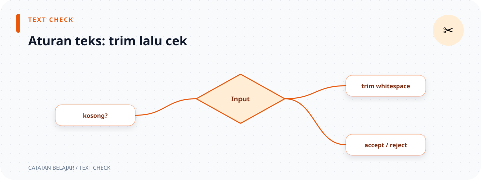

# `src/validation/text.rs`

> **Navigasi:** [Indeks catatan](../../README.md) · [README proyek](../../../README.md) · [Endpoint API](../../../endpoin.md)




[Buka source `text.rs`](../../../src/validation/text.rs)

## Tujuan

File ini menyediakan helper umum untuk membersihkan dan memeriksa teks seperti nama laptop dan merek. Teks dengan spasi pinggir dibersihkan, teks kosong ditolak, dan jumlah karakter dibatasi.

## Import

```rust
use crate::error::ApiError;
```

`crate::` menunjuk akar crate aplikasi. `ApiError` dipakai untuk mengembalikan kesalahan input sebagai `BadRequest` (HTTP 400).

## Fungsi `validate_text`

Kode:

```rust
pub(super) fn validate_text(
    value: String,
    field: &str,
    max_length: usize,
) -> Result<String, ApiError> {
    let value = value.trim().to_string();

    if value.is_empty() {
        return Err(ApiError::BadRequest(format!("{field} tidak boleh kosong")));
    }
    if value.chars().count() > max_length {
        return Err(ApiError::BadRequest(format!(
            "{field} maksimal {max_length} karakter"
        )));
    }

    Ok(value)
}
```

### Deklarasi fungsi

- `pub` membuat fungsi terbuka menurut aturan visibility Rust. Namun, modul induknya dideklarasikan `mod text;` (privat) dan tidak di-re-export, sehingga pemanggil normal memakai validator payload, bukan jalur `validation::text` dari luar modul.
- `fn validate_text` mendeklarasikan fungsi bernama `validate_text`.
- `value: String` adalah teks yang dimiliki fungsi. `String` merupakan teks yang dapat dimiliki dan disimpan.
- `field: &str` adalah nama field yang dipinjam, misalnya `"Nama laptop"`, agar pesan error dapat menyebut field yang tepat.
- `max_length: usize` adalah batas jumlah karakter. `usize` adalah tipe bilangan bulat yang biasa dipakai untuk ukuran atau indeks.
- `-> Result<String, ApiError>` berarti hasilnya teks bersih (`Ok(String)`) atau error validasi (`Err(ApiError)`).

### Alur isi fungsi

1. `value.trim()` membuat tampilan teks tanpa whitespace di awal dan akhir. Teks `"  Laptop  "` menjadi `"Laptop"`.
2. `.to_string()` membuat `String` yang dimiliki fungsi dari hasil trim.
3. `let value = ...` mengikat hasil bersih ke nama `value` yang sama. Ini *shadowing*: nama lama digantikan nama baru dengan nilai yang sudah dibersihkan.
4. `if value.is_empty()` memeriksa apakah hasil bersih kosong. Contohnya, input `"   "` menjadi kosong setelah trim.
5. `return Err(...)` langsung menghentikan fungsi dengan error. `format!("{field} ...")` menyusun pesan dinamis dengan memasukkan nilai `field`.
6. `value.chars().count()` menghitung Unicode scalar value, bukan jumlah byte UTF-8. Karena itu huruf `é` dihitung sebagai satu karakter; beberapa emoji gabungan dapat dihitung lebih dari satu scalar value meskipun terlihat seperti satu simbol.
7. `> max_length` memeriksa apakah teks melampaui batas. Jika iya, fungsi mengembalikan pesan error yang menyebut batas tersebut.
8. Jika kedua pemeriksaan lolos, `Ok(value)` mengembalikan teks yang sudah dibersihkan.

## Contoh

| Input | Batas | Hasil |
| --- | ---: | --- |
| `"  ThinkPad  "` | 150 | `Ok("ThinkPad")` |
| `"   "` | 150 | Error: teks tidak boleh kosong |
| `"é"` | 1 | `Ok("é")` |
| `"éé"` | 1 | Error: melebihi batas |

Helper ini digunakan validator [create](create.md) dan [update](update.md). Validator tersebut menentukan nama field dan batas panjangnya.

## Unit test

Modul test di source memeriksa tiga perilaku helper:

1. Spasi di awal dan akhir dihapus.
2. Teks yang kosong setelah proses trim ditolak.
3. Karakter Unicode dihitung sebagai karakter, bukan byte.

Pada test, `.into()` mengubah string literal menjadi `String` sesuai tipe parameter, `matches!(...)` mencocokkan pola hasil `Result`, dan `assert!(...)` menggagalkan test bila kondisinya salah.

## Ilustrasi normalisasi

```text
teks dengan spasi → trim → cek kosong → cek panjang → Ok(String)
teks berisi spasi saja → trim → kosong → BadRequest
```
