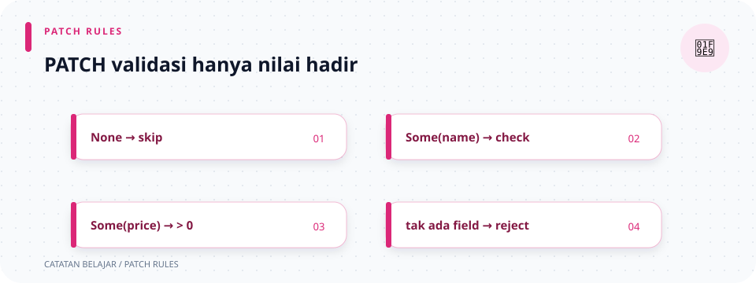

# `src/validation/update.rs`

> **Navigasi:** [Indeks catatan](../../README.md) · [README proyek](../../../README.md) · [Endpoint API](../../../endpoin.md)




[Buka source `update.rs`](../../../src/validation/update.rs)

## Tujuan

Validator ini memeriksa body `PATCH` yang boleh berisi hanya sebagian field laptop. Field yang tidak dikirim tetap `None` dan tidak diubah; field yang dikirim diperiksa sebelum handler mengirim query update.

## 1. Import

```rust
use crate::{error::ApiError, models::UpdateLaptopPayload};
use super::text::validate_text;
```

- `crate::` menunjuk akar crate.
- `ApiError` digunakan untuk menandai input tidak valid.
- `UpdateLaptopPayload` menampung field PATCH dalam bentuk `Option`.
- `super::text::validate_text` mengambil helper teks dari modul saudara dalam `validation`.

## 2. Fungsi `validate_update_laptop`

```rust
pub fn validate_update_laptop(
    mut payload: UpdateLaptopPayload,
) -> Result<UpdateLaptopPayload, ApiError> {
    if let Some(nama) = payload.nama.take() {
        payload.nama = Some(validate_text(nama, "Nama laptop", 150)?);
    }
    if let Some(merek) = payload.merek.take() {
        payload.merek = Some(validate_text(merek, "Merek laptop", 100)?);
    }
    if payload.harga.is_some_and(|harga| harga < 0) {
        return Err(ApiError::BadRequest("Harga tidak boleh negatif".into()));
    }
    if payload.stok.is_some_and(|stok| stok < 0) {
        return Err(ApiError::BadRequest("Stok tidak boleh negatif".into()));
    }
    if payload.nama.is_none()
        && payload.merek.is_none()
        && payload.harga.is_none()
        && payload.stok.is_none()
    {
        return Err(ApiError::BadRequest(
            "Minimal satu field harus dikirim untuk diperbarui".into(),
        ));
    }

    Ok(payload)
}
```

### Deklarasi

- `pub fn` mendeklarasikan fungsi publik untuk dipakai handler.
- `mut payload` berarti binding `payload` boleh diubah. Kata `mut` diperlukan karena validasi teks akan menulis kembali field nama dan merek.
- `UpdateLaptopPayload` adalah tipe input dan tipe data yang dikembalikan jika valid.
- `Result<UpdateLaptopPayload, ApiError>` membedakan payload valid dari error validasi.

### Pemeriksaan field teks

1. `payload.nama.take()` mengambil nilai `Option<String>` dari field dan mengganti field asalnya dengan `None`.
2. `if let Some(nama) = ...` menjalankan blok hanya jika nilai tadi berisi teks. `Some(nama)` membuka nilai yang ada dan mengikatnya pada variabel `nama`.
3. `validate_text(...)?` memeriksa teks dan meneruskan error jika tidak valid.
4. `Some(...)` membungkus lagi hasil bersih sebagai `Option`, lalu disimpan ke `payload.nama`.
5. Langkah yang sama dilakukan untuk `merek`, dengan batas 100 karakter.

`take()` dipakai agar nilai dapat dipindahkan keluar dari field, divalidasi, lalu dimasukkan kembali tanpa harus membuat salinan `String`.

### Pemeriksaan angka

- `payload.harga.is_some_and(|harga| harga < 0)` mengembalikan `true` hanya jika harga dikirim (`Some`) dan nilainya negatif.
- `|harga| harga < 0` adalah closure: fungsi kecil yang menerima nilai bernama `harga` dan menguji apakah nilainya kurang dari nol.
- Jika harga atau stok negatif, fungsi segera mengembalikan `ApiError::BadRequest`. Nilai nol diperbolehkan.

### Menolak body tanpa perubahan

Rangkaian `&&` berarti “dan”. Jika `nama`, `merek`, `harga`, **dan** `stok` semuanya `None`, tidak ada field yang dikirim. Fungsi menolak payload tersebut agar request PATCH kosong tidak dianggap sebagai perubahan.

Jika minimal satu field berisi nilai, `Ok(payload)` mengembalikan payload yang sudah divalidasi.

## Contoh

Body `{"nama":" ThinkPad "}` menjadi `nama: Some("ThinkPad")`; field lain tetap `None`. Body `{}` menghasilkan error karena tidak ada perubahan. Harga atau stok negatif juga ditolak.

Field `None` diteruskan ke repository sebagai field yang tidak diubah. Query PATCH menggunakan `COALESCE` untuk mempertahankan nilai lama; detailnya ada di [repository laptop](../repositories/laptop-repository.md).

## Ringkasan perilaku field

| Field request | Contoh | Hasil validasi |
| --- | --- | --- |
| `nama` | `" ThinkPad "` | `Some("ThinkPad")` setelah trim. |
| `merek` | Tidak dikirim | Tetap `None`; merek lama dipertahankan. |
| `harga` | `0` | Diterima; nol diperbolehkan. |
| `stok` | `-1` | Ditolak sebagai `BadRequest`. |
| Semua field tidak dikirim | `{}` | Ditolak karena tidak ada perubahan. |

## 3. Unit test

Test pada source memastikan satu field teks dapat dibersihkan sementara field lain tetap dipertahankan, serta payload yang seluruh field-nya `None` ditolak. `assert_eq!` membandingkan nilai, dan `assert!(...is_err())` memastikan hasilnya error.

## Ilustrasi hasil PATCH

```text
Body berisi sebagian field → validasi nilai yang hadir
                            → None dipertahankan oleh SQL
                            → Some diperbarui
Body kosong ────────────────→ 400 Bad Request
```
