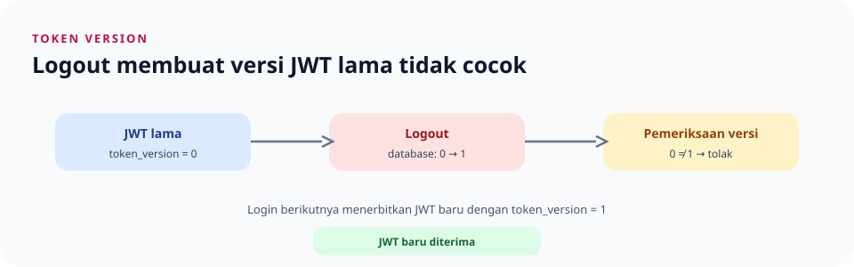

# Memahami `token_version`

> **Navigasi:** [Indeks catatan](README.md) · [JWT](rust/auth/jwt.md) · [Logout](rust/handlers/auth.md)



## Gampangnya

`token_version` adalah nomor versi token milik seorang pengguna. Aplikasi menyimpan nomor terbaru di kolom `users.token_version`, dan menyalin nomor itu ke setiap JWT saat login.

Di Rust, versi ini adalah field `i64` pada `Claims` dan kolom bilangan bulat di PostgreSQL. `i64` berarti bilangan bulat bertanda 64-bit. Middleware hanya menerima JWT setelah signature/expiry lolos dan nilai klaim tersebut sama dengan data user yang dibaca dari database.

Server membandingkan nomor di JWT dengan nomor terbaru di database setiap kali JWT dipakai:

- Nomornya sama: JWT masih berlaku.
- Nomornya berbeda: JWT ditolak.

Dengan cara ini, server dapat membatalkan JWT lama tanpa menyimpan satu per satu token di tabel blacklist.

## Contoh dari login sampai logout

Anggap nilai awal pengguna Rizki di database adalah `0`.

### 1. Login pertama

Server membuat JWT dengan klaim seperti ini:

```json
{
  "sub": 7,
  "role": "buyer",
  "token_version": 0
}
```

JWT adalah token yang dikirim ke client. Nilai `token_version: 0` merupakan bagian dari isi JWT yang sudah ditandatangani. Client menyimpan JWT tersebut dan mengirimkannya pada request berikutnya.

### 2. Memakai JWT

Saat client mengirim JWT, server memeriksa signature dan waktu kedaluwarsanya, lalu membaca `token_version` dari token. Server juga membaca versi terbaru user dari database.

Pada awalnya nilainya cocok:

```text
Versi di JWT      = 0
Versi di database = 0
Hasil             = token diterima
```

### 3. Logout

Saat logout berhasil, server menjalankan operasi yang setara dengan:

```sql
UPDATE users
SET token_version = token_version + 1
WHERE id = 7;
```

Versi yang tersimpan di database sekarang `1`. JWT lama tidak diubah dan tidak dipindahkan ke blacklist; isinya masih `token_version: 0`.

### 4. Memakai JWT lama setelah logout

Perbandingannya sekarang berbeda:

```text
Versi di JWT      = 0
Versi di database = 1
Hasil             = token ditolak
```

Jadi JWT lama tidak perlu dihapus dari server agar tidak berlaku. Ketidakcocokan nomor versinya sudah cukup untuk membuat server menolaknya.

### 5. Login lagi

Login berikutnya membaca versi terbaru (`1`) dari database dan membuat JWT baru dengan `token_version: 1`. Token baru diterima karena versinya cocok:

```text
JWT baru          = 1
Versi di database = 1
Hasil             = token diterima
```

## Apakah token dikonversi atau disimpan sebagai versi?

Tidak. JWT tidak dikonversi menjadi angka dan token lengkap tidak disimpan di database. Yang disimpan di database hanya satu angka `token_version` untuk setiap user. Angka yang sama dimasukkan ke JWT saat login.

JWT lama juga tidak diubah saat logout. Server hanya menaikkan angka di database; token lama otomatis tidak cocok lagi.

## Kenapa bukan blacklist?

Dengan blacklist, server perlu menyimpan ID setiap JWT yang dicabut, sehingga perlu tabel seperti `revoked_jwts`. Dengan `token_version`, database cukup menyimpan satu angka per user.

Komprominya, menaikkan versi mencabut **semua JWT user tersebut**, bukan hanya JWT yang dipakai untuk logout. Contohnya, token di laptop dan ponsel sama-sama tidak berlaku setelah logout dari salah satunya.

## Bagaimana dengan session cookie?

Session cookie adalah mekanisme login terpisah dari JWT. Logout juga menghapus session yang dipakai pada request logout. Session di perangkat lain tidak dihapus oleh `token_version`; yang dicabut di semua perangkat adalah JWT-nya.

## Ringkasan alur

```text
login       -> JWT membawa versi database (contoh: 0)
request     -> versi JWT sama dengan database? lanjut
logout      -> versi database naik (0 menjadi 1)
JWT lama    -> masih membawa 0, sehingga ditolak
login lagi  -> JWT baru membawa 1
```

## File implementasi

- [Pembuatan dan verifikasi JWT](rust/auth/jwt.md) mendefinisikan klaim `token_version`.
- [Middleware autentikasi](rust/auth/middleware.md) membandingkan versi pada JWT dengan database.
- [Handler logout](rust/handlers/auth.md) memicu pencabutan token.
- [Repository user](rust/repositories/user-repository.md) membaca dan menaikkan versinya.
- [Skema database](rust/database/initial-schema.md) menjelaskan kolom `token_version`.
