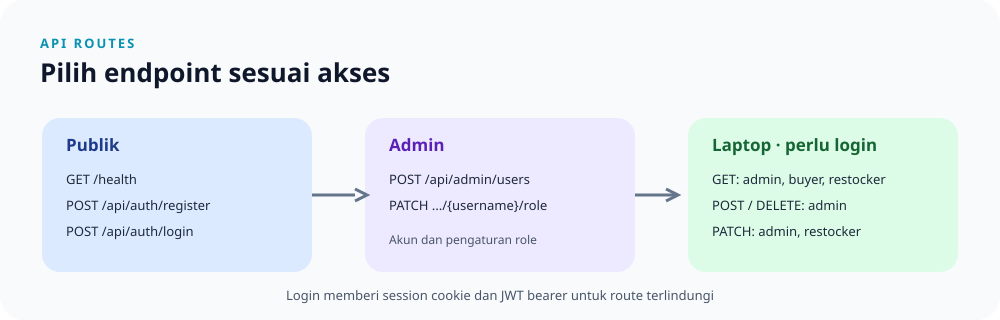

# Dokumentasi Endpoint API

> **Navigasi:** [README proyek](README.md) · [Indeks catatan](catatan/README.md) · [Panduan curl](catatan/curl.md)



## Base URL

Alamat server mengikuti `APP_HOST` dan `APP_PORT` di `.env` pada root proyek. Pada konfigurasi yang sedang berjalan, server tersedia di [http://127.0.0.1:3001](http://127.0.0.1:3001). Jika port atau host berubah, sesuaikan URL request dan variabel `baseUrl` di environment Postman. `APP_HOST` default-nya `127.0.0.1`, sedangkan `APP_PORT` wajib diatur.

Endpoint laptop memerlukan login terlebih dahulu. Pendaftaran publik menghasilkan role `buyer`; akun admin berasal dari environment. Admin dapat membuat akun buyer/restocker dan mengubah role akun melalui endpoint admin. Login mengirim cookie session dan JWT untuk request selanjutnya. Route terlindungi menerima cookie session atau header `Authorization: Bearer <token>`. Contoh URL di bawah memakai server lokal pada port `3001`.

Untuk seluruh contoh perintah terminal dan penjelasan opsi seperti `-X`, `-d`, `-b`, dan `-c`, lihat [panduan curl](catatan/curl.md).

> [!WARNING]
> Password di-hash dengan Argon2id, tetapi session disimpan sementara di memori server. Gunakan hanya untuk belajar lokal, bukan untuk akun nyata atau produksi.

## Ringkasan Endpoint

| Method | Endpoint | Kegunaan | Akses | Sukses |
| --- | --- | --- | --- | --- |
| `GET` | [`/health`](http://127.0.0.1:3001/health) | Memeriksa apakah server merespons | Publik | `200 OK` |
| `POST` | `/api/auth/register` | Membuat akun baru | Publik | `201 Created` |
| `POST` | `/api/auth/login` | Login, membuat session, dan menerbitkan JWT | Publik | `200 OK` |
| `GET` | `/api/auth/session` | Melihat pengguna pada session atau JWT aktif | Wajib login | `200 OK` |
| `POST` | `/api/auth/logout` | Mencabut semua JWT pengguna dan session yang dipakai | Wajib login | `200 OK` |
| `POST` | `/api/admin/users` | Membuat akun buyer/restocker | Admin | `201 Created` |
| `PATCH` | `/api/admin/users/{username}/role` | Mengubah role menjadi buyer/restocker | Admin | `200 OK` |
| `GET` | [`/api/laptops`](http://127.0.0.1:3001/api/laptops) | Melihat semua laptop | Admin, buyer, restocker | `200 OK` |
| `POST` | `/api/laptops` | Menambah laptop | Admin | `201 Created` |
| `GET` | `/api/laptops/{id}` | Melihat detail laptop | Admin, buyer, restocker | `200 OK` |
| `PATCH` | `/api/laptops/{id}` | Mengubah sebagian field laptop | Admin, restocker | `200 OK` |
| `DELETE` | `/api/laptops/{id}` | Menghapus laptop | Admin | `200 OK` |

`{id}` harus berupa ID positif laptop yang ada di database. Collection Postman menyediakan request registrasi dan login, serta lima request CRUD; setelah request tambah berhasil, collection menyimpan ID sebagai `laptopId` untuk request detail, ubah, dan hapus.

**Urutan mencoba API:** periksa `/health` → registrasi akun atau siapkan akun admin → login untuk mendapat cookie → kirim request laptop → logout setelah selesai. Contoh siap salin tersedia di [panduan curl](catatan/curl.md); skenario otomatis tersedia di [panduan Postman](catatan/postman.md).

### Quick flow

```text
/health
  -> register/login
  -> cookie session dan/atau JWT bearer
  -> GET/POST/PATCH/DELETE /api/laptops
  -> logout
```

## Login, Session, dan JWT

### Registrasi — `POST /api/auth/register`

Endpoint publik untuk membuat akun buyer. Kirim JSON berisi `username` (1–100 karakter setelah spasi pinggir dibuang) dan `password` (tidak boleh kosong). Role tidak dapat ditentukan dari endpoint publik. Username yang sudah dipakai mengembalikan `409 Conflict`. Registrasi tidak otomatis login; gunakan endpoint login setelah akun berhasil dibuat.

```bash
curl -i \
  -H 'Content-Type: application/json' \
  -d '{"username":"pengguna-baru","password":"password-lokal"}' \
  http://127.0.0.1:3001/api/auth/register
```

Password di-hash dengan Argon2id dan tidak pernah dikembalikan dalam response. Gunakan password latihan, bukan password akun pribadi.

### Pengelolaan akun — admin

Admin awal disinkronkan dari `ADMIN_USERNAME` dan `ADMIN_PASSWORD`. Setelah login sebagai admin, buat akun buyer/restocker dengan `POST /api/admin/users`:

```bash
curl -i -b cookies.txt \
  -H 'Content-Type: application/json' \
  -d '{"username":"petugas-stok","password":"password-lokal","role":"restocker"}' \
  http://127.0.0.1:3001/api/admin/users
```

Role akun yang sudah ada dapat diubah dengan `PATCH /api/admin/users/{username}/role`, memakai body `{"role":"buyer"}` atau `{"role":"restocker"}`. Role `admin` hanya dapat ditetapkan melalui konfigurasi startup, dan admin tidak dapat mengubah role akunnya sendiri. Perubahan role mencabut session dan JWT lama pengguna tersebut.

Role menentukan akses endpoint laptop: buyer hanya dapat `GET`, restocker dapat `GET` dan `PATCH`, sedangkan admin dapat melakukan semua operasi. Endpoint login, session, dan logout tetap tersedia untuk semua role yang sudah login. Request terautentikasi tanpa izin mendapat `403 Forbidden`.

`POST /api/auth/login` menerima JSON username dan password dari akun terdaftar atau sesuai `ADMIN_USERNAME` dan `ADMIN_PASSWORD` di environment server:

```bash
curl -i -c cookies.txt \
  -H 'Content-Type: application/json' \
  -d '{"username":"admin","password":"GANTI_DENGAN_ADMIN_PASSWORD"}' \
  http://127.0.0.1:3001/api/auth/login
```

Response sukses mengembalikan nama pengguna, role, header `Set-Cookie` untuk session, dan `data.access_token` berupa JWT HMAC-SHA256. Token berlaku satu jam (`expires_in: 3600`) dan dapat dipakai pada header `Authorization: Bearer <token>`. Cookie bersifat `HttpOnly`; pada HTTPS juga atur `SESSION_COOKIE_SECURE=true`.

Untuk autentikasi cookie, gunakan cookie jar yang sama:

```bash
curl -i -b cookies.txt http://127.0.0.1:3001/api/laptops
curl -i -b cookies.txt http://127.0.0.1:3001/api/auth/session
curl -i -b cookies.txt -X POST http://127.0.0.1:3001/api/auth/logout
```

Untuk autentikasi JWT, salin token dari response login dan kirim header bearer:

```bash
TOKEN='SALIN_ACCESS_TOKEN_DARI_RESPONSE_LOGIN'
curl -i -H "Authorization: Bearer $TOKEN" http://127.0.0.1:3001/api/laptops
curl -i -H "Authorization: Bearer $TOKEN" http://127.0.0.1:3001/api/auth/session
```

Kredensial salah, token tidak valid/kedaluwarsa/dicabut, atau request terlindungi tanpa session maupun JWT menghasilkan `401 Unauthorized`. Jangan membagikan atau commit file cookie maupun token. Session disimpan dalam memori server dan otomatis hilang saat server dimulai ulang. Logout mencabut semua JWT pengguna dengan menaikkan `token_version`, lalu menghapus session yang dipakai; client tetap harus menghapus token lokal.

## Pemeriksaan Layanan

### `GET /health`

Buka [http://127.0.0.1:3001/health](http://127.0.0.1:3001/health). Endpoint ini memeriksa server HTTP tanpa mengakses database.

```json
{
  "status": "ok",
  "service": "toko-laptop-app"
}
```

## Operasi Laptop

### 1. Melihat semua laptop

**Request:** [GET http://127.0.0.1:3001/api/laptops](http://127.0.0.1:3001/api/laptops)

Tidak membutuhkan request body.

**Contoh response `200 OK`:**

```json
{
  "status": "success",
  "data": [
    [1, "ThinkPad E14", "Lenovo", "Rp 12.500.000", 5]
  ]
}
```

Setiap laptop pada `data` berbentuk array dengan urutan `[id, nama, merek, harga, stok]`. Harga response berupa string Rupiah. Jika belum ada laptop, `data` berupa array kosong.

### 2. Menambah laptop

**Request:** `POST http://127.0.0.1:3001/api/laptops` dengan header `Content-Type: application/json`.

```json
{
  "nama": "ThinkPad E14",
  "merek": "Lenovo",
  "harga": 12500000,
  "stok": 5
}
```

`nama` dan `merek` wajib berupa teks yang tidak kosong setelah spasi di awal/akhir dibuang. Panjang maksimum `nama` 150 karakter dan `merek` 100 karakter. `harga` wajib bilangan bulat nol atau lebih yang muat dalam `i64`; `stok` wajib bilangan bulat nol atau lebih yang muat dalam `i32`.

**Contoh response `201 Created`:**

```json
{
  "status": "success",
  "message": "Laptop berhasil ditambahkan",
  "data": {
    "id": 1,
    "nama": "ThinkPad E14",
    "merek": "Lenovo",
    "harga": "Rp 12.500.000",
    "stok": 5
  }
}
```

Berbeda dari endpoint GET, `data` pada response tambah berbentuk objek dengan nama field.

### 3. Melihat detail laptop

Ganti `1` pada [http://127.0.0.1:3001/api/laptops/1](http://127.0.0.1:3001/api/laptops/1) dengan ID laptop yang ingin dilihat. Request ini tidak membutuhkan body.

**Contoh response `200 OK`:**

```json
{
  "status": "success",
  "data": [1, "ThinkPad E14", "Lenovo", "Rp 12.500.000", 5]
}
```

### 4. Mengubah laptop

**Request:** `PATCH http://127.0.0.1:3001/api/laptops/1` dengan header `Content-Type: application/json`. Kirim satu atau beberapa field; field yang tidak dikirim tidak berubah. Minimal satu field harus dikirim.

```json
{
  "nama": "ThinkPad E14 Gen 5",
  "harga": 13500000
}
```

Field teks yang dikirim mengikuti aturan panjang dan isi yang sama seperti request tambah. `harga` dan `stok` yang dikirim harus bilangan bulat nol atau lebih.

**Contoh response `200 OK`:**

```json
{
  "status": "success",
  "message": "Laptop berhasil diperbarui",
  "data": [1, "ThinkPad E14 Gen 5", "Lenovo", "Rp 13.500.000", 5]
}
```

### 5. Menghapus laptop

**Request:** `DELETE http://127.0.0.1:3001/api/laptops/1`. Ganti `1` dengan ID laptop yang ingin dihapus. Request ini tidak membutuhkan body.

**Contoh response `200 OK`:**

```json
{
  "status": "success",
  "message": "Laptop berhasil dihapus",
  "id": 1
}
```

## Error

Error aplikasi menggunakan JSON berikut:

```json
{
  "status": "error",
  "message": "Pesan error"
}
```

Status error aplikasi yang umum:

| Status | Penyebab |
| --- | --- |
| `400 Bad Request` | ID tidak positif, teks tidak valid, nilai negatif, atau body PATCH tidak berisi field yang dapat diubah |
| `404 Not Found` | Laptop dengan ID tersebut tidak ditemukan |
| `409 Conflict` | Username registrasi sudah digunakan |
| `401 Unauthorized` | Kredensial login salah atau request memerlukan session/JWT valid |
| `500 Internal Server Error` | Query atau koneksi database gagal; detail internal tidak dikirim ke client |

Request dengan JSON yang tidak valid, tipe konten yang salah, atau ID path yang tidak dapat dibaca sebagai angka dapat ditolak oleh Axum sebelum handler dijalankan. Bentuk response untuk penolakan tersebut mengikuti format bawaan Axum dan tidak selalu memakai JSON error aplikasi di atas.
