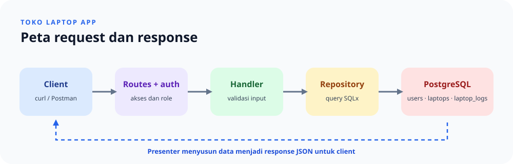

# Toko Laptop App

REST API inventaris laptop yang dibuat dengan Rust, Axum, SQLx, dan PostgreSQL. Proyek ini cocok untuk belajar alur request API dari route sampai query database.



## Mulai cepat

### Yang diperlukan

- Rust toolchain (edition 2024).
- PostgreSQL yang sudah berjalan.
- Redis yang sudah berjalan. Untuk pengembangan lokal, jalankan `docker compose up -d redis` dari folder `backend`.
- Database PostgreSQL kosong untuk aplikasi. Akun PostgreSQL aplikasi perlu izin membuat tabel dan menjalankan migration.

### Siapkan konfigurasi

Dari root proyek, siapkan konfigurasi dan jalankan backend dari folder `backend`. Sesuaikan `.env` dengan PostgreSQL lokal. Buat database kosong dengan nama yang sama seperti `DB_NAME`; tabel dan constraint akan dibuat otomatis oleh migration saat aplikasi pertama kali dijalankan. Tidak perlu menyalin skema secara manual.

| Variabel | Wajib | Kegunaan |
| --- | --- | --- |
| `APP_HOST` | Tidak | Alamat bind server; default `127.0.0.1`. |
| `APP_PORT` | Ya | Port HTTP, misalnya `3001`. |
| `SESSION_COOKIE_SECURE` | Tidak | `true` jika cookie hanya dikirim melalui HTTPS; default `false`. |
| `JWT_SECRET` | Ya | Secret HMAC minimal 32 byte untuk menandatangani JWT. |
| `REDIS_URL` | Ya | URL server Redis untuk penyimpanan session, misalnya `redis://127.0.0.1:6379/0`. |
| `DB_HOST`, `DB_PORT` | Ya | Alamat dan port PostgreSQL. |
| `DB_NAME`, `DB_USER`, `DB_PASSWORD` | Ya | Database dan kredensial koneksi PostgreSQL. |
| `ADMIN_USERNAME`, `ADMIN_PASSWORD` | Ya | Akun latihan yang disinkronkan ketika server mulai. |

Buat secret acak, misalnya dengan `openssl rand -base64 32`. Jangan membagikan `.env`, JWT, atau file cookie session. File `.env` sudah diabaikan oleh Git.

### Jalankan server

```bash
cd backend
docker compose up -d redis
cargo run
```

Migration diterapkan otomatis saat startup. Pada database baru, urutan migration membentuk skema final yang sama, lalu aplikasi membuat akun admin berdasarkan konfigurasi. Password lama yang masih tersimpan sebagai teks biasa akan di-hash dengan Argon2id sebelum kolom lama dihapus. Untuk memindahkan aplikasi, siapkan PostgreSQL, database kosong, dan `.env` yang sesuai di mesin tujuan, lalu jalankan `cargo run`; skema tidak bergantung pada data lokal yang perlu disalin. Jika server berhasil dimulai, periksa [http://127.0.0.1:3001/health](http://127.0.0.1:3001/health) atau ubah alamat sesuai `APP_HOST` dan `APP_PORT`.

Frontend dapat dibuka di [http://127.0.0.1:3001/login](http://127.0.0.1:3001/login); alamat `/` juga mengarahkan ke halaman login. Setelah login, dashboard menampilkan inventaris dan aksi sesuai role: buyer dapat melihat detail serta membeli laptop, restocker dapat memperbarui laptop, dan admin dapat menambah, mengubah, atau menghapus laptop. Frontend memakai session cookie dan JWT yang dikembalikan API.

Data session disimpan di Redis dan dapat dipakai bersama oleh beberapa instance backend. Server membutuhkan Redis saat startup; jika koneksi gagal, aplikasi tidak mulai melayani request. Konfigurasi lokal memakai volume dan AOF melalui [compose.yaml](compose.yaml).

Source frontend ada di folder [`../frontend`](../frontend/). File HTML, CSS, dan JavaScript disertakan langsung oleh router backend, jadi keduanya dijalankan pada origin dan port yang sama.

Baseline [0001_final_schema.sql](database/migrations/0001_final_schema.sql) membentuk tabel akun dan inventaris. Migration [0002_laptop_audit.sql](database/migrations/0002_laptop_audit.sql) menambahkan audit log untuk setiap perubahan laptop, termasuk actor dari autentikasi aplikasi. Sebelum startup pertama yang menerapkan migration baru pada database lama, buat dan verifikasi backup PostgreSQL. Migration lama tidak diubah; skema target dan DBML ada di [catatan database](catatan/rust/database/initial-schema.md) dan [schema.dbml](database/schema.dbml).

## Coba API

Login melalui Postman atau `curl` untuk memperoleh session cookie dan JWT. Operasi laptop menerima salah satu dari keduanya.

| Method | Endpoint | Kegunaan | Akses |
| --- | --- | --- | --- |
| `GET` | `/health` | Memeriksa server HTTP. | Publik |
| `POST` | `/api/auth/register` | Mendaftarkan akun. | Publik |
| `POST` | `/api/auth/login` | Login dan menerbitkan session serta JWT. | Publik |
| `GET` | `/api/auth/session` | Melihat identitas pengguna aktif. | Login |
| `POST` | `/api/auth/logout` | Menghapus session yang dipakai. JWT tetap berlaku sampai kedaluwarsa. | Login |
| `POST` | `/api/admin/users` | Membuat akun buyer/restocker. | Admin |
| `PATCH` | `/api/admin/users/{username}/role` | Mengubah role menjadi buyer/restocker. | Admin |
| `GET` | `/api/laptops` | Melihat daftar laptop. | Admin, buyer, restocker |
| `POST` | `/api/laptops` | Menambahkan laptop. | Admin |
| `GET` | `/api/laptops/{id}` | Melihat detail laptop. | Admin, buyer, restocker |
| `POST` | `/api/laptops/{id}/buy` | Membeli laptop dan mengurangi stok. | Admin, buyer |
| `PATCH` | `/api/laptops/{id}` | Mengubah field tertentu. | Admin, restocker |
| `DELETE` | `/api/laptops/{id}` | Menghapus laptop. | Admin |

- Lihat body request, response, validasi, dan status error di [dokumentasi endpoint](endpoin.md).
- Salin perintah terminal dari [panduan curl](catatan/curl.md).
- Ikuti [panduan Postman](catatan/postman.md) untuk mencoba login, CRUD laptop, dan pembelian memakai collection di folder `postman/`.

Login memberi JWT yang berlaku satu jam. Logout menghapus session yang dipakai; JWT tetap dapat digunakan sampai kedaluwarsa. Hapus token lokal setelah logout jika client tidak ingin menggunakannya lagi.

Password akun disimpan sebagai hash Argon2id dengan salt acak, bukan sebagai teks asli. Setelah update pertama kali, migration dan proses startup meng-upgrade password lama otomatis; akun yang sudah terdaftar tetap bisa login dengan password yang sama.

Pendaftaran publik selalu membuat role `buyer`. Akun admin disinkronkan dari `ADMIN_USERNAME` dan `ADMIN_PASSWORD`; admin dapat membuat akun buyer/restocker atau mengubah role lewat endpoint admin. Buyer dapat melihat dan membeli laptop, restocker dapat melihat serta memperbarui laptop, dan admin dapat menjalankan semua operasi.

## Cara kerja aplikasi

```text
Request HTTP
    ↓
Route dan middleware autentikasi
    ↓
Handler → Validation → Repository → PostgreSQL
    ↓
Presenter → Response JSON
```

| Bagian | Tugas |
| --- | --- |
| `src/main.rs` | Menyiapkan konfigurasi, database, migration, router, dan server. |
| `src/routes.rs` | Menghubungkan URL dan method ke handler serta middleware. |
| `src/handlers/` | Mengatur alur request dan response per endpoint. |
| `src/validation/` | Memeriksa dan membersihkan input sebelum query. |
| `src/repositories/` | Menjalankan query PostgreSQL. |
| `src/models/` | Mendefinisikan entity dan payload JSON. |
| `src/presenters/` | Menyusun bentuk response, termasuk format Rupiah. |
| `src/auth/` | Memisahkan layanan akun, middleware autentikasi, session, JWT, dan response. |
| `src/error.rs` | Mengubah error aplikasi menjadi response JSON. |
| `database/migrations/` | Menyimpan perubahan skema database. |
| `catatan/` | Panduan belajar per alur, lapisan, dan file source. |

Untuk memahami proyek atau menyiapkan presentasi, mulai dari [indeks catatan belajar](catatan/README.md), lalu ikuti [gambaran proyek](catatan/01-gambaran-proyek.md) dan [alur kerja aplikasi](catatan/02-alur-kerja-aplikasi.md). Ada juga [panduan presentasi](catatan/00-panduan-presentasi.md) singkat.

## Aturan data utama

- Nama laptop wajib diisi dan dibatasi hingga 150 karakter; merek dibatasi hingga 100 karakter.
- Harga adalah bilangan bulat Rupiah dan stok adalah bilangan bulat; keduanya tidak boleh negatif.
- Request `PATCH` boleh mengirim sebagian field, tetapi minimal satu field harus disertakan.
- Nilai harga disimpan sebagai angka di database dan ditampilkan sebagai teks, misalnya `Rp 12.500.000`.
- Daftar, detail, dan update mengembalikan laptop sebagai array berurutan `[id, nama, merek, harga, stok]`; create mengembalikan object bernama.

## Pemeriksaan lokal

```bash
cargo fmt --all -- --check
cargo check
```
