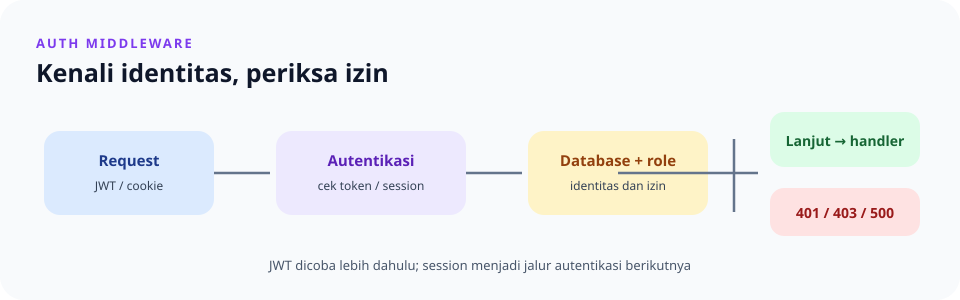

# `src/auth/middleware.rs`

> **Navigasi:** [Indeks catatan](../../README.md) · [README proyek](../../../README.md) · [Endpoint API](../../../endpoin.md)



[Buka source `middleware.rs`](../../../src/auth/middleware.rs)

## Tujuan dan cakupan

`wajibkan_autentikasi` adalah middleware autentikasi sekaligus otorisasi untuk endpoint protected. Tugasnya memastikan request memiliki identitas pengguna yang masih berlaku, memastikan role pengguna boleh menjalankan method pada path tersebut, lalu meneruskan request ke handler.

Middleware tidak dipasang ke seluruh aplikasi. [`buat_router`](../routes.md) menerapkannya dengan `route_layer` pada grup route protected: endpoint session dan logout, endpoint laptop, serta endpoint admin untuk pengguna. Endpoint health, login, dan register berada di luar grup tersebut.

Pemeriksaan dibagi ke beberapa bagian:

| Bagian | Tanggung jawab |
| --- | --- |
| [JWT](jwt.md) | Membaca bearer token serta memeriksa signature dan expiry. |
| [`JwtTokenStore`](../../../src/auth/token_store.rs) | Memastikan ID JWT masih terdaftar di Redis dan belum kedaluwarsa/dicabut. |
| [Session](session.md) | Membaca username dari session cookie. |
| `wajibkan_autentikasi` | Memilih identitas, memeriksa ulang ke database, mengotorisasi role, dan meneruskan request. |
| [`UserRole::boleh_mengakses`](../../../src/auth/role.rs) | Menentukan akses berdasarkan role, HTTP method, dan path. |

## Data yang diterima middleware

Axum menyediakan dependency berikut saat memanggil `wajibkan_autentikasi`:

| Extractor | Sumber | Kegunaan |
| --- | --- | --- |
| `State<PgPool>` | State router | Memeriksa pengguna dan role ke database. |
| `Extension<JwtService>` | Extension router | Memverifikasi bearer JWT. |
| `Extension<JwtTokenStore>` | Extension router | Memeriksa status token JWT di Redis. |
| `Session` | `SessionManagerLayer` | Membaca identitas session dari cookie. |
| `Request` | Request masuk | Membaca header, method, dan path; juga menjadi tempat menyimpan identitas hasil pemeriksaan. |
| `Next` | Rantai middleware Axum | Menjalankan handler berikutnya setelah semua pemeriksaan berhasil. |

Identitas yang diteruskan ke handler berbentuk `AuthIdentity`, berisi `user_id`, `username`, `role`, dan `jwt_id` bila request memakai bearer JWT. Nilai ini bukan diambil begitu saja dari body request: middleware menyusunnya setelah verifikasi JWT/Redis atau pencarian username session di database.

## Urutan pemeriksaan

1. **Periksa bearer JWT bila dikirim.** Middleware memastikan signature dan expiry, lalu mewajibkan `jti` beserta ID akun cocok dengan registry Redis. Bearer yang invalid atau tidak terdaftar langsung ditolak; middleware tidak diam-diam beralih ke cookie pada request tersebut.
2. **Cari pemilik JWT di database.** Setelah token lolos verifikasi dan registry Redis, middleware mencari pengguna berdasarkan `sub`. Identitas diterima selama pengguna masih ada; role terbaru dari database dipakai untuk memeriksa izin route.
3. **Gunakan session jika tidak ada bearer token.** Middleware membaca username dari session. Username tersebut dicari kembali ke database; `user_id` dan role yang dipakai berasal dari database, bukan session.
4. **Tolak request tanpa identitas.** Jika session tidak berisi username atau pengguna session sudah tidak ditemukan, middleware mengembalikan `401 Unauthorized`.
5. **Periksa otorisasi role.** Middleware memanggil `UserRole::boleh_mengakses` dengan role tepercaya, HTTP method request, dan path request. Query string tidak termasuk path karena yang dipakai adalah `request.uri().path()`.
6. **Teruskan request yang diizinkan.** Middleware menyimpan `AuthIdentity` pada request extensions, lalu memanggil `next.run(request)` agar handler berikutnya dapat memproses request.

### Perilaku fallback dan kegagalan

| Kondisi | Hasil |
| --- | --- |
| Tidak ada bearer JWT dan session valid | Autentikasi dilanjutkan menggunakan session. |
| Bearer JWT invalid, kedaluwarsa, dicabut, atau Redis gagal dihubungi | Token ditolak; jika Redis gagal, response `500`. |
| JWT valid dan penggunanya masih ada, tetapi role akun berubah | Autentikasi dilanjutkan memakai role terbaru dari database. |
| JWT tidak menghasilkan identitas dan session tidak memiliki identitas | `401 Unauthorized`. |
| Pengguna session tidak ditemukan di database | `401 Unauthorized`. |
| Pengguna terautentikasi, tetapi role tidak boleh mengakses method/path | `403 Forbidden`. |
| Query database atau pembacaan session gagal | `500 Internal Server Error`; kegagalan dicatat di log server. |

Kegagalan verifikasi token atau registry Redis tidak membuka fallback cookie ketika header bearer dikirim. Kegagalan Redis, database, atau pembacaan session langsung menghasilkan `500`; kondisi tersebut tidak disamarkan sebagai autentikasi yang berhasil.

Respons error dibuat melalui [helper response](response.md) dalam format JSON:

```json
{
  "status": "error",
  "message": "Login diperlukan"
}
```

Nilai `message` menyesuaikan kondisi; status HTTP tetap menjadi pembeda utama antara autentikasi yang belum ada (`401`), role yang tidak diizinkan (`403`), dan kegagalan internal (`500`).

## Aturan akses role

Semua baris di bawah tetap mensyaratkan identitas yang valid. Matriks ini berlaku hanya pada route yang dipasang middleware.

| Role | Akses yang diizinkan |
| --- | --- |
| `admin` | Semua method pada route protected. |
| `buyer` | `GET /api/laptops`, detail laptop, dan `POST /api/laptops/{id}/buy`. |
| `restocker` | `GET` pada path laptop tersebut dan `PATCH` pada path yang diawali `/api/laptops/`. |
| Semua role terautentikasi | `GET /api/auth/session` dan `POST /api/auth/logout`. |

Dengan demikian, `buyer` dapat membaca laptop dan membeli stok yang tersedia, tetapi tidak dapat mengubah atau menghapus data laptop. `restocker` dapat membaca dan memperbarui laptop, tetapi tidak dapat membuat atau menghapusnya. Role non-admin juga tidak dapat mengakses route admin. Aturan role berada di [`role.rs`](../../../src/auth/role.rs).

## Integrasi dengan route dan handler

`endpoin/mod.rs` memasang middleware melalui `middleware::from_fn_with_state(pool.clone(), auth::wajibkan_autentikasi)` pada grup endpoint privat. `State` membawa pool database; router juga memasang `JwtService` sebagai `Extension` dan `SessionManagerLayer` untuk menyediakan session. `auth::wajibkan_autentikasi` diekspor ulang dari `auth/mod.rs`, sehingga router tidak perlu mengimpor jalur modul internal.

Setelah lolos, handler dapat mengambil `AuthIdentity` dari request extensions untuk mengetahui pengguna yang sudah diverifikasi. Handler tidak perlu memeriksa ulang header JWT atau cookie session. Kegagalan terjadi sebelum handler dijalankan, sehingga handler protected hanya menerima request yang telah melewati autentikasi dan otorisasi.

## File terkait

- [JWT](jwt.md) menjelaskan format bearer, claims, expiry, dan verifikasi token.
- [Session](session.md) menjelaskan identitas session serta operasi login/logout.
- [Session dan JWT](sesi_jwt.md) membandingkan perilaku kedua metode autentikasi.
- [Routes](../routes.md) menjelaskan pemasangan middleware dan daftar endpoint.
- [Handler auth](../handlers/auth.md) menjelaskan login, logout, dan endpoint identitas saat ini.
