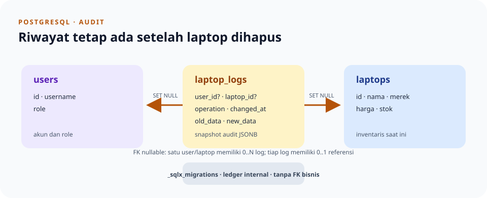

# Skema database final

> **Navigasi:** [Indeks catatan](../../README.md) · [README proyek](../../../README.md) · [Endpoint API](../../../endpoin.md)

## Tujuan

Skema target terdiri dari `users`, `laptops`, `laptop_logs`, `purchases`, dan tabel internal SQLx `_sqlx_migrations`. Baseline [0001_final_schema.sql](../../../database/migrations/0001_final_schema.sql) membuat akun dan inventaris. Migration [0002_laptop_audit.sql](../../../database/migrations/0002_laptop_audit.sql) membuat atau menyesuaikan tabel audit dan memasang trigger. Migration [0003_remove_token_version.sql](../../../database/migrations/0003_remove_token_version.sql) menghapus kolom `token_version` yang tidak lagi dipakai. Migration [0004_product_details_and_purchases.sql](../../../database/migrations/0004_product_details_and_purchases.sql) menambah deskripsi laptop, produk contoh, dan penyimpanan struk simulasi. Migration [0005_purchase_integrity.sql](../../../database/migrations/0005_purchase_integrity.sql) menambah indeks FK laptop dan memastikan total struk cocok dengan harga satuan dikali jumlah. DBML target tersedia di [schema.dbml](../../../database/schema.dbml).

Audit read-only pada database yang sudah ada menemukan `laptop_logs` berisi data tetapi tidak dikelola oleh baseline dan tidak memiliki trigger/function. Foreign key lama memakai aksi default `NO ACTION`, sehingga log dapat menghalangi penghapusan laptop. Migration baru tidak mengubah file baseline; ia menambahkan `user_id`, mengganti FK laptop menjadi `ON DELETE SET NULL`, dan mengaktifkan pencatatan otomatis. Sebelum startup menerapkan migration pada database lama, ambil dan verifikasi backup.

Migration memeriksa data lama sebelum membuat FK. Referensi yang tidak valid tidak dihapus: nilainya dipindahkan ke metadata `_migration_orphaned_laptop_id` atau `_migration_orphaned_user_id` dalam `old_data`, lalu kolom FK dibuat `NULL`. Rollback manual tersedia di [database/rollbacks/0002_laptop_audit.sql](../../../database/rollbacks/0002_laptop_audit.sql); script menolak rollback jika ada actor ID atau tautan laptop yang perlu dipertahankan. Rollback ini harus disertai deploy kode yang tidak memuat migration v2, karena startup aplikasi saat ini menerapkan migration secara otomatis. SQLx 0.9 tidak mengizinkan migration simple lama dicampur dengan format up/down reversible, jadi rollback tersebut sengaja berada di luar folder migration.

Rollback untuk migration 0005 tersedia di [database/rollbacks/0005_purchase_integrity.sql](../../../database/rollbacks/0005_purchase_integrity.sql). Script hanya melepas constraint dan indeks tambahan, tidak menghapus baris pembelian. Hentikan aplikasi dan sesuaikan ledger SQLx sebelum menjalankannya; jika aplikasi aktif kembali dengan migration v5 masih tersedia, startup akan menerapkannya lagi.

## Tabel `laptops`

| Kolom | Tipe | Kegunaan |
| --- | --- | --- |
| `id` | `BIGINT` identity | Primary key. |
| `nama`, `merek` | `VARCHAR` | Nama dan merek wajib; nilai kosong ditolak. |
| `deskripsi` | `TEXT` | Deskripsi laptop untuk katalog; migration mengisi deskripsi untuk data lama. |
| `harga` | `BIGINT` | Harga rupiah, tidak boleh negatif. |
| `stok` | `INTEGER` | Jumlah stok, tidak boleh negatif. |
| `created_at`, `updated_at` | `TIMESTAMPTZ` | Waktu pembuatan dan perubahan. |

Validasi di database menjadi lapisan perlindungan tambahan bagi [validasi Rust](../validation.md). Query PATCH memperbarui `updated_at`.

## Tabel `purchases`

Setiap pembelian simulasi menyimpan snapshot sehingga struk tetap konsisten jika akun atau laptop dihapus atau data katalog berubah.

| Kolom | Constraint / kegunaan |
| --- | --- |
| `id` | Primary key identity; menjadi nomor struk. |
| `user_id` | Nullable FK ke `users.id`, `ON DELETE SET NULL`; relasi akun tetap ada selama akun tersimpan. |
| `username` | Snapshot nama akun saat transaksi, tetap tersedia setelah akun dihapus. |
| `laptop_id` | Nullable FK ke `laptops.id`, `ON DELETE SET NULL`; relasi produk tetap ada selama produk tersimpan. |
| `laptop_name`, `laptop_brand` | Snapshot identitas laptop saat transaksi. |
| `unit_price`, `quantity`, `total_price` | Harga dan jumlah snapshot; constraint memastikan nilai non-negatif, jumlah positif, dan `total_price = unit_price * quantity`. |
| `payment_method` | `CHECK` membatasi `qris`, `cash`, `bank_transfer`, atau `debit_card`. Semua metode hanya simulasi dan tidak memproses uang sungguhan. |
| `payment_status` | Saat ini hanya `simulated_paid`, sesuai alur simulasi pembayaran. |
| `created_at` | Waktu transaksi; indeks descending mendukung daftar transaksi terbaru. |

## Tabel `users`

| Kolom | Tipe | Kegunaan |
| --- | --- | --- |
| `id` | `BIGINT` identity | Primary key. |
| `username` | `VARCHAR(100)` | Username unik dan tidak boleh kosong. |
| `password_hash` | `TEXT` | Hash password Argon2id. |
| `role` | `VARCHAR(20)` | Role `admin`, `buyer`, atau `restocker`; default `buyer`. |
| `created_at` | `TIMESTAMPTZ` | Waktu akun dibuat. |

Migration 0003 menghapus kolom `token_version` dari database lama tanpa mengubah migration baseline yang telah diterapkan. Akun dan hash password tetap dipertahankan. JWT sekarang memakai registry Redis terpisah dari database PostgreSQL; token dicabut dengan menghapus registry saat logout.

## Tabel `laptop_logs`

Satu baris log mewakili satu perubahan pada satu laptop. `old_data` dan `new_data` menyimpan snapshot JSONB agar riwayat tetap dapat dibaca setelah nilai inventaris berubah.

| Kolom | Constraint / kegunaan |
| --- | --- |
| `id` | Primary key identity. |
| `laptop_id` | Nullable foreign key ke `laptops.id`, `ON DELETE SET NULL`. Saat laptop dihapus, trigger membuat log DELETE dengan `laptop_id = NULL`; snapshot lengkap laptop disimpan pada `old_data`. Log terdahulu juga tetap ada dan snapshot-nya tidak diubah. |
| `user_id` | Nullable foreign key ke `users.id`, `ON DELETE SET NULL`. Baris lama dan perubahan langsung di database dapat memiliki actor `NULL`; backend mengisi ID dari `AuthIdentity` yang telah diverifikasi middleware. |
| `operation` | `CHECK` membatasi nilai menjadi `INSERT`, `UPDATE`, atau `DELETE`. |
| `old_data`, `new_data` | Snapshot record sebelum dan sesudah perubahan; sisi yang tidak tersedia bernilai `NULL`. |
| `changed_at` | Waktu perubahan, default `CURRENT_TIMESTAMP`. |

Trigger `laptops_capture_audit_log` memanggil function `public.capture_laptop_log()` setelah setiap perubahan per baris. Untuk INSERT, function mengisi `new_data`; untuk UPDATE, mengisi keduanya; untuk DELETE, mengisi `old_data` dan membiarkan `new_data` kosong. Semua query write backend berjalan dalam transaksi yang menyetel `rizzshop.user_id` secara lokal, jadi actor dan perubahan tercatat atomik. Penulisan langsung tanpa konteks aplikasi tetap tercatat dengan `user_id = NULL`.

## Relasi dan kardinalitas

| Relasi | Kardinalitas | Aturan penghapusan | Alasan |
| --- | --- | --- | --- |
| `users.id` → `laptop_logs.user_id` | Satu user ke nol atau banyak log; setiap log punya nol atau satu actor. | `SET NULL` | Menyimpan actor perubahan tanpa menghapus audit saat akun dihapus. |
| `laptops.id` → `laptop_logs.laptop_id` | Satu laptop ke nol atau banyak log; setiap log punya nol atau satu laptop aktif. | `SET NULL` | Menjaga referensi untuk laptop aktif; log dan snapshot tetap ada ketika laptop dihapus. |
| `users.id` → `purchases.user_id` | Satu user ke nol atau banyak pembelian; setiap pembelian punya nol atau satu akun aktif. | `SET NULL` | Snapshot `username` menjaga informasi pembeli pada struk setelah akun dihapus. |
| `laptops.id` → `purchases.laptop_id` | Satu laptop ke nol atau banyak pembelian; setiap pembelian punya nol atau satu laptop aktif. | `SET NULL` | Snapshot nama, merek, dan harga menjaga isi struk setelah laptop dihapus atau diubah. |
| `_sqlx_migrations` → tabel bisnis | Tidak ada relasi. | — | Ledger internal SQLx, bukan data bisnis. |

Tidak ada foreign key kepemilikan langsung antara `users` dan `laptops`. Relasi actor perubahan melalui `laptop_logs`, sedangkan snapshot pembelian menghubungkan akun dan laptop melalui `purchases`.

## Index dan constraint

- Primary key: `users.id`, `laptops.id`, `laptop_logs.id`, dan `_sqlx_migrations.version`.
- Unique: `users.username`.
- Check: nama/merek/username tidak kosong setelah trim; harga/stok tidak negatif; role, operation, metode/status pembayaran, dan aritmetika total struk dibatasi.
- Index tambahan: FK `laptop_logs` dan `purchases` diindeks agar pencarian serta aksi referensial tidak perlu memindai seluruh tabel.
- Index `purchases_created_at_idx` mengurutkan waktu secara descending untuk daftar transaksi terbaru.
- Tidak ada stored procedure; hanya function trigger `capture_laptop_log`.
- DBML mendeskripsikan kolom, checks, indexes, kardinalitas, dan aksi `ON DELETE`. Pengaturan PostgreSQL `NOT DEFERRABLE` tidak tersedia dalam sintaks relationship DBML, jadi file DBML dipakai untuk ERD; migration SQL tetap menjadi sumber DDL yang dijalankan.

## Istilah SQL dalam skema

- **Primary key** (`id`) mengidentifikasi satu baris secara unik. `BIGINT ... IDENTITY` meminta PostgreSQL menghasilkan angka ID.
- **Unique** pada username mencegah dua akun memakai nama yang sama; **NOT NULL** mewajibkan kolom memiliki nilai.
- `TIMESTAMPTZ` menyimpan suatu instant waktu dengan dukungan zona waktu; PostgreSQL menormalisasinya dan tidak menyimpan nama zona asli yang diberikan client. `DEFAULT` mengisi nilai bila query tidak menyediakannya.
- Constraint `CHECK` dapat membatasi nilai (misalnya harga/stok tidak negatif); validasi Rust memberi pesan ramah lebih awal, sedangkan constraint database melindungi data dari semua jalur penulisan.
- Tipe `BIGINT`/`INTEGER` membatasi rentang bilangan; nilai Rupiah disimpan sebagai bilangan bulat, bukan pecahan floating-point.
